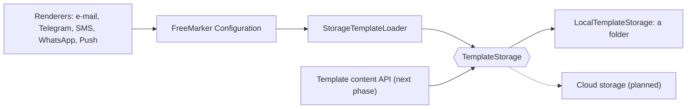

# Template storage

Mercury reads and writes the content of its message templates only through `TemplateStorage`, so the place where they live is a configuration choice and not something the rest of the code knows.

## Pieces

| Class | Role |
|---|---|
| `TemplateStorage` | `read`, `stat`, `write` (with an expected etag), `delete`, `list`. |
| `LocalTemplateStorage` | A folder: `spring.freemarker.template-loader-path` (`TEMPLATE_PATH`). Atomic writes (temporary file moved over the target), writes of one name serialized. |
| `StorageTemplateLoader` | A FreeMarker `TemplateLoader` over a `TemplateStorage`. Replaces the folder loader; FreeMarker's localized lookup (`name_es_MX.ftl` before `name.ftl`) and refresh work as before. |
| `TemplateNames` | The only accepted names: a plain file name ending in `.ftl`, `.ftlh`, `.md` or `.html`, at most 128 characters. No directories, `..` or backslashes. |
| `TemplateConflictException` | The etag the caller read is no longer the stored one. |

## Rules

- **A name is a file name, never a path.** An invalid name is "not found" on reads (FreeMarker falls back) and `IllegalArgumentException` on writes. `LocalTemplateStorage` also checks that the resolved file sits directly in the folder.
- **Etag = SHA-256 of the content.** `write(name, bytes, expectedEtag)` succeeds only if the stored etag equals `expectedEtag`; `TemplateStorage.ABSENT` means "must not exist yet" and `null` means "overwrite". Two editors never silently overwrite each other.
- **Writes are atomic.** A reader sees the old or the new content, never a mix.
- **Edits are visible within FreeMarker's refresh interval** (5 s by default). A changed etag is a changed template whatever the clock says.
- **Existing templates need no migration.** `Template.location` keeps being the file name, and the 28 shipped `.ftl` files are read from the same folder as before.
- Several Mercury instances on one shared folder are not protected against each other's concurrent writes (the lock is per instance); use a storage with conditional writes for that.

## Configuration

| Variable | Use |
|---|---|
| `TEMPLATE_PATH` | Folder of the local storage (default `/usr/local/runme/templates`). It must exist at startup: Mercury fails fast if not, as before. |
| `TEMPLATE_SUFFIX` | Unchanged. |

## Tests

`LocalTemplateStorageTest` (round trip, invalid names, etag conflicts, atomicity, a concurrent race with exactly one winner), `StorageTemplateLoaderTest` (rendering, localized lookup, refresh after an edit, deletion), `TemplateNamesTest` and `FreeMarkerConfigTest`. The existing template tests (ZeroBound, SmartKin, Iris) render through the new loader unchanged.
