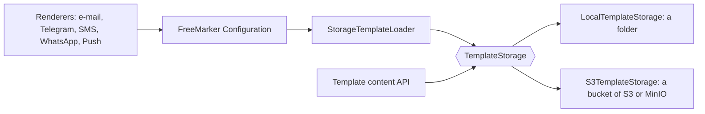
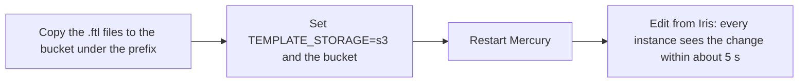

# Template storage

Mercury reads and writes the content of its message templates only through `TemplateStorage`, so the place where they live is a configuration choice and not something the rest of the code knows.

## Pieces

| Class | Role |
|---|---|
| `TemplateStorage` | `read`, `stat`, `write` (with an expected etag), `delete`, `list`. |
| `LocalTemplateStorage` | A folder: `spring.freemarker.template-loader-path` (`TEMPLATE_PATH`). Atomic writes (temporary file moved over the target), writes of one name serialized. |
| `StorageTemplateLoader` | A FreeMarker `TemplateLoader` over a `TemplateStorage`. Replaces the folder loader; FreeMarker's localized lookup (`name_es_MX.ftl` before `name.ftl`) and refresh work as before. |
| `S3TemplateStorage` | A bucket of S3 or of an S3-compatible service, under a key prefix. The etag is the object's own. `If-None-Match: *` creates and `If-Match` replaces, decided by the service, so it is safe across instances. |
| `TemplateStorageConfig` | Builds the S3 client and the storage when `umdc.templates.storage=s3`. |
| `TemplateNames` | The only accepted names: a plain file name ending in `.ftl`, `.ftlh`, `.md` or `.html`, at most 128 characters. No directories, `..` or backslashes. |
| `TemplateConflictException` | The etag the caller read is no longer the stored one. |

## Rules

- **A name is a file name, never a path.** An invalid name is "not found" on reads (FreeMarker falls back) and `IllegalArgumentException` on writes. `LocalTemplateStorage` also checks that the resolved file sits directly in the folder.
- **Etag = SHA-256 of the content.** `write(name, bytes, expectedEtag)` succeeds only if the stored etag equals `expectedEtag`; `TemplateStorage.ABSENT` means "must not exist yet" and `null` means "overwrite". Two editors never silently overwrite each other.
- **Writes are atomic.** A reader sees the old or the new content, never a mix.
- **Edits are visible within FreeMarker's refresh interval** (5 s by default). A changed etag is a changed template whatever the clock says.
- **Existing templates need no migration.** `Template.location` keeps being the file name, and the 28 shipped `.ftl` files are read from the same folder as before.
- Several Mercury instances on one shared folder are not protected against each other's concurrent writes (the lock is per instance); use the S3 storage, whose conditional writes are done by the service.

## Configuration

| Variable | Use |
|---|---|
| `TEMPLATE_PATH` | Folder of the local storage (default `/usr/local/runme/templates`). It must exist at startup: Mercury fails fast if not, as before. |
| `TEMPLATE_SUFFIX` | Unchanged. |
| `TEMPLATE_STORAGE` | `local` (default) or `s3`. |
| `CLOUDFLARE_R2_BUCKET_NAME` | Bucket that holds the templates (required with `s3`). |
| `TEMPLATE_S3_PREFIX` | Key prefix inside the bucket (default `templates/`). |
| `TEMPLATE_S3_REGION` | Region (default `us-east-1`; any value for MinIO). |
| `CLOUDFLARE_R2_ENDPOINT` | Endpoint of an S3-compatible service; empty for AWS. |
| `TEMPLATE_S3_PATH_STYLE` | `true` for MinIO and similar (`host/bucket/key`). |
| `CLOUDFLARE_R2_ACCESS_KEY`, `CLOUDFLARE_R2_SECRET_KEY` | **Secrets** (keep them in Vault). Empty: the AWS default credentials chain (instance role, environment, profile). |

### Moving from the folder to a bucket

The names and the `location` of the templates do not change; only where the files are read from. Mercury does not copy the files for you: upload the folder first (`aws s3 sync <TEMPLATE_PATH> s3://<bucket>/<prefix>`), otherwise messages fall back to their plain text.

## Tests

`S3TemplateStorageTest` (key and prefix handling, conditional headers, 404/409/412 mapping, paging; the S3 client is mocked) and `S3TemplateStorageIT` (the same contract against a real S3-compatible service; off by default, see its header to run it against MinIO). `LocalTemplateStorageTest` (round trip, invalid names, etag conflicts, atomicity, a concurrent race with exactly one winner), `StorageTemplateLoaderTest` (rendering, localized lookup, refresh after an edit, deletion), `TemplateNamesTest` and `FreeMarkerConfigTest`. The existing template tests (ZeroBound, SmartKin, Iris) render through the new loader unchanged.
