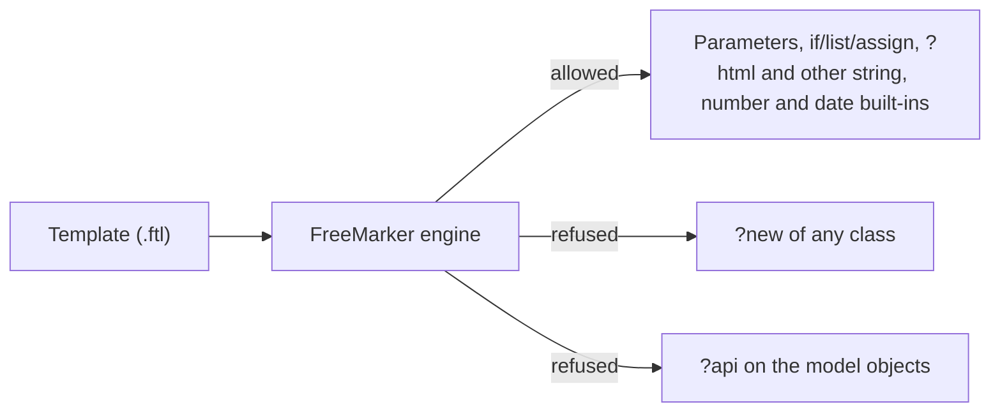

# Template engine security

Mercury renders its messages with FreeMarker. A template is code, so the engine is configured to run only what a message needs.

## What is refused

| Construct | Why | Result |
|---|---|---|
| `"freemarker.template.utility.Execute"?new()` | Runs a command on the server | `TemplateException`: "Instantiating … is not allowed in the template for security reasons." |
| `"freemarker.template.utility.ObjectConstructor"?new()` | Builds any Java object (for example a `ProcessBuilder`) | same |
| `"any.other.Class"?new()` | Any class a template names | same |
| `value?api` | Reaches the Java methods of the objects in the model | `TemplateException` |

The rule lives in `FreeMarkerConfig` (`ALLOWS_NOTHING_RESOLVER` and `setAPIBuiltinEnabled(false)`), so it applies to **every channel** that renders: e-mail, Telegram, SMS, WhatsApp and Push.

## What does not change

Parameters (`${name}`), `<#if>`, `<#list>`, `<#assign>`, `<#include>`, `?html`, `?string`, `?number` and the other built-ins keep working. The 28 reference templates kept for the tests in `src/test/resources/templates` render exactly as before (checked by `ZeroboundTemplatesTest`, `SmartkinTemplatesTest` and the Iris template tests).

## Why now

Iris will let people write and edit templates. Without this, anyone allowed to save a template could run commands on the Mercury host. The hardening ships first and on its own, so it also protects templates edited by hand on disk.

## Tests

`FreeMarkerConfigTest` renders the three instantiation payloads and an `?api` call and expects each to be refused, and checks that ordinary directives and escaping still render.
