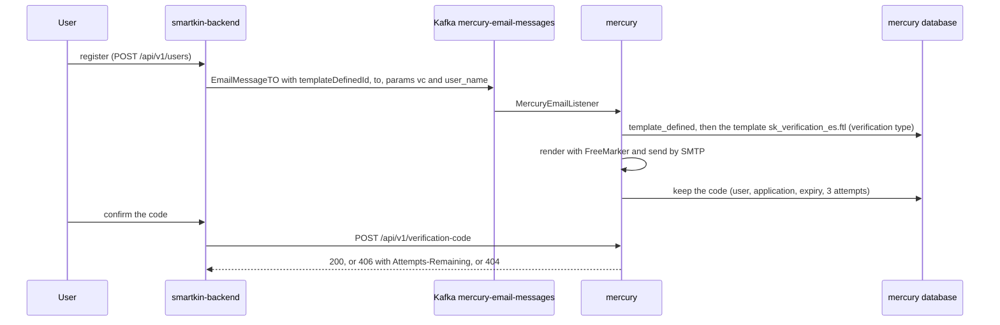

# SmartKin in Mercury: the verification e-mail and its templates

smartkin-backend does not send e-mail itself: it publishes a message and Mercury renders and sends it (the rule for every e-mail, WhatsApp or
Telegram notification). Today SmartKin sends **one** kind of e-mail: the verification code of a new account. Its templates are
`src/main/resources/templates/sk_verification_<es|en>.ftl`.



## 1. What SmartKin sends

`UserServiceImpl.toEmailMessageTO` publishes an `EmailMessageTO` (JSON names `template_defined_id`, `user_id`, `from`, `to`, `cc`, `subject`,
`body`, `send_date`, `params`) to the topic `mercury-email-messages` (smartkin-backend's `umdc.producer.mercury.topic`, Vault `MERCURY_EMAIL_TOPIC`).
Mercury's `MercuryEmailListener` silently discards a message without `send_date`, `to`, `template_defined_id`, `user_id` or `from`; SmartKin fills all
of them. The fields that reach the template are the `params`:

| param | value | required |
| --- | --- | --- |
| `vc` | the code, `####-####` (two groups of four digits) | yes |
| `user_name` | the user's full name | yes |
| `expiresInMinutes` | how long the code lives | **no**: SmartKin does not send it today. Without it Mercury keeps the code for 2 days and the e-mail does not state a duration; with it, the e-mail says it |

`subject` and `body` of the message are SmartKin's own ("Verification Code subscription" and a one-line body); they are not in the template.

## 2. The templates

| file | language | use |
| --- | --- | --- |
| `sk_verification_es.ftl` | Spanish | **the one SmartKin should use** (the app is in Spanish) |
| `sk_verification_en.ftl` | English | to switch to |

SmartKin sends a single `templateDefinedId` for every user, so the language is whichever id its configuration holds. Values are HTML-escaped (`?html`);
a missing `vc` or `user_name` makes the render fail instead of sending a half-empty mail. The text says that SmartKin never asks for the code by phone,
chat or social media, and to ignore the mail if the account was not created by the reader. `SmartkinTemplatesTest` renders both with exactly the params above,
with and without `expiresInMinutes`, checks the escaping, the missing-parameter failure and that the seed script registers exactly these files.

They replace, for SmartKin, the generic `ds_new_user_verification_code_es.ftl` ("Tu Empresa", and a promise of 24 hours that Mercury does not enforce).

## 3. Registering them in an environment

Templates are files (`TEMPLATE_PATH`, baked into the image from `src/main/resources/templates/`, so Mercury must be rebuilt and redeployed) **plus** rows in
`mercury.templates` and `mercury.template_defined`. `scripts/smartkin/seed-templates.sql` creates the rows, is idempotent, checks that every id exists before
writing and prints the `template_defined` ids:

```bash
psql "$MERCURY_DB" -v ON_ERROR_STOP=1 \
     -v app_id=<general.application id of SmartKin> \
     -v owner_id=<user id that owns the definitions> \
     -v verification_type_id=<mercury.template_types id that Mercury has as PRX_VERIFICATION_CODE_TEMPLATE_ID> \
     -v severity_id=<mercury.severity_type id> -v frequency_id=<mercury.frequency_type id> \
     -f scripts/smartkin/seed-templates.sql
```

The schema is managed outside the application. The script was validated on a throwaway PostgreSQL with tables equivalent to the JPA entities (first run, repeat,
correction of a wrong type, unknown ids, missing variable); it was **not** run against a real Mercury database: review it on a copy first. The SmartKin
`general.application` row must already exist.

## 4. Two ids with the same name

| where | property / env | holds |
| --- | --- | --- |
| Mercury | `umdc.verification.code.template.id`, env `PRX_VERIFICATION_CODE_TEMPLATE_ID` | the **template type** id of verification-code templates (`MessageProcessor` compares each template's type with it) |
| smartkin-backend | `umdc.verification.code.template.id`, Vault `PRX_VERIFICATION_CODE_TEMPLATE_ID` | the **template_defined** id of `sk_verification_es.ftl`, which the seed prints |

Both templates must be of the verification-code type, otherwise Mercury never keeps the code and the confirmation answers 404. The seed script gives them that type
(`verification_type_id`) and corrects a row that was registered with another.
