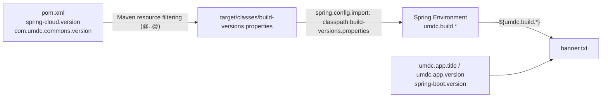

# 08 · Startup banner

🌐 [Leer esto en Español](../es/08-banner-de-arranque.md)

The banner (`src/main/resources/banner.txt`) prints the application, Spring Boot, Spring Cloud and UMDC libraries versions. It mirrors backbone-rest.

## Where each version comes from

| Placeholder | Source |
|---|---|
| `${umdc.app.title}`, `${umdc.app.version}`, `${spring-boot.version}` | Existing application and Spring Boot properties |
| `${umdc.build.spring-cloud-version}` | `spring-cloud.version` in `pom.xml`, through `build-versions.properties` |
| `${umdc.build.umdc-libs-version}` | `com.umdc.commons.version` in `pom.xml`, through `build-versions.properties` |

## Design decisions

- **Only `build-versions.properties` is filtered.** `pom.xml` declares two `<resource>` blocks over `src/main/resources`: one excludes that file, the other filters only that file. Filtering the whole folder would corrupt other files that contain `@` or `${...}` (`application.yml`, FreeMarker templates).
- **The file holds no secrets** and nothing else should be added to it.
- **`spring.config.import` loads it first** (`classpath:build-versions.properties,optional:vault://,optional:configserver:`), so the properties exist when the banner is printed. Vault and Config Server stay optional.
- `umdc.build.umdc-libs-version` follows `com.umdc.commons.version`; the other UMDC libraries have their own properties and today share the same value. If they diverge, the banner shows the `commons` one.

## Tests

`BannerVersionsTest` (`src/test/java/com/umdc/mercury/config`):

- the filtered file has non-blank versions without `@`;
- the banner prints both versions and `application.yml` imports the file.

## Changing it

Edit `banner.txt` only for layout. A new version in the banner needs a property in `build-versions.properties` (filtered from the `pom.xml`) and a line in the test.
