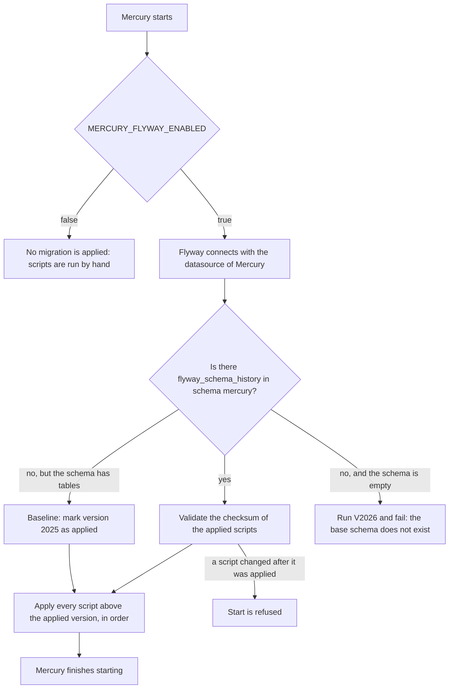

# 🗃️ 09 · Flyway migrations

🌐 [Leer esto en Español](../es/09-migraciones-flyway.md) · ⬅️ [Back to index](README.md)

> Mercury applies the SQL scripts of `src/main/resources/db/migration` by itself when it starts. Before Flyway they were run by hand against the `mercury` schema, and Hibernate never changes the schema (`ddl-auto: none`).

## What runs and when

## Settings

All of them are under `spring.flyway` in `application.yml`; only the first one is an environment variable.

| Property | Value | Why |
|---|---|---|
| `enabled` | `${MERCURY_FLYWAY_ENABLED:true}` | `false` returns to applying the scripts by hand. |
| `locations` | `classpath:db/migration` | The folder of the scripts, inside the jar. |
| `schemas` / `default-schema` | `mercury` | Where tables are created and where `flyway_schema_history` lives. |
| `baseline-on-migrate` | `true` | A database that already has tables is marked at `baseline-version` instead of being refused. |
| `baseline-version` | `2025` | The schema before Flyway (V2025 and older) was never versioned. Scripts V2026 onwards are applied. |
| `validate-on-migrate` | `true` | Editing a script that was already applied stops the start instead of letting databases drift. |
| `out-of-order` | `false` | A script with a version lower than the applied one is an error, not a silent skip. |

## First start on an existing database

The first start finds no `flyway_schema_history`, baselines at 2025 and **runs V2026 to V2032 again**, even if they were applied by hand. That is safe because every statement is idempotent (`ADD COLUMN IF NOT EXISTS`, `CREATE TABLE IF NOT EXISTS`, `CREATE INDEX IF NOT EXISTS`); `FlywayMigrationsTest` fails if a script adds a statement that is not.

An **empty** schema is not baselined. The base schema (everything up to V2025) still has to exist before Mercury starts.

## Adding a migration

1. Create `V<next number>__<snake_case>.sql` in `src/main/resources/db/migration`. The number is the highest one plus one.
2. Use `IF NOT EXISTS` / `IF EXISTS` so it can be repeated.
3. Never edit a script that was released: its checksum is stored and the start is refused. Fix it with a new script.
4. Mention it in the `CHANGELOG`.

`FlywayMigrationsTest` checks the name, the unique version, that the version is above the baseline and that the script is idempotent.

## Requirements and limits

- The database user of Mercury needs the right to create and alter tables in `mercury` and to create `flyway_schema_history`. If the production user is read/write only, run the scripts with an administrator and set `MERCURY_FLYWAY_ENABLED=false` there.
- With several instances starting together, Flyway takes a database lock, so only one applies the scripts.
- Not verified: a start against a real PostgreSQL, and the GraalVM native image (`Dockerfile.native`) with the Flyway resources.

## Files

| File | Role |
|---|---|
| `pom.xml` | `spring-boot-starter-flyway` and `flyway-database-postgresql` (versions managed by Spring Boot). |
| `src/main/resources/application.yml` | The `spring.flyway` block. |
| `src/main/resources/db/migration/` | The scripts. |
| `src/test/java/com/umdc/mercury/migration/FlywayMigrationsTest.java` | Guards names, versions, idempotency and settings. |
