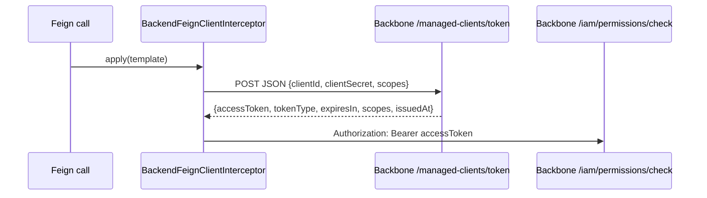

# 10 · Backbone M2M token (outbound)

⬅️ [Back to index](README.md)

`BackendFeignClientInterceptor` attaches a Bearer token to every call of `BackboneClient` and `BackbonePermissionClient`. The token is a Backbone **managed-client** token obtained with the client-credentials flow of `POST /api/v1/managed-clients/token` (`ManagedClientApi`, `consumes = application/json`).

- Request: record `ManagedClientTokenRequest(clientId, clientSecret, scopes)`; `scopes` comes from `umdc.backbone.m2m.scope` (`BACKBONE_M2M_SCOPE`, default `mercury:message:read`), split on spaces and commas. Backbone requires at least one (`@NotEmpty`) that the client holds (`400 invalid_scope` otherwise); `/iam/permissions/check` needs no particular scope. `BACKBONE_SCOPE` is a legacy Keycloak value (`dummy` in `config/native.env`) and is ignored.
- Answer: record `ManagedClientToken(accessToken)` (other fields ignored). It is **camelCase**; the shared `TokenResponse` of the commons library reads `access_token` (Keycloak) and cannot be used.
- Both records are registered for native-image reflection with `@RegisterReflectionForBinding`.
- A missing or blank `accessToken` raises `StandardException`.
- The URL is `umdc.backbone.base-url` (`BACKBONE_BASE_URL`) + the fixed path `/api/v1/managed-clients/token`, like zerobound-rest's `BackboneTokens`. The `redirect-uri` (`AUTH_URI` + `AUTH_TOKEN_URI`) of the `backbone` client is no longer read, so a wrong value there (QA had `/introspect`) cannot break it.
- Pinned by `BackendFeignClientInterceptorTest`.

User guide: [`token-m2m-backbone`](../../user-guide/en/backbone-m2m-token.md).
