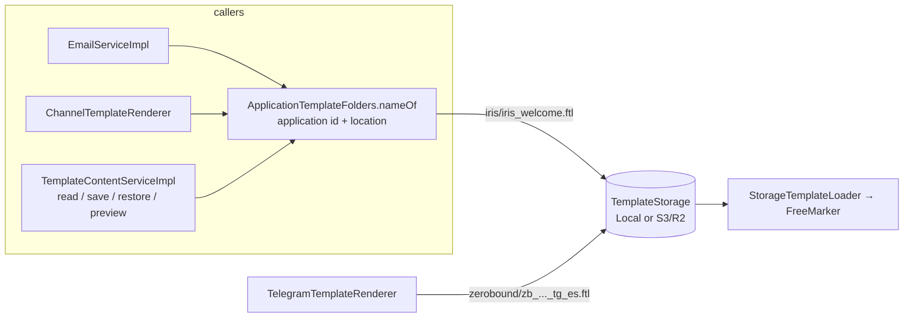
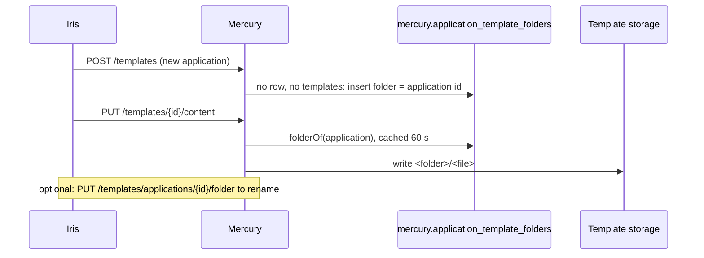

# 11 · Template folders per application

⬅️ [Back to index](README.md)

Template content lives in a `TemplateStorage` (local folder or S3/R2 bucket). Every application has its own folder: `<root or s3 prefix>/<folder>/<file>`, for example `lth/mercury/templates/iris/iris_welcome.ftl`.

- `TemplateEntity.location` is still the plain file name. `ApplicationTemplateFolders.nameOf(applicationId, location)` returns `folder/location`; a location that already has a `/` is left alone.
- Folders are **dynamic**: rows of Mercury's own table `mercury.application_template_folders` (V2033; `application_id` PK, `folder` UNIQUE, no foreign key to `general`). **Mercury never reads the `general` schema** (backbone-rest's), so it does not look an application up and needs no code name.
  - **Read:** `ApplicationTemplateFolders.folderOf` reads the row (cached `umdc.templates.application-folders-cache-seconds`, default 60 s, so a change made through the API or by another instance applies without a restart). No row = the root of the storage, as before folders existed.
  - **New application, zero configuration:** the first template created for an application that has no folder and no templates registers the folder named like its id (`ensureFolder`, race-safe between instances). An application that already has templates keeps where they are.
  - **Friendlier name:** `PUT /api/v1/templates/applications/{applicationId}/folder` `{"folder":"iris"}` (needs the template-manage permission in that application; `GET` needs template-read). A folder belongs to one application (`409` otherwise) and must be a valid folder name (`400`). It **does not move files**: copy the templates of the old folder to the new one.
  - **Existing applications:** an application whose templates already live in a named folder is registered once with `scripts/templates/seed-application-folders.sql` (a data step with the ids of the Backbone database of QA; it only adds). There is **no configuration variable** for folders: the only related setting is `umdc.templates.application-folders-cache-seconds`.
- **No entity maps the `general` schema.** `TemplateEntity`, `TemplateDefinedEntity` and `VerificationCodeEntity` keep the application as a plain `application_id` (UUID) column instead of a `@ManyToOne` to a `general.application` entity: Hibernate checks even a reference built from an id with `select null from general.application where id=?` when it inserts the row (and an EAGER association reads the table on every load), which fails wherever Mercury's database role has no grant. The foreign key stays in the database, which enforces it without Mercury reading the referenced table. `ApplicationEntity` and `UserEntity` are gone, `GeneralSchemaBoundaryTest` fails if an entity maps that schema or a query names it, and `RepositoryMappingTest` builds every JPA repository against the entities (in-memory H2, no tables) so a derived query or JPQL that names a property an entity no longer has fails the build instead of stopping Mercury at startup.

- `TemplateNames` accepts `file` or `folder/file` (one level; folder `[a-z0-9][a-z0-9_-]{0,63}`); `isFileName` is the bare form, which is what `location` must be to be editable. Protected prefixes (`zb_`, `sk_`, `iris_`, `ds_`) are checked on the file name, not on the folder.
- `LocalTemplateStorage` creates the folder on write (temporary file in the same folder, atomic move) and `list()` walks the root and one level of valid folders. `S3TemplateStorage.list()` no longer uses a delimiter, so it returns `folder/file` keys too; deeper keys are ignored.
- Preview renders under the qualified name, so a relative `<#include "header.ftl">` resolves inside the application folder, as it does when sending.
- Telegram (ZeroBound): `umdc.templates.telegram-folder` (env `TEMPLATE_TELEGRAM_FOLDER`, default `zerobound`).
- Cloudflare R2 is configured with `umdc.templates.s3.*`, fed by `CLOUDFLARE_R2_BUCKET_NAME`, `CLOUDFLARE_R2_ENDPOINT` (`https://<account>.r2.cloudflarestorage.com`), `CLOUDFLARE_R2_ACCESS_KEY` and `CLOUDFLARE_R2_SECRET_KEY`; `TEMPLATE_S3_PREFIX` (`lth/mercury/templates/`) stays the base path, with `TEMPLATE_S3_REGION=auto` and `TEMPLATE_S3_PATH_STYLE=true`.

Tests: `TemplateNamesTest`, `LocalTemplateStorageTest`, `S3TemplateStorageTest`, `ApplicationTemplateFoldersTest`, `TemplateContentServiceImplTest`, `ChannelTemplateRendererTest`, `TelegramTemplateRendererTest`.

User guide: [`template-storage`](../../user-guide/en/template-storage.md).
