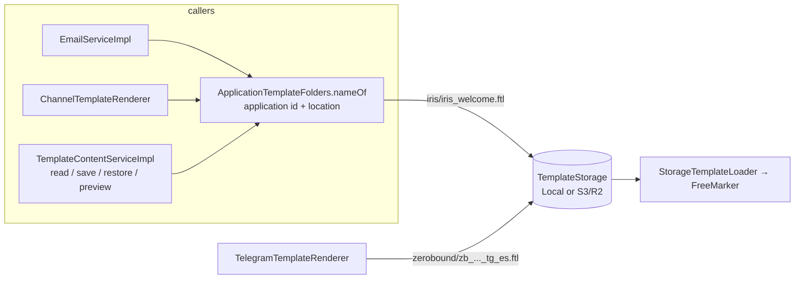

# 11 · Template folders per application

⬅️ [Back to index](README.md)

Template content lives in a `TemplateStorage` (local folder or S3/R2 bucket). Every application has its own folder: `<root or s3 prefix>/<folder>/<file>`, for example `lth/mercury/templates/iris/iris_welcome.ftl`.

- `TemplateEntity.location` is still the plain file name. `ApplicationTemplateFolders.nameOf(applicationId, location)` returns `folder/location`; a location that already has a `/` is left alone.
- Folder of an application: only `umdc.templates.application-folders` (`<application id>=<folder>,...`, env `TEMPLATE_APPLICATION_FOLDERS`). **Mercury never reads the `general` schema** (it belongs to backbone-rest), so the application code is not looked up: the key must be the application id, and a key that is not a UUID stops the start with a message saying so. An application with no entry falls back to the root and logs one WARN. The default lists the applications of the Backbone database (Iris, LatinHub, Lucky Leaf and Lucky Leaf REST, Smart Kin, Zeronbound REST); set the variable where the ids differ.
- `GeneralSchemaBoundaryTest` guards the rule: no repository may query an entity that maps a `general` table, and no query may name that schema. `ApplicationEntity` only holds the id of a foreign key; creating a template trusts the permission check (the caller holds a role in the application) instead of reading the application.
- `TemplateNames` accepts `file` or `folder/file` (one level; folder `[a-z0-9][a-z0-9_-]{0,63}`); `isFileName` is the bare form, which is what `location` must be to be editable. Protected prefixes (`zb_`, `sk_`, `iris_`, `ds_`) are checked on the file name, not on the folder.
- `LocalTemplateStorage` creates the folder on write (temporary file in the same folder, atomic move) and `list()` walks the root and one level of valid folders. `S3TemplateStorage.list()` no longer uses a delimiter, so it returns `folder/file` keys too; deeper keys are ignored.
- Preview renders under the qualified name, so a relative `<#include "header.ftl">` resolves inside the application folder, as it does when sending.
- Telegram (ZeroBound): `umdc.templates.telegram-folder` (env `TEMPLATE_TELEGRAM_FOLDER`, default `zerobound`).
- Cloudflare R2 is configured with `umdc.templates.s3.*`, fed by `CLOUDFLARE_R2_BUCKET_NAME`, `CLOUDFLARE_R2_ENDPOINT` (`https://<account>.r2.cloudflarestorage.com`), `CLOUDFLARE_R2_ACCESS_KEY` and `CLOUDFLARE_R2_SECRET_KEY`; `TEMPLATE_S3_PREFIX` (`lth/mercury/templates/`) stays the base path, with `TEMPLATE_S3_REGION=auto` and `TEMPLATE_S3_PATH_STYLE=true`.

Tests: `TemplateNamesTest`, `LocalTemplateStorageTest`, `S3TemplateStorageTest`, `ApplicationTemplateFoldersTest`, `TemplateContentServiceImplTest`, `ChannelTemplateRendererTest`, `TelegramTemplateRendererTest`.

User guide: [`template-storage`](../../user-guide/en/template-storage.md).
