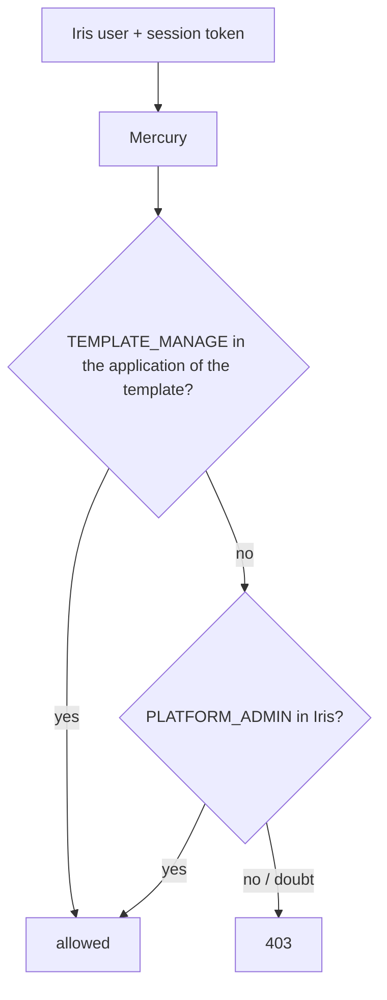
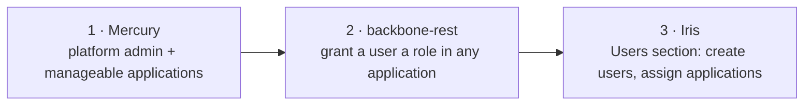

# 12 · Who administers applications and their templates

⬅️ [Back to index](README.md)

## Model

Backbone-rest owns users, roles and the ACL `general.application_role_user`: **one row per (user, application) with one role**. Mercury never keeps a copy; it asks backbone (`POST /api/v1/iam/permissions/check`) with the caller's own session token.

| Kind of user | How it is defined in backbone | What Mercury lets it do |
|---|---|---|
| **Platform administrator** (one or more) | A role with the feature `PLATFORM_ADMIN` linked to the user **in the Iris application** | Every application: list them, manage all their templates, administer login clients |
| **Template administrator of one or more applications** | A role with `TEMPLATE_MANAGE` (and `TEMPLATE_READ`) linked to the user **in each application** it manages | Only the templates of those applications; Iris lists only those applications |
| Anyone else | No such link | `403` |

## What Mercury does

- `ApplicationAuthorizationService.assertPermission` grants when backbone grants the permission in the application **or** the caller is a platform administrator (`isPlatformAdmin`: `PLATFORM_ADMIN` in the administering application). `holds` is the strict, per-application question without the exception. Everything fails closed: unreachable backbone, unresolvable Iris, missing token ⇒ denied.
- `AdministeringApplication` finds Iris by `code_name` (`LOGIN_CLIENTS_ADMIN_APPLICATION`, default `iris`; exactly one match or nobody is an administrator; `LOGIN_CLIENTS_ADMIN_APPLICATION_ID` forces a UUID).
- `GET /api/v1/templates/applications` returns the active applications whose templates the caller may manage: all of them for a platform administrator, otherwise those where `TEMPLATE_MANAGE` is held. Iris uses it for its application selector.
- Permission names: `PLATFORM_ADMIN_PERMISSION` (default `PLATFORM_ADMIN`), `TEMPLATE_MANAGE_PERMISSION`, `TEMPLATE_READ_PERMISSION`, `LOGIN_CLIENT_MANAGE_PERMISSION`.

## Plan (three repositories)

1. **Mercury** (this document): the authorization model above.
2. **backbone-rest**: today a user has one primary application and `PUT /users/link/user/{id}/role/{id}` links a role only in it, so a user cannot be given access to several applications. Needs endpoints to grant and revoke a role in a chosen application, guarded by `PLATFORM_ADMIN`.
3. **Iris**: a Users section (list, create, assign applications and role per application) and the application selector fed by `GET /api/v1/templates/applications`.

## Set-up in backbone (data, no code)

1. Create the feature `PLATFORM_ADMIN` and a role (for example `PLATFORM_ADMIN`) that holds it, plus `TEMPLATE_MANAGE`, `TEMPLATE_READ` and `LOGIN_CLIENT_MANAGE`; link the role to each platform administrator in the Iris application.
2. Create a role with `TEMPLATE_MANAGE` and `TEMPLATE_READ` (`TEMPLATE_ADMIN`) and link it to the user in each application they manage.
