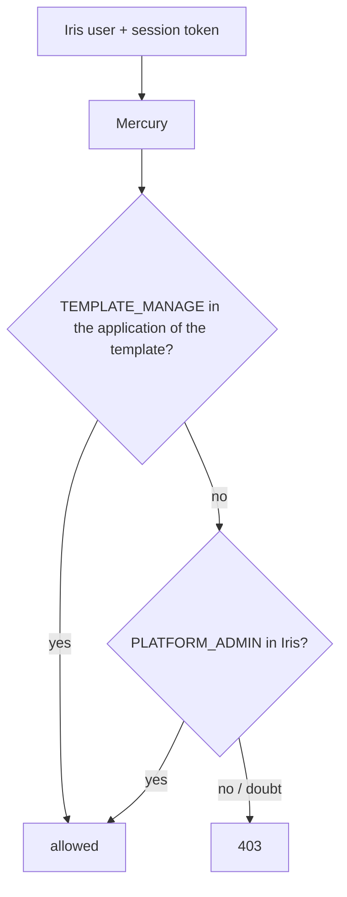
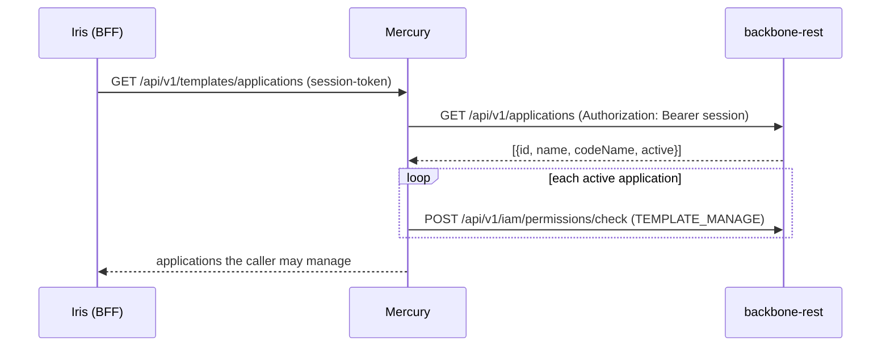

# 12 · Who administers applications and their templates

⬅️ [Back to index](README.md)

## Model

Backbone-rest owns users, roles and the ACL `general.application_role_user`: **one row per (user, application) with one role**. Mercury never keeps a copy; it asks backbone (`POST /api/v1/iam/permissions/check`) with the caller's own session token.

| Kind of user | How it is defined in backbone | What Mercury lets it do |
|---|---|---|
| **Platform administrator** (one or more) | A role with the feature `PLATFORM_ADMIN` linked to the user **in the Iris application** | Every application: list them, manage all their templates, administer login clients |
| **Template administrator of one or more applications** | A role with `TEMPLATE_MANAGE` (and `TEMPLATE_READ`) linked to the user **in each application** it manages | Only the templates of those applications; Iris lists only those applications |
| Anyone else | No such link | `403` |



## What Mercury does

- `ApplicationAuthorizationService.assertPermission` grants when backbone grants the permission in the application **or** the caller is a platform administrator (`isPlatformAdmin`: `PLATFORM_ADMIN` in the administering application). `holds` is the strict, per-application question without the exception. Everything fails closed: unreachable backbone, unresolvable Iris, missing token ⇒ denied.
- `AdministeringApplication` finds Iris by `code_name` through `ApplicationDirectory`, which calls backbone-rest's `GET /api/v1/applications` (`BackboneApplicationClient`) with the caller's session as `Authorization: Bearer`; Mercury never reads the `general` schema, and a backbone that cannot answer refuses everyone (`LOGIN_CLIENTS_ADMIN_APPLICATION`, default `iris`; exactly one match or nobody is an administrator; `LOGIN_CLIENTS_ADMIN_APPLICATION_ID` forces a UUID).
- `GET /api/v1/templates/applications` returns the active applications whose templates the caller may manage: all of them for a platform administrator, otherwise those where `TEMPLATE_MANAGE` is held. Iris uses it for its application selector.
- Permission names: `PLATFORM_ADMIN_PERMISSION` (default `PLATFORM_ADMIN`), `TEMPLATE_MANAGE_PERMISSION`, `TEMPLATE_READ_PERMISSION`, `LOGIN_CLIENT_MANAGE_PERMISSION`.

### How applications are read (never from the `general` schema)



Backbone cannot be reached or refuses the session: `ApplicationDirectory` throws `ForbiddenException` and the caller sees nothing (fail closed).

## Plan (four repositories) — status

```mermaid
flowchart LR
  A[1 · Mercury<br/>platform admin + manageable applications<br/>DONE] --> B[2 · backbone-rest<br/>grant a user a role in any application<br/>DONE: PUT /users/{id}/access/{app}/role/{role}]
  B --> C[3 · Stratum<br/>create the application, give users access<br/>DONE: Applications and Users sections]
  C --> D[4 · Iris<br/>applications selector, folder, templates, preview<br/>DONE: /dashboard/applications]
```

1. **Mercury** (this document): the authorization model above.
2. **backbone-rest**: `UserApplicationAccessController` (`/api/v1/users/{userId}/access`) lists, grants and revokes a user's role in each application, so a user can administer several applications.
3. **Stratum**: backbone's administration console creates and edits the applications and the users' access. **A new application is registered there**; Mercury and Iris do not create applications.
4. **Iris**: the page **Aplicaciones y plantillas** (`/dashboard/applications`) shows the applications `GET /api/v1/templates/applications` returns, their folder, and creates, edits and previews their templates.

To attach a new application to messaging: create it in Stratum, give the person that will administer it a role with `TEMPLATE_MANAGE` and `TEMPLATE_READ` in it, and open Iris: it appears in the page, and its first template registers its folder.

## Set-up in backbone (data, no code)

1. Create the feature `PLATFORM_ADMIN` and a role (for example `PLATFORM_ADMIN`) that holds it, plus `TEMPLATE_MANAGE`, `TEMPLATE_READ` and `LOGIN_CLIENT_MANAGE`; link the role to each platform administrator in the Iris application.
2. Create a role with `TEMPLATE_MANAGE` and `TEMPLATE_READ` (`TEMPLATE_ADMIN`) and link it to the user in each application they manage.
