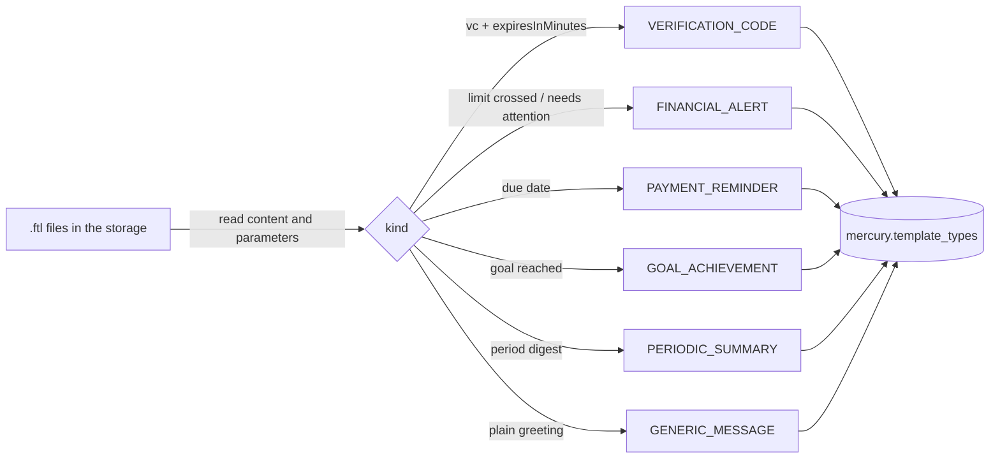

# 13 · Template types

⬅️ [Back to index](README.md)

Every template (`mercury.templates`) points to a type (`mercury.template_types`). The types were defined by reading the shipped templates (the `.ftl` files of the template storage; reference copies in `src/test/resources/templates`): what the message says and which parameters it needs, not its file name.

| Type | What the message is | Parameters | Templates (each in `_es`, `_en`; zb_* also `_tg_es`, `_tg_en`) |
|---|---|---|---|
| `VERIFICATION_CODE` | A single-use confirmation code that expires | `vc`, `expiresInMinutes`, `user_name` | `zb_verification`, `sk_verification`, `iris_verification`, `ds_new_user_verification_code` |
| `FINANCIAL_ALERT` | A warning when a limit is crossed or something needs attention now | spent, limit, percent / symbol, threshold, price / title, summary | `zb_budget_exceeded`, `zb_price_alert`, `zb_critical_insight` |
| `PAYMENT_REMINDER` | A reminder tied to a due date | debtName, dueDate, amount | `zb_debt_due` |
| `GOAL_ACHIEVEMENT` | A congratulation when a goal is reached | goalName, target | `zb_goal_reached` |
| `PERIODIC_SUMMARY` | A recurring digest of a period | periodStart, periodEnd, income, spending, net | `zb_weekly_summary` |
| `GENERIC_MESSAGE` | A plain greeting with no business meaning, to try a channel | name, userEntity.alias | `first_message_template` |



## The script

`scripts/templates/seed-template-types.sql` inserts the six types. It is a manual, per-environment step (like the other scripts in `scripts/`), not a Flyway migration, because the verification-code type is configured by id and each environment may already have one.

```
psql "$MERCURY_DB" -f scripts/templates/seed-template-types.sql
```

- **Idempotent:** a type whose name already exists (any case) is left untouched; nothing is updated or deleted; it runs in one transaction. Tested on PostgreSQL 17: the first run inserts the missing types and keeps a pre-existing `verification_code`; the second inserts nothing.
- **One verification-code type.** Mercury keeps a confirmable code only for templates of that type, and its id is `PRX_VERIFICATION_CODE_TEMPLATE_ID`. If the environment already has one under another name, delete the `VERIFICATION_CODE` line of the script before running it.
- It prints the types with their ids at the end. Use the id of `VERIFICATION_CODE` as `PRX_VERIFICATION_CODE_TEMPLATE_ID`, and another one as `type_id` of `scripts/zerobound/seed-templates.sql` (`type_id` and `verification_type_id` must differ).
- `TemplateTypesScriptTest` fails if a template that ships has no type in the script (the `MAP` lines in its header), if a type is inserted twice, or if the script stops being idempotent.

Adding a new kind of template: add its `MAP` line (and a type, if none fits) to the script and a row to the table above.
