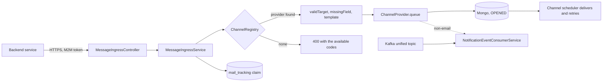
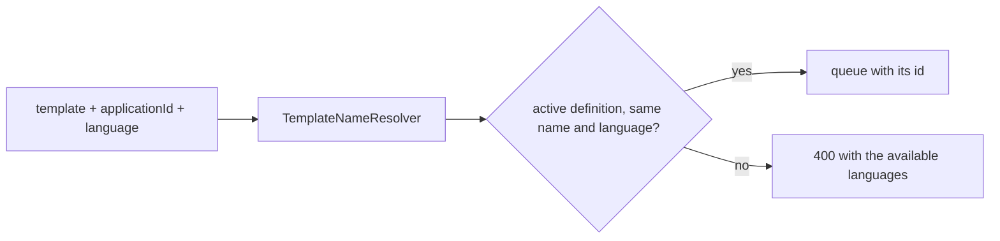

# 14 · Unified message ingress (`POST /api/v1/messages`)

Decision D-14 of zerobound-rest (`zerobound-rest/docs/decisions/D-14-async-multichannel-handover-to-mercury.md`). One **asynchronous**, **channel-agnostic** HTTPS door for every
backend service that wants mercury to deliver something, whatever the channel: e-mail, SMS, WhatsApp, Telegram, push, and any channel added later. The caller needs only HTTPS and a mercury
token; it needs no Kafka client, no broker and no knowledge of how a channel delivers.

## Components (package `com.umdc.mercury.ingress`)

| Class | Role |
|---|---|
| `MessageIngressController` / `MessageIngressApi` | `POST /api/v1/messages`, `GET /api/v1/messages/channels`, `GET /api/v1/messages/{id}`. M2M only (`MachineTokenInterceptor` covers `/api/v1/messages/**`). |
| `MessageIngressService` | Validates, claims the `Idempotency-Key`, asks the provider to queue, answers `202`. Status lookups are scoped to the caller. |
| `ChannelProvider` | The SPI: `code()`, `validTarget(target)`, `missingField(message)`, `queue(message)`. |
| `TemplateNameResolver`, `TemplateIdentity` | Resolve a template by name + language inside an application, with no fallback language (D-15). |
| `ChannelRegistry` | Finds the provider by code (case-insensitive) from the Spring beans; two providers with one code stop the start-up. |
| `EmailChannelProvider` | Queues the same `EmailMessageDocument` as `POST /api/v1/mail`; the e-mail scheduler sends it. |
| `SmsChannelProvider`, `WhatsAppChannelProvider`, `TelegramChannelProvider`, `PushChannelProvider` | Build the `NotificationEventTO` of the unified Kafka topic and hand it to the **same** `NotificationEventConsumerService`, so one message has one path whether it arrives over HTTP or Kafka. |



## Request and answer

`POST /api/v1/messages` with `session-token: <token from POST /api/v1/auth/token>` and, optionally, `Idempotency-Key`:

```json
{
  "channel": "email",
  "userId": "0b7c4a38-6a1d-4c33-9a31-0e8f1d2f7a10",
  "target": "ana@example.com",
  "templateDefinedId": "7f0a4f0e-1f6e-4b8e-8e0c-0d3b2f9a6c11",
  "language": "es",
  "from": "no-reply@zerobound.app",
  "subject": "Verifica tu correo en ZeroBound",
  "body": "verification",
  "params": { "vc": "123456", "expiresInMinutes": "30" }
}
```

`202 {"id": "...", "status": "OPENED", "message": "Queued"}`. A repeat with the same key and body answers the first message with `Idempotent-Replayed: true`; the same key with another body is `422`.
`400`: unknown or disabled channel (the answer lists the available codes), a target that is not valid for the channel, a field the channel needs (e-mail: `templateDefinedId`, `from`, and a `subject` sent in the request **or** defined by the template — see `docs/template-management-api.md#-e-mail-subject`), or an unknown template.
`GET /api/v1/messages/{id}` returns `OPENED`, `SENT` or `FAILED` (the channel's own document when it has one, else the tracking row); `404` for an unknown id or another caller's message.

## Templates by name (decision D-15)

A caller does not keep mercury's template ids. It sends `template` (the name), `applicationId` and `language`, and `TemplateNameResolver` finds the active definition whose template has that
`language` (a column of `mercury.templates`, migration `V2034`, filled from the file name for existing rows and by `TemplateEntity.deriveLanguage` for new ones) and whose name equals the one asked
(the location without extension and language: `zb_verification` for `zb_verification_es.ftl`). **There is no fallback language**: a missing version is a `400` that lists the available ones,
because sending in another language is a silent failure. `templateDefinedId` still works for older callers (send one or the other, not both). `GET /api/v1/messages/templates?applicationId=` lists
every name with its languages, so a caller can check what it needs against what mercury has. Registering a new template (a `.ftl` and its definition, by Iris, the template-management API or `seed-templates.sql`) makes it
reachable at once; no caller changes.



*Hardening left for later:* the application is named by the caller (as the template id was before, mercury never scoped templates per caller); binding each login client to its application would close that.

## The channel is data plus a provider

* **Accepted** when a `ChannelProvider` bean has that `code()` **and** the catalogue (`/api/v1/channel-types`, table `channel_types`) has not switched it off (`enabled=false` or `active=false`). A code the catalogue does not list keeps its provider's default, on.
* **Adding a channel** = one more bean implementing `ChannelProvider` (and, if wanted, a catalogue row). The endpoint, the request, the answer and every caller stay as they are; the channel appears in `GET /api/v1/messages/channels` by itself.
* **Honest limit.** The Mongo documents and the Kafka consumer still use the closed `ChannelType` enum, so a channel that is neither the five above nor backed by its own store needs its provider to persist its own document and a scheduler to deliver it. Delivery today: e-mail (SMTP scheduler) and Telegram (`MultiChannelMessageProcessor`) deliver; SMS, WhatsApp and Push are queued as `OPENED` until their providers are integrated.

## Privacy

The tracking row (`mail_tracking`, TTL `umdc.mail.tracking-retention`, 30 d) holds no target, content or parameter. `MessageRequest` and `OutboundMessage` print neither; nothing logs a target.

## Tests

`ChannelRegistryTest`, `ChannelProvidersTest`, `MessageIngressServiceTest` (idempotency, catalogue, validation, status, claim release on failure), `MessageIngressControllerTest`, `OpenApiSpecTest` (the three operations are documented in `src/main/resources/api/openapi.yaml`, which zerobound-rest validates against).
