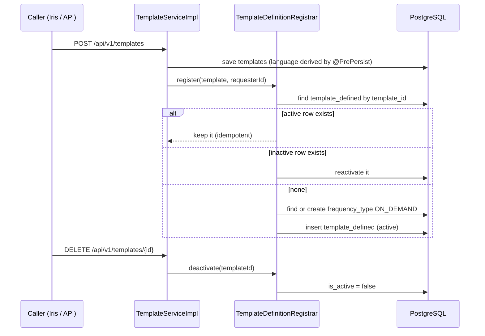

# 15 · Template definitions (`template_defined`) are written on create

## Problem

`mercury.template_defined` is the table `POST /api/v1/messages` (`TemplateNameResolver`), campaigns (`CampaignServiceImpl`) and `GET /api/v1/messages/templates` read. Nothing wrote it: `TemplateServiceImpl.createTemplate` saved only `mercury.templates`, and `TemplateDefinedService` is read-only. Result: the table stayed empty and every send by template name was a 400 (`not registered for this application`).

## Design

- `TemplateDefinitionRegistrar` (`api/v1/service`): `register` (idempotent, reactivates, never duplicates) and `deactivate`. The frequency is `umdc.template.default-frequency-type` (default `ON_DEMAND`), found by name or created if absent.
- `user_id` is the requester; `application_id` is the template's; `expired_at` stays `NULL`.
- Repositories: `TemplateDefinedRepository.findByTemplateId`, `FrequencyTypeRepository.findFirstByNameIgnoreCaseAndActiveTrue`.
- Migration `V2035__template_defined_backfill.sql`: seeds `ON_DEMAND` and gives every active template without a definition one (`user_id` = nil UUID, the creator was never recorded). Idempotent.
- `createTemplate` is `@Async` and not `@Transactional`: the template is saved first and the definition second; if the definition fails the request fails and a retry is safe (`register` is idempotent).

## Tests

`TemplateDefinitionRegistrarTest` (create, create frequency, idempotent, reactivate, deactivate) and the create/delete cases of `TemplateServiceImplTest`.
