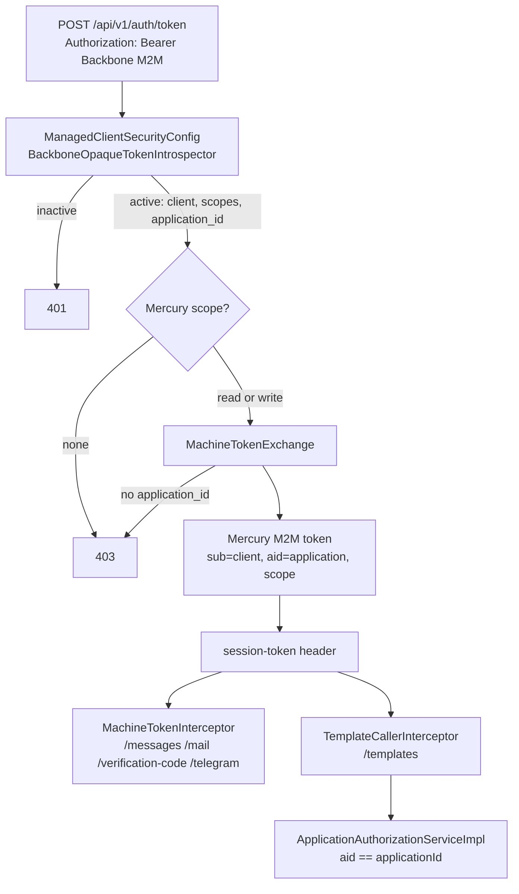

# 16 · Mercury M2M token obtained with the Backbone M2M token

## Why

Applications used to log in to Mercury with an alias and a password (`mercury.login_clients`): a second, Mercury-only secret that duplicated the credentials the application already has in Backbone, and that Mercury had to store, throttle and rotate. Applications could not manage templates at all: `/api/v1/templates` demanded a person's `session-token` and checked that person's roles. Now Backbone is the only source of an application's identity, and an application manages its own templates and sends with Mercury's M2M token.

## Design

- **Identity comes from Backbone.** backbone-rest's introspection returns the client's `applicationId` (every managed client belongs to one application) and `security-oauth` exposes it as the `application_id` claim of the principal. A client without it (older backbone-rest) is refused (`403`, fail closed).
- **`MachineTokenExchange`** copies client (`sub`), name, application (`aid`) and the `mercury:*` scopes into a Mercury token (`SessionJwtServiceImpl.generateMachineToken`). Later calls need no round trip to Backbone. Revocation: the token lives `APP_TOKEN_EXPIRATION`; `POST /api/v1/auth/logout` revokes it locally.
- **`MachineCaller`** (`getMachineCaller`) is what the interceptors read: it requires Mercury's own `iss`/`aud`, no `uid`, and a valid `aid`. A token without `aid` (the old alias/password kind) is not a machine token.
- **Scopes per call:** `GET`/`HEAD`/`OPTIONS` need `mercury:message:read` or `write`; anything else needs `write` (`MachineCaller.allows`).
- **The caller is the application.** `MachineTokenInterceptor.CALLER` is now the application id (before: the alias), so idempotency keys and Telegram links are scoped per application. `MessageIngressService` refuses (`403`) a request that names another application or a template definition of another application, and fills in `applicationId` when the request has none (`CallerApplication`).
- **Templates, two callers.** `ManagedClientSecurityConfig` applies to `/api/v1/templates/**` only when the request has an `Authorization` header (a person of Iris: service Bearer + the person's `session-token`, as before). Without it the request falls to `SessionTokenSecurityConfig` and `TemplateCallerInterceptor` requires a Mercury M2M token. A person's session token without the service Bearer is refused, so the Bearer layer cannot be skipped by omitting the header.
- **Authorization.** `ApplicationAuthorizationServiceImpl` grants a machine caller exactly its own application (`holds`/`assertPermission`) without asking Backbone and never makes it a platform administrator. Template controllers record the actor with `getVerifiedActorId` (the person's `uid`, or the client UUID); `GET /api/v1/templates/applications` returns just its own application.

## Removed

`AuthServiceImpl`, `LoginClientVerifier`, `LoginAttemptThrottle`, `LoginClientProperties`, `LoginThrottleProperties`, the login-client administration API (`/api/v1/login-clients`) with its service, entity, repository and exceptions, `scripts/login-clients`, and the config keys `umdc.mercury.login-clients`, `login-registry`, `login-throttle`, `permissions.login-client-manage`. The table `mercury.login_clients` (migration `V2031`) is left in place, unused: drop it once every service has moved.

## Configuration

| Key | Meaning |
|---|---|
| `TELEGRAM_APPLICATION` | Now the **application id (UUID)** whose users the bot serves (it was the login alias). The webhook path is that UUID. |
| `LOGIN_CLIENTS_ADMIN_APPLICATION[_ID]` | Unchanged: it finds Iris to detect platform administrators (the name is historical). |

## Tests

`MachineTokenExchangeTest`, `TemplateCallerInterceptorTest`, `MachineTokenInterceptorTest`, `SessionJwtServiceImplTest` (machine token, actor id), `SecurityFilterChainsTest` (the real chains: `/auth/token` needs a Backbone Bearer and a Mercury scope; templates without `Authorization` fall to the session-token chain), `ApplicationAuthorizationServiceImplTest`, `TemplateApplicationServiceImplTest`, `MessageIngressServiceTest`.
