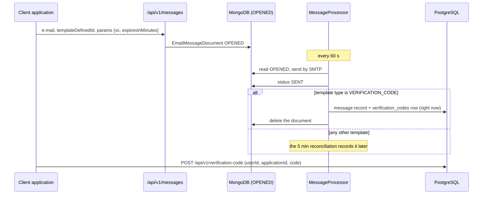

# Verification code storage

A client application (ZeroBound, Smartkin, Directory) sends a **verification e-mail** through `POST /api/v1/messages` with the code in the
`vc` parameter (and `expiresInMinutes`). Mercury keeps that code in `mercury.verification_codes` so the application can later confirm it with
`POST /api/v1/verification-code`.

## Flow

## Rules

- **A template is a verification-code template** when its type id is `umdc.verification.code.template.id`
  (`PRX_VERIFICATION_CODE_TEMPLATE_ID`) **or** its type is named `VERIFICATION_CODE` (case, spaces and hyphens ignored). The name is accepted
  because a deployment whose variable did not match the type id in the database used to record the message, delete the document and store
  **no code**, without any log.
- **The code is stored as soon as the e-mail is sent**, in the same run that sends it. Before, it waited for the reconciliation
  (`umdc.scheduler.save-message-processed.fixed-rate`, 5 min by default), so a user who typed the code earlier was told there was none.
  Other e-mails are still reconciled by the periodic job.
- A verification message **without `vc`** logs an error and stores no code; the message is still recorded and removed.
- A message with **no `sendDate`** lives from now (`expiresInMinutes`, never more than two days).
- A new code expires the pending ones of the same user and application (resend).
- Logs: `Verification code stored for user <id> (message <id>)` (INFO).

## Tests

`MessageProcessorTest`: type by name, type by id, another type, missing `vc`, missing `sendDate`, immediate storage after sending, failed send, and an ordinary e-mail left for the reconciliation.

## Where each record lives

| Step | Store | Where to look |
|---|---|---|
| E-mail accepted (`OPENED`), then sent (`SENT`) | MongoDB (Atlas), collection `messages`, `_class` `EmailMessageDocument` | removed once the next row is written |
| Record of the sent e-mail | PostgreSQL `mercury.message_record` (`id` = the `id` Mercury returned in `MessageResponse`) | `SELECT * FROM mercury.message_record ORDER BY created_at DESC` |
| The code to confirm | PostgreSQL `mercury.verification_codes` (`message_record_id` -> the record above) | `SELECT * FROM mercury.verification_codes ORDER BY created_at DESC` |

If PostgreSQL has nothing, the e-mail is still in MongoDB with status `SENT` (that is where "the record" is until it can be written).

## Why PostgreSQL stayed empty (reproduced on a real PostgreSQL 17)

`MessageRecordEntity.id` was `@GeneratedValue` but the mapping sets it to the message id. With an id already set, Spring Data `save` calls
`merge`, and Hibernate 7 throws `StaleObjectStateException` ("Row was already updated or deleted by another transaction") because the row does
not exist: **no `message_record` row, and so no `verification_codes` row, could ever be written**; the e-mail stayed `SENT` in MongoDB. The id is
now assigned (`MessageRecordService.create` gives one when none is set) and saving the same id twice is idempotent. A pin test fails the build if
`@GeneratedValue` comes back.

An SMTP failure (`MailSendException: Read timed out`) is no longer fatal for the run: that e-mail stays `OPENED` and is retried at the next run,
and the others go on.
