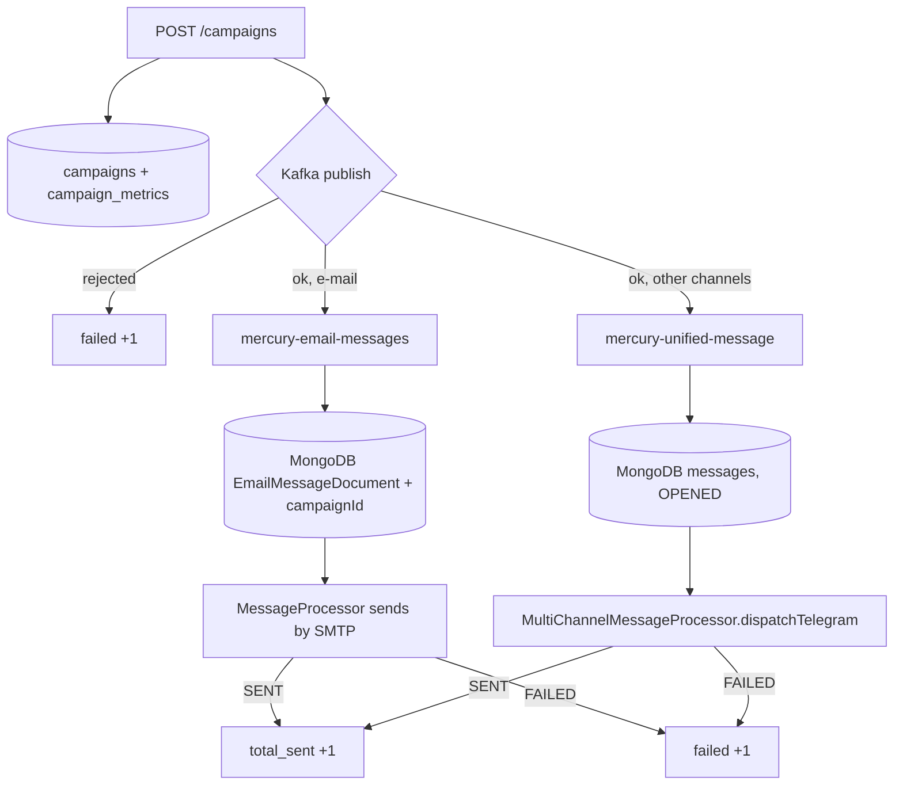

# Campaign metrics

`GET /api/v1/campaigns/{id}/progress` reads `campaigns.total_recipients` and the counters of `campaign_metrics` (`total_sent`, `failed`).
`pending = total_recipients - (total_sent + failed)`. The counters are advanced with atomic `UPDATE` statements by `CampaignMetricsService`.

## Where each recipient is counted

## What changed

- `EmailMessageTO` (Kafka) and `EmailMessageDocument` (MongoDB) carry `campaignId` (`campaign_id` in JSON). Before, an e-mail of a campaign lost its
  campaign on the way, so **no e-mail campaign ever advanced its counters**. Messages outside a campaign (verification codes, `/api/v1/messages`)
  keep `null` and are ignored by `CampaignMetricsService`.
- `MessageProcessor.processMessage` records the outcome of each e-mail right after sending it (once: only `OPENED` documents are processed).
- A recipient whose message Kafka rejects is counted as `failed` (it used to stay pending forever).

## Known scope limits (unchanged)

SMS, WhatsApp and Push have no provider: their messages stay `OPENED`, so those campaigns report every recipient as pending until a provider
is integrated (`dispatchX()` in `MultiChannelMessageProcessor`). Non-e-mail messages are not migrated to PostgreSQL nor purged from MongoDB.
`delivered`, `opened` and `clicked` are not fed by any process yet.
