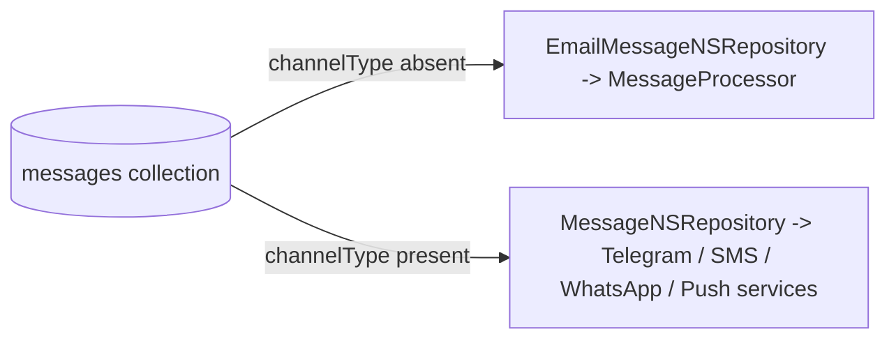

# The shared `messages` collection

MongoDB's `messages` collection holds, together, the in-flight **e-mails** (`EmailMessageDocument`) and the documents of the other channels
(`TelegramMessageDocument`, `SmsMessageDocument`, `WhatsAppMessageDocument`, `PushNotificationMessageDocument`, all `MessageDocument`s that carry
`channelType`). Each repository must read only its own kind.

## The defect (reproduced against a real MongoDB 8)

- `EmailMessageNSRepository.findByDeliveryStatus` was a plain derived query: it also returned the Telegram / SMS documents, mapped as e-mails with no
  template. `MessageProcessor` then threw on the first one on **every run**, so e-mails behind it were never sent, **no `message_record` and no
  `verification_codes` row was written**, and nothing logged the cause clearly. SMS/WhatsApp/Push documents stay `OPENED` forever (no provider), and
  Telegram campaign documents are never purged, so the poison document never went away.
- `MessageNSRepository.findByDeliveryStatus` returned the e-mails too, and mapping one as a `MessageDocument` threw (`MappingInstantiationException`):
  the Telegram dispatch failed on every run while any e-mail was queued.

## The fix

- `EmailMessageNSRepository.findByDeliveryStatus`: `{ 'deliveryStatus': ?0, 'channelType': { $exists: false } }`.
- `MessageNSRepository.findByDeliveryStatus`: `{ 'deliveryStatus': ?0, 'channelType': { $exists: true } }`.
- `MessageProcessor` skips (with an error log) an `OPENED` or `SENT` document that has no `templateDefinedId` instead of aborting the run.
- Regression tests: `SharedCollectionQueriesTest` and the two new `MessageProcessorTest` cases.
