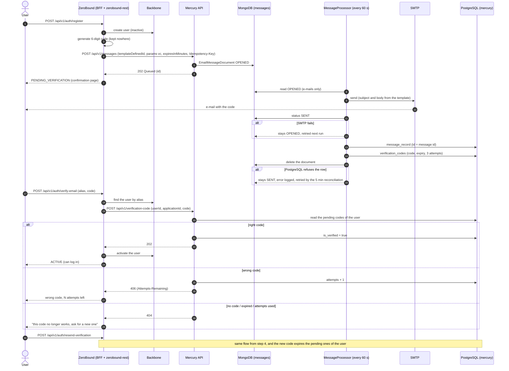

# Verification code: the whole cycle

## Why `mercury.verification_codes` exists

ZeroBound creates the account in Backbone **inactive** and generates a 6-digit code. It keeps **no copy** of it. Mercury is the one that remembers the code
(table `verification_codes`) so that, when the user types it, someone can answer "is this the code that was sent to this user?". The table holds, per
code: the user, the application, the code, when it expires (`expiresInMinutes` of the e-mail, at most two days), `attempts` / `max_attempts` (3),
`is_verified` and `verified_at`, and the `message_record_id` of the e-mail that carried it. It is read and written only by Mercury
(`POST /api/v1/verification-code`, `GET /api/v1/verification-code/latest-status`).
**Without a row there, every code the user types is answered `404` ("no code") and the account is never activated.**

## Sequence

## Where it can stop (and the log that tells)

| Step | Symptom | Log / check |
|---|---|---|
| ZeroBound -> Mercury | no message accepted | zerobound: `mercury did not take the message` |
| Mercury sends | e-mail never arrives, stays `OPENED` | `SMTP failure sending message ..., left OPENED to retry` |
| Mercury records | e-mail arrives, **table empty**, document stays `SENT` in MongoDB | `Could not record message ... (it stays SENT in MongoDB and is retried): <database error>` |
| Mercury records | row stored | `Verification code stored for user ...` |
| Confirm | `404` | no row, expired, or 3 wrong attempts |

## The database check that blocked the rows

`mercury.verification_codes` has the check `chk_verification_code_length`, which is not defined in this repository and refused the 6-digit code
(`new row for relation "verification_codes" violates check constraint "chk_verification_code_length"`). `V2038__verification_code_length.sql`
replaces it with `char_length(verification_code) BETWEEN 4 AND 9` (the column is `varchar(9)`), `NOT VALID` so existing rows are not re-checked.
Each message is now recorded in **its own transaction**: a row the database refuses is logged with its message id and retried, and it no longer
undoes or blocks the others (before, the whole run rolled back at commit). The `modified_by` column received a timestamp (`modifiedBy` was mapped from
`modifiedAt`); it now comes from `updatedBy`.
