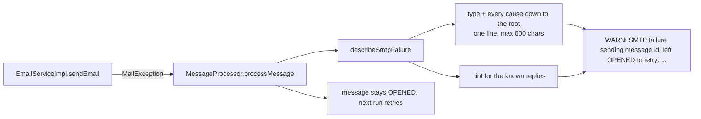

# SMTP failure diagnosis

When the SMTP server refuses a send, `MessageProcessor.processMessage` keeps the e-mail `OPENED` (it is retried on the next run) and logs one
`WARN` line. The line used to hold only the exception type (`MailSendException`); the server's own reply was lost. It now holds the cause.



## Log line

```
SMTP failure sending message <id>, left OPENED to retry: MailAuthenticationException | Authentication failed | AuthenticationFailedException: 535 5.7.8 Username and Password not accepted -> the SMTP login was refused: use an app password (...)
```

`describeSmtpFailure` walks the cause chain (at most 8 levels, loops are cut), collapses whitespace so the line stays single, truncates at 600
characters and appends a hint when the text matches one of these replies. The SMTP reply never contains the password, so nothing secret is logged.

| Reply in the text | Hint |
|---|---|
| `535`, `AuthenticationFailedException` | login refused: use or recreate an app password |
| `5.4.5`, `quota` | daily sending limit exceeded: wait about 24 h |
| `421`, `454`, `4.7.0` | rate limited: retry later, lower the send rate |
| `534`, `5.7.9` | sign-in blocked as suspicious: confirm it in the account's security alert |
| `timed out`, `ConnectException`, `UnknownHostException` | server unreachable: check `MAIL_HOST`/`MAIL_PORT` and the network |

Behaviour is otherwise unchanged: the e-mail is retried every run, so while the provider limits or blocks the account each retry is another
login attempt; fix the cause (see the user guide) rather than waiting.

Tests: `MessageProcessorTest.describeSmtpFailure_*`.
