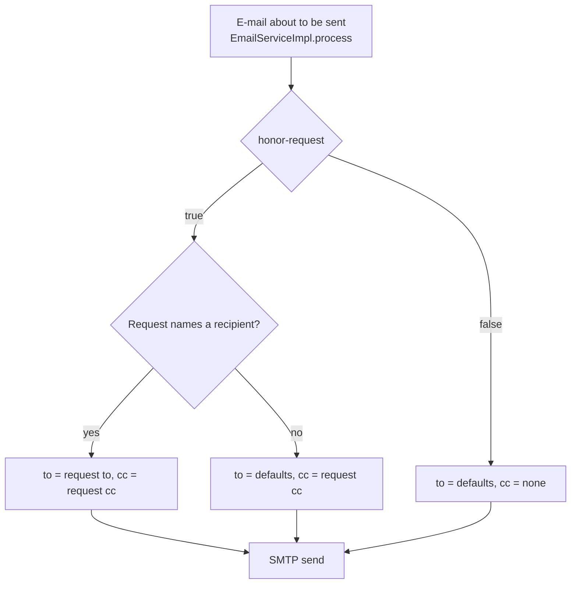

# Test recipients for QA

Two settings let a non-production environment send every e-mail to a fixed list of people, so flows can be tested end to end (verification
codes, campaigns, notifications) without writing to real users.

| Property (`umdc.mail.recipients.*`) | Environment variable | Default | Meaning |
|---|---|---|---|
| `defaults` | `MAIL_DEFAULT_RECIPIENTS` | empty | Comma separated list of addresses. |
| `honor-request` | `MAIL_HONOR_REQUEST_RECIPIENTS` | `true` | `true`: use the recipients of the request (form or payload). `false`: ignore them and use `defaults`. |

## Behaviour

- Applied in one place, `MailRecipientPolicy`, called by `EmailServiceImpl` right before the SMTP send, so it covers every path (`POST
  /api/v1/messages`, `/mail`, campaigns, verification codes).
- With `honor-request=false` the copies (`cc`) of the request are dropped as well, so nobody outside the list gets a copy.
- The message record, the verification code and the campaign metrics are unchanged: they keep the user the application asked for; only the
  SMTP recipients change. The log line `E-mail recipients replaced by the default list (N requested, M used)` shows counts, never addresses.

## Safety

- `honor-request=false` with an empty `defaults` refuses to start Mercury (nobody would receive anything), and an invalid address in the list
  does too: the error names the setting.
- At start Mercury logs a `WARN` when the override is on, so it is visible in the logs of the environment.
- Production leaves both unset: behaviour is exactly what it was before.

Classes: `mail/MailRecipientProperties` (binding and validation), `mail/MailRecipientPolicy` (decision). Tests: `MailRecipientPolicyTest`,
`MailRecipientPropertiesBindingTest`, `EmailServiceImplRecipientsTest` (inspects the real MIME message).
