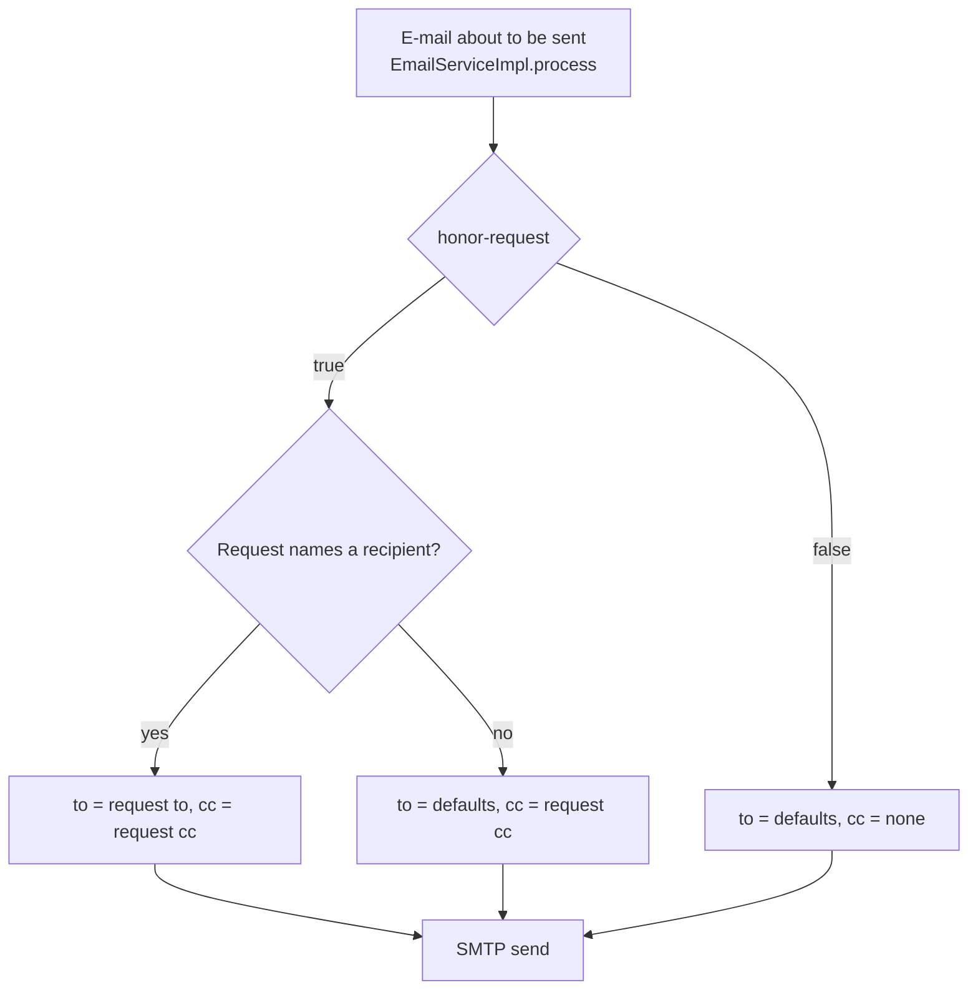
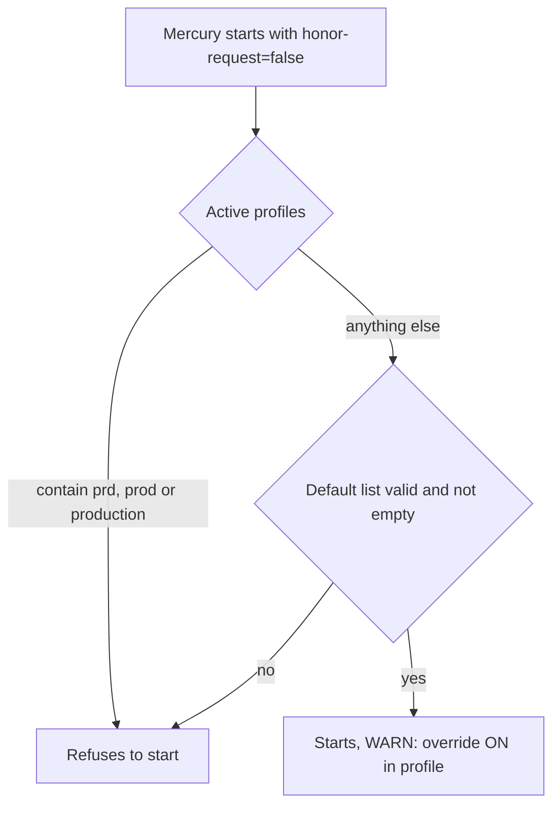
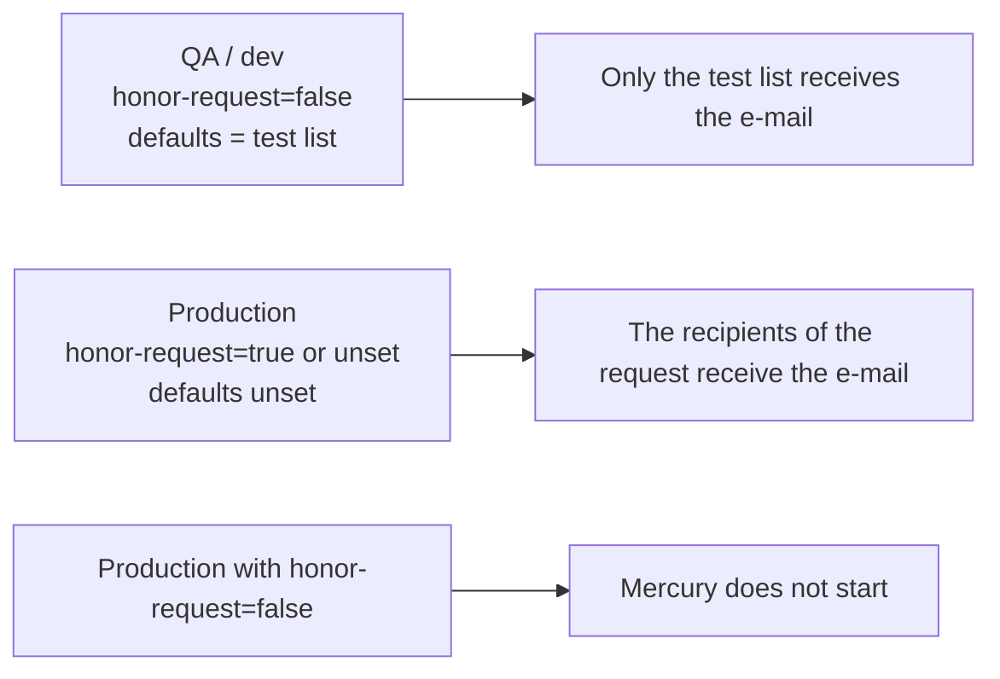

# Test recipients for QA

Two settings let a non-production environment send every e-mail to a fixed list of people, so flows can be tested end to end (verification
codes, campaigns, notifications) without writing to real users.

| Property (`umdc.mail.recipients.*`) | Environment variable | Default | Meaning |
|---|---|---|---|
| `defaults` | `MAIL_DEFAULT_RECIPIENTS` | empty | Comma separated list of addresses. |
| `honor-request` | `MAIL_HONOR_REQUEST_RECIPIENTS` | `true` | `true`: use the recipients of the request (form or payload). `false`: ignore them and use `defaults`. |

## Behaviour

- Applied in one place, `MailRecipientPolicy`, called by `EmailServiceImpl` right before the SMTP send, so it covers every path (`POST
  /api/v1/messages`, `/mail`, campaigns, verification codes).
- With `honor-request=false` the copies (`cc`) of the request are dropped as well, so nobody outside the list gets a copy.
- The message record, the verification code and the campaign metrics are unchanged: they keep the user the application asked for; only the
  SMTP recipients change. The log line `E-mail recipients replaced by the default list (N requested, M used)` shows counts, never addresses.

## Which environment is production

Mercury reads the active Spring profiles (`SPRING_BOOT_PROFILE_ACTIVE`) and only asks one question: **is a production profile active?**
Production profiles are `prd`, `prod` and `production` (compared ignoring case). Every other environment (`qa`, `dev`, `native`,
`remote-supabase`, no profile, any custom name) is non-production, so the override may run there.

- A production profile refuses the override even when it is active next to `qa`. There is no setting that enables it in production.
- With `honor-request=true` (default) the profile is not checked and nothing changes.

## Values per environment

| Variable | Non-production (qa, dev, native, ...) | Production (`prd`, `prod`, `production`) |
|---|---|---|
| `MAIL_HONOR_REQUEST_RECIPIENTS` | `false` (test list only) or `true` | `true`, or leave it unset (the default is `true`) |
| `MAIL_DEFAULT_RECIPIENTS` | the test list, e.g. `qa1@example.com,qa2@example.com` | unset or empty |

In production Mercury behaves exactly as before this setting existed: every e-mail goes to the recipients the application sent, and the
profile is not checked. `MAIL_HONOR_REQUEST_RECIPIENTS=false` in production makes Mercury refuse to start.

**Shared configuration.** If QA and production read the same Vault path or Config Server file, QA's values (`false` and the test list) would be
inherited by production and production would refuse to start. Keep those variables only in the QA/dev path or profile; to make production
independent of what it inherits, set `MAIL_HONOR_REQUEST_RECIPIENTS=true` there explicitly.

**After deploying to production:** the start log must not contain `E-mail recipient override is ON`, and a real e-mail reaches the recipient the
application named.

## Safety

- `honor-request=false` with an empty `defaults` refuses to start Mercury (nobody would receive anything), and an invalid address in the list
  does too: the error names the setting.
- At start Mercury logs a `WARN` when the override is on, so it is visible in the logs of the environment.
- Production leaves both unset: behaviour is exactly what it was before.

Classes: `mail/MailRecipientProperties` (binding and validation), `mail/MailRecipientPolicy` (decision). Tests: `MailRecipientPolicyTest` (profile gate),
`MailRecipientPropertiesBindingTest`, `EmailServiceImplRecipientsTest` (inspects the real MIME message).
