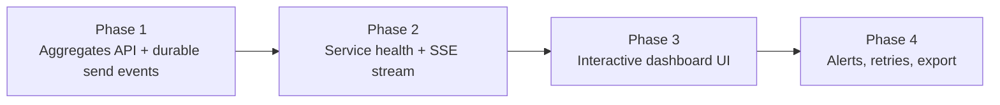
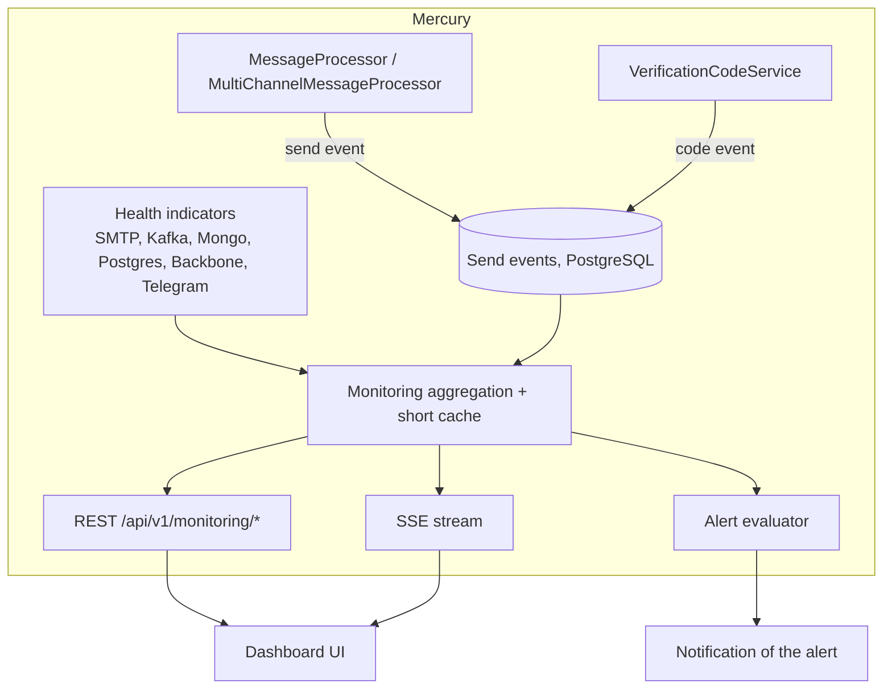

# Monitoring dashboard: requirements and scope

> **Status: planned.** Nothing described here is implemented yet. This document fixes the requirements, the scope and the phases so each
> phase can be built, tested and reviewed on its own branch. User-facing description: `docs/user-guide/en/monitoring-dashboard.md`.

## Purpose

Give operators a live view of the state of every outgoing communication (e-mail, SMS, Telegram, WhatsApp, Push and verification codes) and
of the services behind them, so failures and outages are seen as they happen.

## Where things stand today

| Finding | Consequence for the scope |
|---|---|
| Mercury has no frontend, only a REST API. The current monitoring area is not in this repository. | Mercury provides the data and the real-time stream; the views live in the frontend repository (to be confirmed, see *Open questions*). |
| `CampaignMetricsService` / `ChannelMetrics` exist, but only per campaign (see `18-campaign-metrics.md`). | A global view per channel and per period is missing. |
| Actuator and Micrometer/Prometheus are in the `pom.xml`. | Service health and technical counters have a base. |
| An e-mail leaves MongoDB when it is migrated to PostgreSQL, so no history of the in-flight state is kept. | A durable event record is needed for time series (Phase 1). |
| SMS, WhatsApp and Push have no provider: they stay `OPENED` and are never reconciled (see `CLAUDE.md`, *Known gaps*). | The views must show them as "queued, no provider", never as delivered. |
| Verification codes have their own cycle and table (see `20-verification-cycle.md`). | They are one more communication type with their own states. |
| `docs/tareas/TAREA-005-Seguimiento-Monitoreo.md` left the visual dashboard and real-time alerts out of scope. | This work covers exactly that. |

## Functional requirements

| Id | Requirement |
|---|---|
| FR-1 | **Live summary (KPIs):** sent, failed, queued and success rate for the last hour and the day, broken down by channel and by kind (transactional, campaign, verification code). |
| FR-2 | **Time series:** sends and failures per minute, hour and day, with a range selector (1 h, 24 h, 7 d, 30 d). |
| FR-3 | **Service health** with a green / amber / red state and the history of outages for SMTP, Kafka (consumer lag), MongoDB, PostgreSQL, Backbone and the Telegram Bot API, with the cause in text (for example `535 login refused`, `550 5.4.5 quota`). |
| FR-4 | **Failures and stuck queues:** top error causes, `OPENED` messages older than a threshold, `SENT` messages not reconciled. |
| FR-5 | **Verification codes:** generated, sent, confirmed, expired and failed, with the confirmation rate. |
| FR-6 | **Message table** filterable by channel, status, application, template and date; recipients are masked. |
| FR-7 | **Actions:** retry a failed message; export CSV or JSON (resumes `TAREA-005`). |
| FR-8 | **Alerts** with configurable thresholds: failure rate above X %, a service down, a queue growing. |

## Requirements of the views

- **Dynamic:** updated in real time through Server-Sent Events (SSE). The flow only goes server to client, which is why SSE is chosen over
  WebSocket; the client falls back to polling when the stream drops.
- **Linked:** a click on a channel, a bar or a service filters every other view and the table.
- **Interactive:** range selector, hover detail, drill-down from a KPI to the messages behind it.
- **Look:** dark blue theme with KPI cards, line and bar charts, a ring for the success rate and a detail table, following the reference
  images supplied by the product owner.
- **Quality:** accessible (state is never conveyed by colour alone), responsive, and a visible warning when the data is stale.

## Non-functional requirements

| Id | Requirement |
|---|---|
| NFR-1 | **Privacy:** recipients are masked; the monitoring endpoints need a dedicated scope and never return message bodies or verification codes. |
| NFR-2 | **Load:** aggregates are precomputed and cached for a short time; the dashboard must not run heavy queries against PostgreSQL or MongoDB per viewer. |
| NFR-3 | **Honesty:** a channel without a provider is labelled "queued, no provider". |
| NFR-4 | **Schema changes** go through new Flyway migrations and are tested against a real PostgreSQL. |
| NFR-5 | **Fail closed:** an unauthenticated or out-of-scope caller gets 401/403; an application only sees its own data. |

## Phases

| Phase | Where | Delivers | Requirements |
|---|---|---|---|
| 1 | Mercury | `/api/v1/monitoring/*` (summary, series, failures, messages) and a durable record of send events | FR-1, FR-2, FR-4, FR-5, FR-6, NFR-1, NFR-2, NFR-4 |
| 2 | Mercury | Health indicators per service with history; SSE stream | FR-3, NFR-5 |
| 3 | Frontend repository | The linked, interactive views | the *Requirements of the views* |
| 4 | Mercury + frontend | Alerts, retry and export | FR-7, FR-8 |

Every phase is a separate branch from `develop`, with tests, CHANGELOG, user guide and technical guide, and its own pull request.

## Target architecture

## Out of scope

- Integrating real SMS, WhatsApp and Push providers.
- Predictive analysis.
- External monitoring tools such as Datadog or Grafana (Prometheus stays a source).

## Risks

| Risk | Mitigation |
|---|---|
| Showing SMS/WhatsApp/Push as "sent" without a provider misleads. | Explicit status "queued, no provider" (NFR-3). |
| Heavy real-time queries on PostgreSQL and MongoDB. | Precomputed aggregates and a short cache (NFR-2). |
| Personal data in the table. | Masked recipients and a dedicated scope (NFR-1). |
| Schema drift. | New Flyway migrations and tests on real PostgreSQL (NFR-4). |

## Open questions

1. Where does the current monitoring dashboard live (repository and technology)? If none exists, is it a new app or part of the existing frontend?
2. Who can see it: internal operators only, or also each client application viewing its own data? This decides the permission model in Phase 1.
