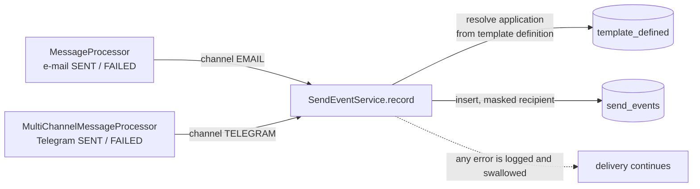
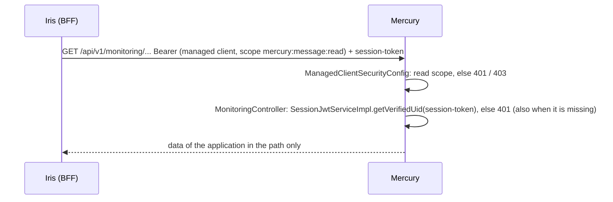

# Monitoring API (phase 1)

Phase 1 of the monitoring dashboard (`23-monitoring-dashboard-requirements.md`): a durable record of delivery outcomes and the read API
that Iris draws its views from. The dashboard itself is phase 3, in Iris.

## What is new

| Piece | Where | Purpose |
|---|---|---|
| Table `mercury.send_events` | `V2039__send_events.sql` | One row per delivery outcome (SENT or FAILED). The recipient is stored **masked**; no body, no code. |
| `SendEventService` | `monitoring/` | Writes the outcomes. Best effort and isolated (own transaction, never throws), so monitoring can never stop or undo a delivery. Also the retention purge. |
| `SendEventRetentionScheduler` | `monitoring/` | Deletes outcomes older than `umdc.monitoring.retention-days` (90). |
| `MonitoringService` / `MonitoringServiceImpl` | `api/v1/service` | Builds the views from the events and `verification_codes`. |
| `QueueSnapshots` | `monitoring/` | The live queues (`OPENED` documents in MongoDB of the application's templates), cached for a few seconds. |
| `MonitoringApi` / `MonitoringController` | `api/v1/controller` | `GET /api/v1/monitoring/applications/{applicationId}/...` |

## Where the outcomes are recorded

- The kind is `VERIFICATION_CODE` for a verification-code template, else `CAMPAIGN` when the message carries a campaign, else
  `TRANSACTIONAL`.
- An e-mail that fails with an SMTP error (`MailException`) stays `OPENED` and is retried, so it is **not** an outcome yet; its cause (`535`,
  quota, rate limit) shows in the service-health view (`25-monitoring-health-and-stream.md`).
- Failure causes recorded today are coarse: `SEND_FAILED` (e-mail) and `DELIVERY_FAILED` (Telegram), because the delivery code reports only that
  a send failed.
- SMS, WhatsApp and Push have no provider (see `CLAUDE.md`, *Known gaps*): they never reach SENT/FAILED, so they appear only as **queued**, and
  every channel summary carries `providerConnected` so the dashboard can say so.
- The Telegram channel of ZeroBound (`telegram_messages`, its own outbox) is not recorded in phase 1.

## Endpoints

All are `GET`, rooted at `/api/v1/monitoring/applications/{applicationId}`.

| Path | Query parameters | Returns |
|---|---|---|
| `/summary` | `range` | Totals, per channel (all five, always present) and per kind: sent, failed, queued, success rate. |
| `/series` | `range`, `channel`, `kind` | Sent and failed per time bucket; empty buckets as zeros. |
| `/failures` | `range` | Top 10 failure causes (cause, channel, total) and the queues holding messages longer than the threshold. |
| `/verification-codes` | `range` | Generated, confirmed, expired, pending, failed sends and the confirmation rate. |
| `/messages` | `channel`, `status`, `kind`, `templateDefinedId`, `from`, `to`, `page`, `size` | The message table: newest first, at most 100 per page. |

- `range` is `1h`, `24h` (default), `7d` or `30d`. Buckets: minute, hour, day, day. An unknown value is a 400 with the accepted ones.
- `channel` is `email`, `sms`, `telegram`, `whatsapp` or `push`; `kind` is `TRANSACTIONAL`, `CAMPAIGN` or `VERIFICATION_CODE`; `status` is
  `SENT` or `FAILED`; `from` / `to` are ISO local date-times in UTC. An invalid filter is a 400.
- A missing or unverified `session-token` is a 401; a page defaults to 0 and a size to 20 (maximum 100).
- A rate is `null` when there is nothing to divide (nothing finished, no code generated): no rate is invented.
- `queued` and the stuck queues are **live**: the `OPENED` documents in MongoDB whose template belongs to the application, kept for
  `umdc.monitoring.cache-seconds` (10) so many viewers do not each read MongoDB. A message is stuck when it is older than
  `umdc.monitoring.stuck-after-minutes` (15); one without a send date is queued but never stuck.

## Security

- `/api/v1/monitoring/**` is on the managed-client chain, **read only**: a write is refused for lack of the write scope.
- Like the campaigns endpoints, the controller verifies the `session-token` itself. The application is the one the calling service asks for (the
  Iris BFF fixes the application of the logged-in user); every query is filtered by it, so a caller never gets another application's rows.
- Recipients are masked when stored (`j***@e***.com`, `***567`), so even a database read leaks no contact.

## Configuration

| Property | Variable | Default | Meaning |
|---|---|---|---|
| `umdc.monitoring.retention-days` | `MONITORING_RETENTION_DAYS` | `90` | How long the outcomes are kept. |
| `umdc.monitoring.stuck-after-minutes` | `MONITORING_STUCK_AFTER_MINUTES` | `15` | Age from which a queued message is stuck. |
| `umdc.monitoring.cache-seconds` | `MONITORING_CACHE_SECONDS` | `10` | Reuse time of the queue snapshot. |
| `umdc.scheduler.send-event-purge.fixed-rate` | `UMDC_SCHEDULER_SEND_EVENT_PURGE_RATE` | `86400000` | Purge rate (ms). |
| `umdc.scheduler.send-event-purge.initial-delay` | `UMDC_SCHEDULER_SEND_EVENT_PURGE_DELAY` | `3600000` | First purge after start (ms). |

## Limits of phase 1

- The queue snapshot reads the `OPENED` documents of MongoDB in memory and filters them by template: fine for the queue sizes seen today; a
  count query per application is the next step if queues grow large.
- `send_events` starts empty: history begins when this is deployed.
- Service health and the SSE stream are phase 2 (`25-monitoring-health-and-stream.md`); alerts, retries and export are phase 4.

## Verification done

- Unit tests for the service, controller, masker, ranges, specifications, scheduler and the two processors.
- `SecurityFilterChainsTest` pins the monitoring chain (no Bearer 401, wrong scope 403, a write 403, read 200).
- The migration and every query (`date_trunc` buckets, the null-safe channel and kind filters, the specification search, the retention delete) were
  run against a real PostgreSQL 17, including `MonitoringServiceImpl.series` over real rows.

Classes: `monitoring/*`, `api/v1/service/MonitoringServiceImpl`, `api/v1/controller/MonitoringController`. Tests: `MonitoringServiceImplTest`,
`MonitoringControllerTest`, `SendEventServiceTest`, `RecipientMaskerTest`, `MonitoringRangeTest`, `SendEventSpecificationsTest`,
`SendEventRetentionSchedulerTest`, `SecurityFilterChainsTest`, `MessageProcessorTest`, `MultiChannelMessageProcessorTest`.
