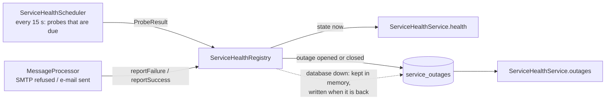
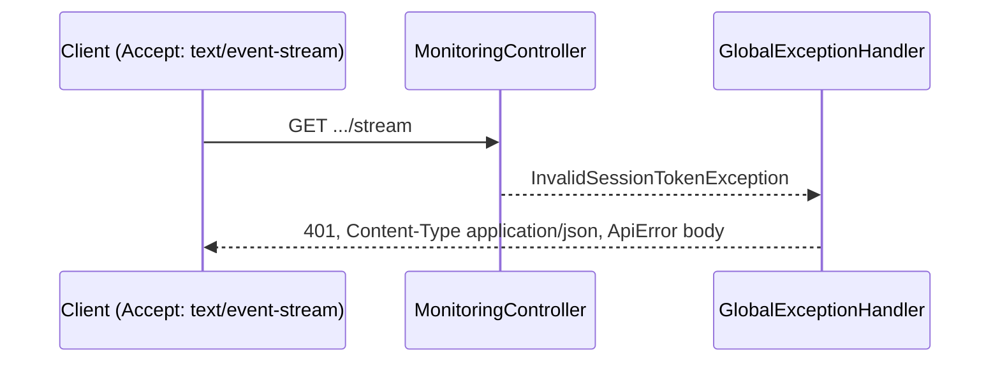

# Monitoring API (phase 2): service health and the live stream

Phase 2 of the monitoring dashboard (`23-monitoring-dashboard-requirements.md`, FR-3 and the real-time requirement). Phase 1
(`24-monitoring-api.md`) answers *what was sent*; this phase answers *are the services behind it up*, keeps the history of outages, and pushes
both to the viewer as they change. The Iris views are phase 3.

## What is new

| Piece | Where | Purpose |
|---|---|---|
| Probes (`PostgresProbe`, `MongoProbe`, `SmtpProbe`, `KafkaProbe`, `BackboneProbe`, `TelegramProbe`) | `monitoring/health` | One check per service. Each has its own interval and time limit. |
| `ServiceHealthScheduler` | `monitoring/health` | Runs the probes that are due, in parallel, each with a hard time limit. |
| `ServiceHealthRegistry` | `monitoring/health` | The state of each service now; opens and closes outages; takes failures reported by real traffic. |
| Table `mercury.service_outages` | `V2040__service_outages.sql` | One row per outage; `ended_at` is null while it lasts. |
| `ServiceHealthService` | `monitoring/health` | Read model: the state now and the outage history. |
| `MonitoringStreamService` | `monitoring/` | The Server-Sent Events feed. |
| `GET /monitoring/health`, `/health/outages`, `/applications/{id}/stream` | `MonitoringApi` | The three new endpoints. |

## How a service gets its state



| Service | Check | Interval |
|---|---|---|
| POSTGRESQL | a pooled connection is valid | 30 s |
| MONGODB | `ping` | 30 s |
| KAFKA | `describeCluster`; **NOT_CONFIGURED** when `UMDC_KAFKA_ENABLED=false` or the listeners are off (`UMDC_KAFKA_AUTO_STARTUP=false`, the local default) | 30 s |
| SMTP | opens a connection and signs in, sends nothing | **300 s**: a provider can block an account that signs in too often |
| BACKBONE | an HTTP GET answers; any code below 500 is UP (a 401 or 404 still proves it is reachable), a 5xx is DOWN | 30 s |
| TELEGRAM | `getMe`; **NOT_CONFIGURED** without a bot token | 30 s |

A check that answers slower than `slow-ms` (2 s) is **DEGRADED / SLOW**; one that does not answer in `timeout-seconds` (5 s) is **TIMEOUT**; a probe
that hangs past the hard limit (timeout + 5 s) is cut off and reported as TIMEOUT without holding back the other services.

### Real traffic beats the rare SMTP check

The SMTP probe runs every 5 minutes, but the e-mails go out every minute, so `MessageProcessor` tells the registry what really happened: a
`MailException` is `reportFailure("SMTP", cause)` and a sent e-mail is `reportSuccess("SMTP")`. The cause comes from the SMTP reply
(`HealthCause.fromSmtpFailure`): 535 → AUTH_REFUSED, 5.4.5 / quota → QUOTA_EXCEEDED, 421 / 454 / 4.7.0 → RATE_LIMITED, 534 / 5.7.9 →
SIGNIN_BLOCKED, timeout, connection. This closes the gap noted in phase 1: the retry causes now show in the health view. A clean probe does not clear
a failure seen in real traffic for `traffic-hold-minutes` (10), otherwise a quota problem (sign-in works, sending does not) would flip back to UP
five minutes later.

## States and causes

| Status | Meaning |
|---|---|
| UP | Answers and works. |
| DEGRADED | Answers but something is wrong (quota, rate limit, slow). An outage. |
| DOWN | Does not answer or refuses us. An outage. |
| NOT_CONFIGURED | Switched off or not set up in this environment. **Not** a failure and never an outage. |
| UNKNOWN | Not checked yet. |

The overall state is OUTAGE when any service is DOWN, else DEGRADED when any is DEGRADED, else UNKNOWN when nothing configured was checked yet,
otherwise OPERATIONAL (NOT_CONFIGURED services are ignored).

**Causes are a fixed list with a fixed sentence** (`HealthCause`): CONNECTION_FAILED, TIMEOUT, AUTH_REFUSED, SIGNIN_BLOCKED, HTTP_ERROR,
QUOTA_EXCEEDED, RATE_LIMITED, SLOW, CHECK_ERROR, NOT_CONFIGURED, LISTENERS_OFF. A raw exception message is never returned or stored: it can hold a
host, an address or part of a credential. A probe that throws is logged by class name only and reported as CHECK_ERROR.

## Outages

An outage opens when a service enters DEGRADED or DOWN and closes when it goes back to UP (or NOT_CONFIGURED). If the cause changes while it
lasts (a timeout becomes a quota problem) the first outage ends and a new one begins, so each row has one cause.

- Written in their own transaction, best effort. If PostgreSQL is the service that is down, the outage stays in memory and is written by the next
  scheduler tick once the database answers; `GET /health/outages` merges the database with what is still in memory.
- At start the outages still open in the database are restored, so a recovery closes the same row instead of leaving it open forever.
- Ended outages are deleted after `umdc.monitoring.retention-days` (90) by the same retention scheduler as the send events.

## Endpoints

All are `GET` under `/api/v1/monitoring`, with the same security as phase 1 (service Bearer with the read scope, plus a verified `session-token`;
401 when it is missing or invalid). Health is **platform-wide**: it says whether Mercury's services are up, not anything about an application's data.

| Path | Query | Returns |
|---|---|---|
| `/health` | | `overall` and, per service, `status`, `latencyMs` (null when not measured), `cause`, `causeText`, `since`, `lastCheckedAt`. |
| `/health/outages` | `range` (1h, 24h default, 7d, 30d) | The outages that overlap the range, newest first, with `durationSeconds` and `ongoing`. |
| `/applications/{applicationId}/stream` | `range` (default 24h) | The live feed (below). |

## The live feed (Server-Sent Events)

```mermaid
sequenceDiagram
    participant B as Iris BFF
    participant M as Mercury
    B->>M: GET /applications/{id}/stream?range=1h (Bearer + session-token)
    M-->>B: 200 text/event-stream
    M-->>B: event summary (the summary of the application) + event health (the services)
    loop every 10 s
        M-->>B: event summary + event health
    end
    Note over M,B: after 15 min the stream ends; the browser reconnects, which asks for the session again
```

- Two named events: `summary` (what `/summary` would answer for that application and range) and `health` (what `/health` answers). If the summary
  cannot be built the event carries `{"error":"SUMMARY_UNAVAILABLE"}` and the stream stays open. The events double as the heartbeat.
- The data is computed **once per application and range** for all its viewers, and every send runs on its own virtual thread, so a slow viewer cannot
  hold back the others. A viewer that left is dropped.
- Limits: `max-streams` (200) in total and `max-per-application` (20); beyond them the answer is **429**. An unknown range is a 400.
- A stream ends after `timeout-minutes` (15). `EventSource` reconnects by itself; the reconnect goes through the security again, so a session that
  expired stops receiving data.
- Browsers cannot set headers on `EventSource`, so the caller is the Iris BFF (which sends the Bearer and the `session-token`), not the browser.

## Configuration

| Property | Variable | Default | Meaning |
|---|---|---|---|
| `umdc.monitoring.health.interval-seconds` | `MONITORING_HEALTH_INTERVAL_SECONDS` | 30 | How often each service is checked. |
| `umdc.monitoring.health.smtp-interval-seconds` | `MONITORING_HEALTH_SMTP_INTERVAL_SECONDS` | 300 | SMTP signs in on every check. |
| `umdc.monitoring.health.timeout-seconds` | `MONITORING_HEALTH_TIMEOUT_SECONDS` | 5 | Time a check may take. |
| `umdc.monitoring.health.slow-ms` | `MONITORING_HEALTH_SLOW_MS` | 2000 | Slower than this is DEGRADED. |
| `umdc.monitoring.health.traffic-hold-minutes` | `MONITORING_HEALTH_TRAFFIC_HOLD_MINUTES` | 10 | A failure seen in traffic is not cleared by a clean check for this long. |
| `umdc.monitoring.health.backbone-path` | `MONITORING_HEALTH_BACKBONE_PATH` | `/actuator/health` | Path of Backbone that proves it answers (the base URL is `BACKBONE_BASE_URL`). |
| `umdc.monitoring.stream.interval-seconds` | `MONITORING_STREAM_INTERVAL_SECONDS` | 10 | Seconds between events. |
| `umdc.monitoring.stream.timeout-minutes` | `MONITORING_STREAM_TIMEOUT_MINUTES` | 15 | A stream ends after this long. |
| `umdc.monitoring.stream.max-streams` | `MONITORING_STREAM_MAX` | 200 | Open streams allowed. |
| `umdc.monitoring.stream.max-per-application` | `MONITORING_STREAM_MAX_PER_APPLICATION` | 20 | Open streams per application. |
| `umdc.scheduler.service-health.fixed-rate` / `.initial-delay` | `UMDC_SCHEDULER_SERVICE_HEALTH_RATE` / `_DELAY` | 15000 / 5000 | How often the scheduler looks for due checks (ms). |

## Limits of phase 2

- Kafka health is the cluster answering; **consumer lag** is not measured yet.
- The streams live in the memory of one Mercury instance: with several instances a viewer sees the instance its request reached (the state itself is
  the same in each, since every instance runs the probes).
- One stream endpoint per application and range; a viewer who changes range reconnects.
- Alerts, retries and export are phase 4; the Iris views are phase 3.

## Verification done

- Unit tests of every probe (the Backbone probe against a real local HTTP server: 200, 401, 404, 503, a slow reply and a closed port), the registry
  (lifecycle, cause split, traffic hold, restore at start, writes retried while the database is down), the scheduler (intervals, a throwing probe, a hanging
  probe cut at the limit), the health service and the stream service.
- The wire format of the feed was checked with the real `SseEmitter`: `text/event-stream` with named `summary` and `health` events carrying JSON.
- `V2040`, the outage lifecycle (open, split, close), the restore after a restart, the overlap query and the retention delete were run against a
  real PostgreSQL 17.
- `SecurityFilterChainsTest` pins the new paths on the managed-client chain (401 without Bearer, 200 with the read scope).

Classes: `monitoring/health/*`, `monitoring/MonitoringStreamService`, `api/v1/controller/MonitoringApi` and `MonitoringController`.

## Errors on the stream endpoint

The stream is requested with `Accept: text/event-stream`. An error raised before the stream starts (invalid or expired `session-token`, 403, 429) is
still answered as a JSON `ApiError` with its own status: `GlobalExceptionHandler` sets `Content-Type: application/json` on every error body, so
Spring does not have to negotiate it against the `text/event-stream` the endpoint produces (that negotiation failed with
`HttpMediaTypeNotAcceptableException` and produced an empty 500). A client must therefore read the status before treating the response as a stream.



Test: `GlobalExceptionHandlerEventStreamTest`.
