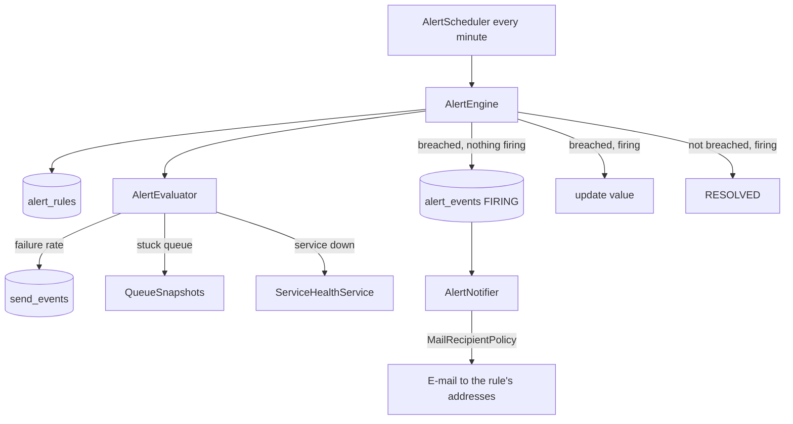
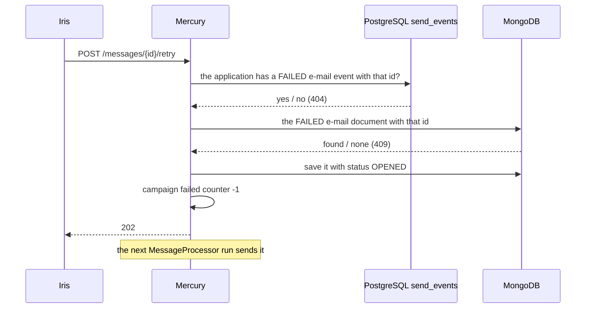

# Monitoring: alerts, retry and export (phase 4)

Phase 4 of the monitoring dashboard (`23-monitoring-dashboard-requirements.md`, FR-7 and FR-8). It adds three things to the monitoring API of phases
1 and 2 (`24-monitoring-api.md`, `25-monitoring-health-and-stream.md`): alert rules with notifications, a retry of failed e-mails and an export of the
message table. The Iris screens that use them are in the Iris repository (`docs/technical/monitoring.md`).

## Endpoints

Rooted at `/api/v1/monitoring/applications/{applicationId}`. Every call needs the managed client's Bearer and a verified `session-token` (401 otherwise).
Reads need `mercury:message:read`; **writes** (`POST`, `PUT`, `DELETE`) need `mercury:message:write`. The BFF of Iris must therefore ask for that scope.

| Method and path | What it does |
|---|---|
| `GET /alerts/rules` | The application's rules. |
| `POST /alerts/rules` | Creates a rule (201). At most 20 per application. |
| `PUT /alerts/rules/{ruleId}` | Replaces a rule's settings; 404 if it is not the application's. |
| `DELETE /alerts/rules/{ruleId}` | Deletes the rule and its alerts (204); 404 if it is not the application's. |
| `GET /alerts?range=` | The alerts that fire now plus those that started in the range, with the count that fire. |
| `POST /messages/{messageId}/retry` | Queues a failed e-mail again: 202, 404 or 409. |
| `GET /messages/export?format=csv\|json` | The message table as a file; same filters as `/messages`. |

## Alert rules

| Type | `threshold` | `windowMinutes` | Other | Fires when |
|---|---|---|---|---|
| `FAILURE_RATE` | percent, above 0 and at most 100 | 1 to 1440 | `minVolume`: least number of outcomes | failed / (sent + failed) over the window is **above** the threshold and there are at least `minVolume` outcomes |
| `QUEUE_STUCK` | number of messages | 1 to 1440 | | at least that many messages of the channels with a provider (e-mail, Telegram) have waited longer than the window |
| `SERVICE_DOWN` | unused | 1 to 1440 | `service`: `POSTGRES`, `MONGO`, `KAFKA`, `SMTP`, `BACKBONE` or `TELEGRAM`; empty is any | a service has been `DEGRADED` or `DOWN` for at least the window |

- `notifyEmails` (at most 5, validated) receive an e-mail when an alert **fires** (not when it resolves). The subject and text are fixed sentences with
  numbers and service names only. The e-mail goes through `MailRecipientPolicy`: with `honor-request=false` (QA) it goes to the test list, never to the
  real addresses. If no mail sender or sender address (`umdc.monitoring.alerts.from`, or `spring.mail.username`) exists, or SMTP fails, it is logged and
  nobody is notified; the alert still shows on the dashboard.
- One rule has at most one alert firing: the partial unique index `alert_events_one_firing_idx` stops a second instance raising it twice.
- SMS, WhatsApp and Push queues are never counted as stuck: they have no provider, so they would always fire.
- Resolved alerts are deleted after `umdc.monitoring.retention-days` (90).

## Retry

- Only **e-mail** can be retried: a failed e-mail stays in MongoDB with its recipients and body. Telegram has no message id in the record and the other
  channels never fail.
- The monitoring history is not rewritten: the first attempt stays as a `FAILED` outcome and the new attempt adds its own `SENT` or `FAILED`, so the
  summary counts attempts, not messages. The campaign counters, in contrast, are corrected (a retry takes the failure back).
- A second retry of the same message is a 409 while it is queued or after it was sent.

## Export

`format=csv` (default) or `json`; `Content-Disposition: attachment; filename="mercury-messages-<UTC date>.<format>"`. The rows are the newest first, at most
`umdc.monitoring.export.max-rows` (10 000); `X-Total-Count` says how many matched and `X-Export-Truncated` is `true` when the file was cut. The recipient
is the masked one. In the CSV a cell that starts with `=`, `+`, `-`, `@`, a tab or a carriage return gets a leading apostrophe so a spreadsheet does not run it.

## Configuration

| Property | Default | Meaning |
|---|---|---|
| `umdc.scheduler.alert-evaluation.fixed-rate` / `initial-delay` | 60 000 / 30 000 ms | How often the rules are evaluated. |
| `umdc.monitoring.alerts.max-emails` | 5 | Addresses per rule (hard limit 5). |
| `umdc.monitoring.alerts.from` | empty | Sender of the alert e-mails; empty uses `spring.mail.username`. |
| `umdc.monitoring.export.max-rows` | 10 000 | Most rows of an export. |

## Limits

- Alerts are evaluated by every instance; the unique index keeps them single, but an instance may evaluate a rule a few seconds after another.
- A rule is a snapshot of the last minute: a service that flaps between checks can open and resolve alerts repeatedly.
- The alert e-mail uses the same SMTP as the messages: if SMTP is what is down, the e-mail may not leave (the dashboard still shows it).
- Telegram messages cannot be retried from here.

## Verification done

- Unit tests of the rule validation, the evaluator (every rule type, boundaries, channels without provider), the engine (raise, keep, resolve, race,
  one failing rule), the notifier (QA policy, no sender, mail failure), the retry service, the export formatter (formula injection, quoting), the
  controller and its HTTP contract, and `SecurityFilterChainsTest` (a write needs the write scope).
- `V2041`, the partial unique index, the cascade on rule delete, the "recent alerts" query, the retention delete and the retry ownership lookup were run
  against a real PostgreSQL 17.

Classes: `monitoring/alerts/*`, `monitoring/MessageRetryService`, `monitoring/MessageExportFormatter`, `api/v1/service/MessageSearch`.
