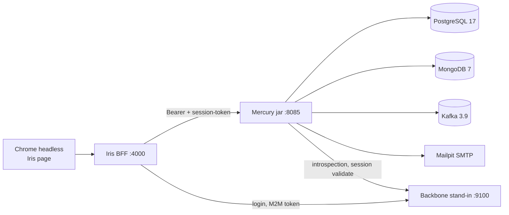

# Monitoring: end-to-end check

How the whole monitoring flow was verified against real services, and what it found. Repeat it after a change to the monitoring code, the security
chains or the Iris BFF: unit tests with mocks did **not** see the first two defects below.

## Setup

| Piece | How |
|---|---|
| PostgreSQL 17, MongoDB 7, Kafka (KRaft), Mailpit (`MP_SMTP_AUTH_ACCEPT_ANY=1`) | throwaway Docker containers on spare ports |
| Mercury | `mvn -DskipTests package`, then `java -jar target/mercury.jar` with environment variables only (no Vault, no config server, `SSL_ENABLED=false`, `EUREKA_CLIENT_ENABLED=false`, `UMDC_KAFKA_ENABLED=true`, `MAIL_PROTOCOL=smtp`, `SPRING_MONGODB_URI`, `MERCURY_DB_*`, `MONGO_*`, `BOOTSTRAP_SERVER_*`, a base64 `APP_TOKEN_SECRET`) |
| Database | schemas `mercury` and `general`; the tables of the entities created once with `SPRING_JPA_HIBERNATE_DDL_AUTO=create` (the schema before V2026 is not versioned), then `send_events`, `service_outages` and `alert_*` dropped and rebuilt from `V2039`-`V2041`, then `ddl-auto=none` |
| Backbone | a small stand-in that signs HS256 session JWTs with the same `APP_TOKEN_SECRET` (`iss=backbone-rest`, `aud=backbone-rest-client`, `type=session-token`) and answers the managed-client token, introspection, session validate and health calls |
| Iris | `node server.js` from a folder without `config/local.env` (it would read real settings), `COOKIE_SECURE=false`, `MERCURY_API_PREFIX=/api/v1`, scopes with `mercury:message:write` |
| Data | templates seeded in PostgreSQL and a `.ftl` file in `TEMPLATE_PATH`; one broken template (`${doesNotExist}`) to produce failures |

## What was checked

- Real sends through `POST /api/v1/mail`: Mongo, SMTP (Mailpit received them), `send_events` with masked recipients, failures with `SEND_FAILED`.
- Monitoring API directly (summary, series, failures, messages, export CSV and JSON headers, health, outages) and through the BFF, including the live SSE stream.
- Retry: 403 with the read scope only, 404 for another application, 202, then 409 while queued or after it was sent; the mail was sent again and the history shows the failure and the new success.
- Alerts: a failure-rate rule fired with its e-mail delivered to the mailbox and resolved when its threshold was raised; a service-down rule fired when SMTP and Kafka were stopped and resolved when they came back; outages were listed with their cause.
- Verification codes: generated and confirmed, counted by kind.
- The Iris page in headless Chrome: login, live connection, figures equal to Mercury's, channel/status/bar filters, CSV and JSON downloads, retry, creating and deleting a rule from the form, the red banner during the outage and its removal, no console errors.

## What it found

| Defect | Why unit tests missed it |
|---|---|
| Mercury did not start: the monitoring repositories were outside `@EnableJpaRepositories` | every test mocked the repositories |
| The Kafka probe was always DOWN: no `KafkaAdmin` bean exists | the probe was tested with a stub `ClusterPing` |
| Alert rules could not name PostgreSQL or MongoDB (`POSTGRES`/`MONGO` vs `POSTGRESQL`/`MONGODB`) | validator and probes were tested separately |
| A message without `sendDate` was never recorded, so no verification code was stored | the mapper was tested with a stub |

## Not covered

Telegram, real Backbone and Vault, a real SMTP provider (Gmail quota, 535), several Mercury instances, nginx in front of the stream, and a browser other than headless Chrome.
