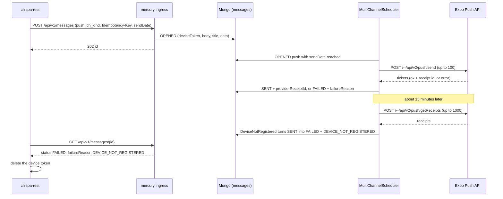
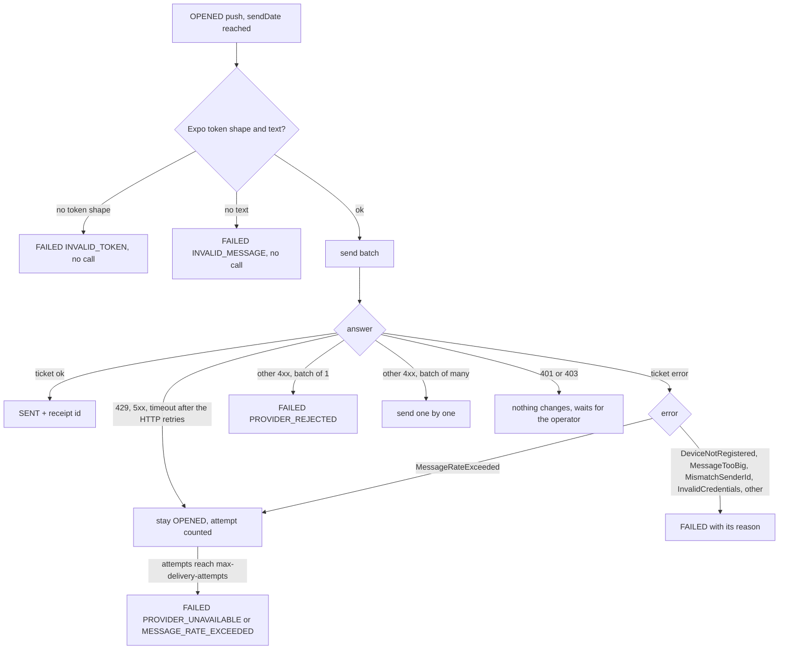

# 28 · Push delivery through Expo and the failure reason

Issue um-dev-creative/mercury#113 (phase F8 of the CHISPA migration to UMDC). Until now `PushChannelService` only stored the push message; nothing delivered it, and the
state of a message (`OPENED`, `SENT`, `FAILED`) had no reason, so a caller could not learn that a device token was dead. This chapter describes the delivery and the contract
change. The caller side is [14 · Unified message ingress](14-unified-message-ingress.md); the user view is [Push notifications](../../user-guide/en/push-notifications.md).

## Components

| Class | Package | Role |
|---|---|---|
| `ExpoPushClient` | `provider` | HTTP client of the Expo Push API (`send`, `getReceipts`): timeouts, bounded retries, reduces every answer to an `ExpoPushResult`. |
| `ExpoPushResult` | `provider` | Sealed result: `Tickets`, `Receipts`, `Rejected`, `Unauthorized`, `Unavailable`. Carries no token and no Expo error text. |
| `ExpoPushPayload` | `provider` | Builds the Expo message of a document; maps Expo error codes to `DeliveryFailureReason`; checks the token shape. |
| `ExpoPushDispatcher` | `provider` | Decides per message: `SENT`, `FAILED` with a reason, or still `OPENED` (transient). Reads receipts. The Telegram counterpart is `TelegramMessageDispatcher`. |
| `ExpoPushProperties` | `provider` | Settings at `umdc.mercury.push.expo.*` (off by default). |
| `MultiChannelMessageProcessor` | `processor` | `dispatchPush()` and `checkPushReceipts()`: select, call the dispatcher, persist, count in campaign metrics and monitoring. |
| `MultiChannelScheduler` | `scheduler` | Runs them: `umdc.scheduler.dispatch-push.fixed-rate` (30 s) and `umdc.scheduler.push-receipts.fixed-rate` (5 min). |
| `DeliveryFailureReason` | `constant` | The stable reason codes returned as `failureReason`. |

## Flow

## Decision per message

## Expo contract used (contrasted with docs.expo.dev/push-notifications/sending-notifications, 2026-11-25)

* `POST https://exp.host/--/api/v2/push/send`, JSON body = array of at most **100** messages; fields sent: `to`, `title` (if any), `body`, `data` (if any, the whole payload must stay under 4096 bytes), `sound` (`default` unless given), `badge` (if given), `priority` (`default`, `normal` or `high`), `channelId` (Android, `umdc.mercury.push.expo.android-channel-id`).
* Headers: `Content-Type` and `Accept: application/json`; `Authorization: Bearer <token>` only when `access-token` is set (needed only with enhanced push security). The `Accept-Encoding: gzip, deflate` that the docs list is **not** sent, so answers arrive uncompressed (the JDK client does not decompress).
* Answer HTTP 200: `data` = one ticket per message, in order: `{status: ok, id}` or `{status: error, message, details: {error}}`. `ok` only means Expo accepted it. A count that differs from the batch is treated as transient, never matched by guess.
* `POST /--/api/v2/push/getReceipts` with `{ids}` (at most **1000**); `data` maps receipt id to receipt; ids with no receipt are absent; receipts live 24 hours (after that mercury stops asking: `receiptCheckedAt`).
* Errors: `DeviceNotRegistered` (dead token), `MessageTooBig`, `MessageRateExceeded` (transient), `MismatchSenderId`, `InvalidCredentials`; request level `errors[].code` (`PUSH_TOO_MANY_EXPERIENCE_IDS`, `PUSH_TOO_MANY_NOTIFICATIONS`, `TOO_MANY_REQUESTS`, `UNAUTHORIZED`); HTTP 400 is not retried, 429 and 5xx are.
* The token shape check (`ExponentPushToken[...]` or `ExpoPushToken[...]`) is mercury's own guard, the format Expo's SDKs use; it is not stated on the page above.

## Failure reason (contract change)

`MailStatusResponse` (answer of `GET /api/v1/messages/{id}`, also of `GET /api/v1/mail/{id}`) gains the nullable `failureReason`. It is filled only while `status` is `FAILED` and the
message document carries one. Existing fields and the four-argument constructor are unchanged, so current callers keep working. The value lives in the Mongo message document
(`MessageDocument.failureReason`), which has no schema, so there is **no Flyway migration**; the monitoring row (`mercury.send_events.error_cause`, `varchar(60)`) receives the same code.

| Code | Meaning | What the caller does |
|---|---|---|
| `DEVICE_NOT_REGISTERED` | Expo/Google/Apple say the device cannot receive notifications | delete the token |
| `INVALID_TOKEN` | the target is not an Expo push token; nothing was sent | delete the token |
| `INVALID_MESSAGE` | no text | fix the template or body |
| `MESSAGE_TOO_BIG` | payload over 4096 bytes | shrink `data` |
| `MESSAGE_RATE_EXCEEDED` | still too many messages to the device after the attempts | none; do not insist |
| `MISMATCH_SENDER_ID`, `INVALID_CREDENTIALS` | Expo project credentials | operator |
| `PROVIDER_REJECTED`, `PROVIDER_UNAVAILABLE`, `PROVIDER_ERROR` | Expo refused, was unreachable, or answered something unknown | retry later with a new message |

## Document fields (Mongo, `messages` collection)

`MessageDocument.failureReason`; `PushNotificationMessageDocument.data`, `providerReceiptId`, `sentAt`, `deliveryAttempts`, `receiptCheckedAt`. The receipt query
(`MessageNSRepository.findPushAwaitingReceipt`) selects `channelType PUSH`, `deliveryStatus SENT`, a receipt id and no `receiptCheckedAt`.

## Configuration (`umdc.mercury.push.expo.*`, environment variable in brackets)

| Key | Default | Meaning |
|---|---|---|
| `enabled` (`PUSH_EXPO_ENABLED`) | `false` | off: push messages stay `OPENED` |
| `api-base-url` (`PUSH_EXPO_API_BASE_URL`) | `https://exp.host` | |
| `access-token` (`PUSH_EXPO_ACCESS_TOKEN`) | empty | Vault-owned; only with enhanced push security |
| `connect-timeout`, `read-timeout` | 3 s, 10 s | per HTTP request |
| `max-attempts` | 3 (1 to 5) | HTTP tries per request on 429, 5xx, network error |
| `retry-backoff` | 500 ms | before the second try, doubles |
| `max-delivery-attempts` | 5 | scheduler runs before a transient failure is `FAILED` |
| `receipt-delay` | 15 min | Expo advises about 15 minutes |
| `android-channel-id` | `default` | |

## Templates

`ch_<kind>_<es|en>.ftl` for `invitation`, `challenge`, `surprise`, `plan`, `date_confirmed`, `memory`, `reward`: the generic, parameter-less copy of CHISPA's `push-policy.ts`
(`PUSH_COPY`; a lock screen is public). Reference copies are in `src/test/resources/templates` (they must be in the template storage); `scripts/chispa/seed-templates.sql`
registers them for the CHISPA application with the subject `CHISPA` (the title), and `scripts/templates/seed-template-types.sql` gains the type `PUSH_NOTIFICATION`
(`TemplateTypesScriptTest` guards the mapping). chispa-rest names them: `template = ch_<kind>`, `language`, `applicationId`.

## Limits and known gaps

* Verified only with a fake Expo server (JDK `HttpServer`); **never against the real Expo API or a physical phone**.
* Like Telegram, the dispatch assumes one mercury instance per scheduler; two instances could both pick the same `OPENED` message (idempotency is on the ingress, not on the delivery).
* A `SENT` push that later fails on its receipt is counted once as sent in the campaign metrics (the monitoring does get the `FAILED` event).
* Non-email documents are still not archived or purged (a gap that already existed).
