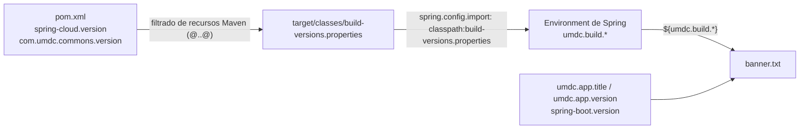

# 08 · Banner de arranque

🌐 [Read this in English](../en/08-startup-banner.md)

El banner (`src/main/resources/banner.txt`) imprime las versiones de la aplicación, Spring Boot, Spring Cloud y las librerías UMDC. Replica el de backbone-rest.

## De dónde sale cada versión

| Marcador | Origen |
|---|---|
| `${umdc.app.title}`, `${umdc.app.version}`, `${spring-boot.version}` | Propiedades existentes de la aplicación y de Spring Boot |
| `${umdc.build.spring-cloud-version}` | `spring-cloud.version` del `pom.xml`, vía `build-versions.properties` |
| `${umdc.build.umdc-libs-version}` | `com.umdc.commons.version` del `pom.xml`, vía `build-versions.properties` |

## Decisiones de diseño

- **Solo se filtra `build-versions.properties`.** El `pom.xml` declara dos bloques `<resource>` sobre `src/main/resources`: uno excluye ese archivo y el otro filtra solo ese archivo. Filtrar toda la carpeta dañaría otros archivos con `@` o `${...}` (`application.yml`, plantillas FreeMarker).
- **El archivo no contiene secretos** y no se le debe añadir nada más.
- **`spring.config.import` lo carga primero** (`classpath:build-versions.properties,optional:vault://,optional:configserver:`), así las propiedades existen al imprimir el banner. Vault y Config Server siguen siendo opcionales.
- `umdc.build.umdc-libs-version` sigue a `com.umdc.commons.version`; las demás librerías UMDC tienen su propia propiedad y hoy comparten el mismo valor. Si divergen, el banner muestra la de `commons`.

## Pruebas

`BannerVersionsTest` (`src/test/java/com/umdc/mercury/config`):

- el archivo filtrado tiene versiones no vacías y sin `@`;
- el banner imprime ambas versiones y `application.yml` importa el archivo.

## Cómo cambiarlo

Edita `banner.txt` solo para el diseño. Una versión nueva en el banner necesita una propiedad en `build-versions.properties` (filtrada desde el `pom.xml`) y una línea en la prueba.
