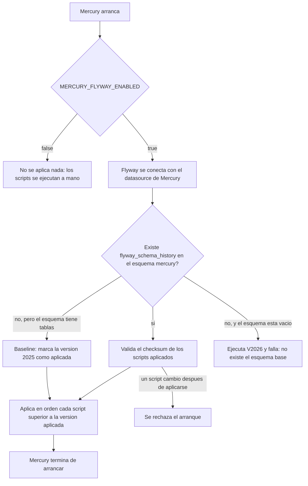

# 🗃️ 09 · Migraciones con Flyway

🌐 [Read this in English](../en/09-flyway-migrations.md) · ⬅️ [Volver al índice](README.md)

> Mercury aplica solo los scripts SQL de `src/main/resources/db/migration` al arrancar. Antes de Flyway se ejecutaban a mano contra el esquema `mercury`, y Hibernate nunca modifica el esquema (`ddl-auto: none`).

## Qué se ejecuta y cuándo

## Configuración

Todo está en `spring.flyway` de `application.yml`; solo la primera es variable de entorno.

| Propiedad | Valor | Para qué |
|---|---|---|
| `enabled` | `${MERCURY_FLYWAY_ENABLED:true}` | `false` vuelve a aplicar los scripts a mano. |
| `locations` | `classpath:db/migration` | La carpeta de los scripts, dentro del jar. |
| `schemas` / `default-schema` | `mercury` | Dónde se crean las tablas y dónde vive `flyway_schema_history`. |
| `baseline-on-migrate` | `true` | Una base que ya tiene tablas se marca en `baseline-version` en lugar de rechazarse. |
| `baseline-version` | `2025` | El esquema anterior a Flyway (V2025 y anteriores) nunca se versionó. Se aplican los scripts desde V2026. |
| `validate-on-migrate` | `true` | Editar un script ya aplicado detiene el arranque en vez de dejar que las bases diverjan. |
| `out-of-order` | `false` | Un script con versión menor que la aplicada es un error, no se omite en silencio. |

## Primer arranque sobre una base existente

El primer arranque no encuentra `flyway_schema_history`, hace baseline en 2025 y **vuelve a ejecutar V2026 a V2032**, aunque se hubieran aplicado a mano. Es seguro porque todas las sentencias son idempotentes (`ADD COLUMN IF NOT EXISTS`, `CREATE TABLE IF NOT EXISTS`, `CREATE INDEX IF NOT EXISTS`); `FlywayMigrationsTest` falla si un script añade una que no lo sea.

Un esquema **vacío** no se marca con baseline. El esquema base (todo hasta V2025) debe existir antes de arrancar Mercury.

## Añadir una migración

1. Crea `V<siguiente número>__<snake_case>.sql` en `src/main/resources/db/migration`. El número es el más alto más uno.
2. Usa `IF NOT EXISTS` / `IF EXISTS` para que pueda repetirse.
3. Nunca edites un script ya publicado: su checksum queda guardado y se rechaza el arranque. Corrígelo con un script nuevo.
4. Anótalo en el `CHANGELOG`.

`FlywayMigrationsTest` comprueba el nombre, la versión única, que esté por encima del baseline y que el script sea idempotente.

## Requisitos y límites

- El usuario de base de datos de Mercury necesita permiso para crear y alterar tablas en `mercury` y para crear `flyway_schema_history`. Si el usuario de producción solo lee y escribe, ejecuta los scripts con un administrador y pon `MERCURY_FLYWAY_ENABLED=false` allí.
- Si varias instancias arrancan a la vez, Flyway toma un bloqueo en la base y solo una aplica los scripts.
- Sin verificar: un arranque contra un PostgreSQL real y la imagen nativa de GraalVM (`Dockerfile.native`) con los recursos de Flyway.

## Archivos

| Archivo | Función |
|---|---|
| `pom.xml` | `spring-boot-starter-flyway` y `flyway-database-postgresql` (versiones gestionadas por Spring Boot). |
| `src/main/resources/application.yml` | El bloque `spring.flyway`. |
| `src/main/resources/db/migration/` | Los scripts. |
| `src/test/java/com/umdc/mercury/migration/FlywayMigrationsTest.java` | Protege nombres, versiones, idempotencia y configuración. |
