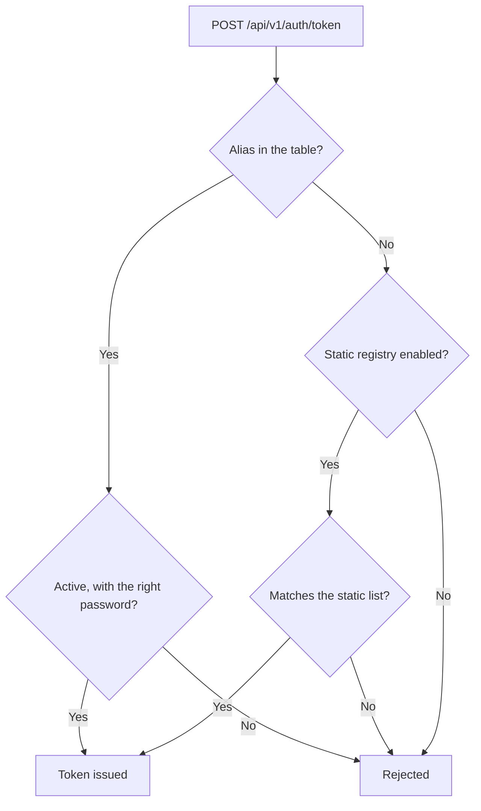

# User guide: login clients

🌐 [Leer esto en Español](../es/clientes-de-login.md)

A login client is a backend service allowed to request a token with `POST /api/v1/auth/token`. Mercury stores them in the `mercury.login_clients` table, with the password hashed with bcrypt.

Administering them needs the `LOGIN_CLIENT_MANAGE` permission in the application set by `LOGIN_CLIENTS_ADMIN_APPLICATION_ID`. While that variable is empty, nobody can administer them.

## Operations

| Action | Call |
|---|---|
| List | `GET /api/v1/login-clients` |
| Register | `POST /api/v1/login-clients` |
| Switch on or off, or describe | `PUT /api/v1/login-clients/{id}` |
| Rotate the password | `PUT /api/v1/login-clients/{id}/password` |
| Delete | `DELETE /api/v1/login-clients/{id}` |

All of them need the `session-token` header.

```json
{ "alias": "zerobound-rest", "description": "ZeroBound backend" }
```

Without a `password`, Mercury generates one and **shows it only in that response**. If you send one, it must have 12 to 72 printable ASCII characters, without spaces.

## How a login is checked



## Rollout

1. Apply `V2031__login_clients.sql`. Until the table exists, only the static list works.
2. Register each service with the API or with `scripts/login-clients/add-login-client.sh`.
3. Once all of them are in the table, set `LOGIN_REGISTRY_PROPERTIES_ENABLED=false`.
