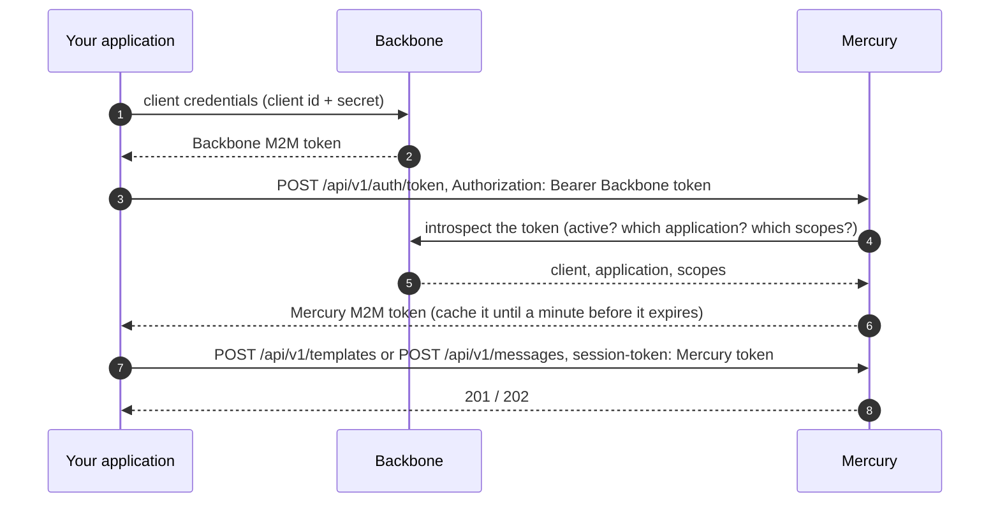

# Applications: manage templates and send messages with Mercury's M2M token

An application never has a password in Mercury. It proves who it is with the **Backbone M2M token** of its managed client, and Mercury gives it a **Mercury M2M token** in return. With that token the application manages its own templates (create, edit, delete) and sends messages. People who administer templates from Iris are a different thing and nothing changes for them.

## What you need

1. A **managed client in Backbone** for your application (it belongs to exactly one application) with the scopes `mercury:message:write` (change things and send) and, to only look, `mercury:message:read`. If the service must work on two applications, create one managed client per application.
2. Nothing else: no Mercury alias or password.

## The flow

## Calls

| What | Call | Scope |
|---|---|---|
| Get the Mercury token | `POST /api/v1/auth/token` with `Authorization: Bearer <Backbone token>` (no body) | `mercury:message:read` or `write` |
| Create a template | `POST /api/v1/templates` with `session-token: <Mercury token>` | `write` |
| Edit it / its content | `PUT /api/v1/templates/{id}`, `PUT /api/v1/templates/{id}/content` | `write` |
| Delete it | `DELETE /api/v1/templates/{id}` | `write` |
| Look at them | `GET /api/v1/templates`, `GET /api/v1/templates/{id}` | `read` or `write` |
| Send a message | `POST /api/v1/messages` with `session-token` | `write` |

The Mercury token is only valid for **your own application**: a template or a message of another application is refused with `403`. `applicationId` can be left out of a request: Mercury uses yours. If you send one, it must be yours.

## Errors

| Status | Meaning |
|---|---|
| 401 on `/auth/token` | The Backbone token is missing, expired or revoked. |
| 403 on `/auth/token` | The client has no `mercury:*` scope, or Backbone does not tie it to an application (an old backbone-rest). |
| 401 on the other calls | The `session-token` is not a Mercury M2M token (an old alias/password token is refused too). |
| 403 on the other calls | The token lacks the `write` scope for that call, or the request is about another application. |

## What changed

The alias and password login (`login clients`) and its administration API are gone. A service that still sends `{ "alias": ..., "password": ... }` to `/api/v1/auth/token` now gets `401`: change it to send its Backbone token as `Authorization: Bearer`.
