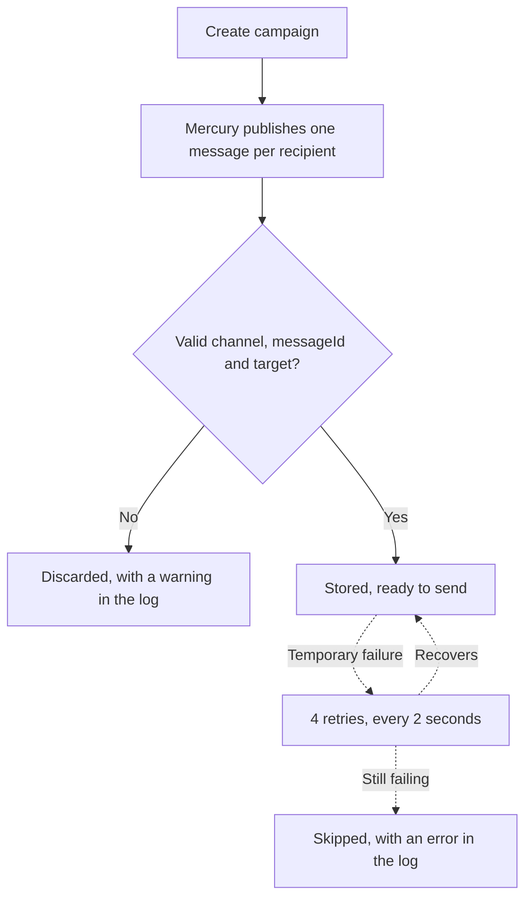

# User guide: sending by SMS, Telegram, WhatsApp and Push

🌐 [Leer esto en Español](../es/canales-de-mensajeria.md)

This guide explains how to ask Mercury to send a campaign by SMS, Telegram, WhatsApp or Push, and what to expect afterwards. Technical detail is in the [configuration guide](../../tec/en/06-environment-configuration.md).

> **Current status:** Mercury validates and stores these messages, but does not deliver them yet. Telegram campaigns are delivered when `TELEGRAM_BOT_TOKEN` is set. SMS, WhatsApp and Push do not call a real provider yet. Direct Telegram alerts do deliver: see [Telegram alerts](telegram.md).

## Create a campaign

The call is the same for every channel: `POST /api/v1/campaigns`, in the format described in [create-campaign.md](../../create-campaign.md). Only `channelTypeCode`, the format of `identifier` and the values of `templateParams` change.

```json
{
  "name": "July notice",
  "channelTypeCode": "whatsapp",
  "templateId": "00000000-0000-0000-0000-000000000001",
  "userId": "00000000-0000-0000-0000-000000000002",
  "recipients": [
    { "identifier": "+34600111222", "name": "Ana" }
  ],
  "templateParams": {
    "message": "Your order has shipped",
    "media_url": "https://example.com/order.png",
    "media_type": "IMAGE"
  },
  "status": "ACTIVE",
  "applicationId": "00000000-0000-0000-0000-000000000003"
}
```

## What to put in `identifier`

| Channel | `channelTypeCode` | `identifier` format | Example |
|---|---|---|---|
| SMS | `sms` | E.164 phone: `+`, country code and number | `+34600111222` |
| WhatsApp | `whatsapp` | E.164 phone | `+34600111222` |
| Telegram | `telegram` | Numeric `chatId`, up to 18 digits; may be negative | `-100123456789` |
| Push | `push` | Device token, not blank | `dA3f...` |

> ⚠️ Creating the campaign does not check these formats. A recipient in the wrong format is discarded later: the API answers with success, but that message is not stored and the campaign metrics do not show it.

## `templateParams` parameters

All of them are optional.

| Channel | Parameter | Use |
|---|---|---|
| All | `message` | Message text |
| All | `template_name`, `template_language` | Template name and language |
| All | `media_url`, `media_type` | Attachment. `media_type` takes `IMAGE`, `VIDEO` or `NONE` (default) |
| SMS | `senderId` | Displayed sender |
| Telegram | `parseMode` | Text format, for example `HTML` |
| WhatsApp | `message_type` | Message type; defaults to `text` |
| Push | `platform` | Platform; defaults to `web` |
| Push | `title`, `icon`, `click_action`, `sound` | Notification presentation |
| Push | `priority`, `badge` | Priority (defaults to `normal`) and badge number |

## What happens to a message



## FAQ

**Has anything changed for API users?**
No. The call and the response are the same. Internally, the four channels now share a single Kafka topic.

**What about email?**
It works as before, on its own topic.

**My campaign was created but a message is missing. Why?**
Check the `identifier` format in the table above. The most common case is a phone number without `+`. Discards show up in the Mercury log as `Invalid target identifier`; the log leaves out the recipient, because it is personal data.

**Do you publish directly to Kafka?**
Use the format in [topic-general-message.md](../../topic-general-message.md). `messageId` is required and must be unique per message: two messages with the same value are treated as the same one.
