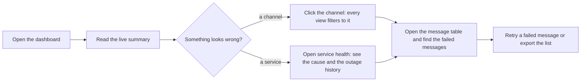
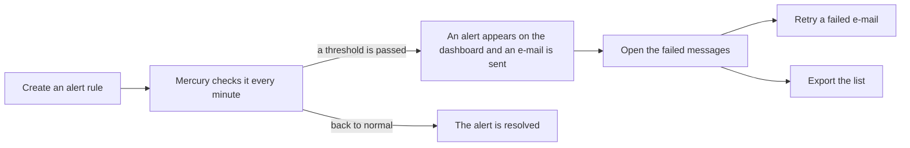

# Monitoring dashboard

> **Status: in progress.** Phases 1 and 2 (the data behind the dashboard, the state of the services and the live feed) are delivered in Mercury: it
> records every delivery outcome, watches its services and answers the monitoring questions through its API. You will not see it on screen until the Iris views of phase 3 are built. Requirements and scope:
> `docs/tec/en/23-monitoring-dashboard-requirements.md`; how phase 1 works: `docs/tec/en/24-monitoring-api.md`; phase 2: `docs/tec/en/25-monitoring-health-and-stream.md`.

## Where you will find it

In **Iris**, on the home page (the dashboard you already see after logging in) and in a new Monitoring section. What you see today (campaign
totals, delivery rate, failed and pending messages, the state of Mercury and Backbone, and the latest campaigns) stays; the items below are
added to it. You see **every communication that goes through Mercury**, whoever sent it (ZeroBound, Iris, any other application), and you can narrow the view to one application.

## What it is for

See, as it happens, whether your e-mails, SMS, Telegram, WhatsApp and Push messages and your verification codes are being sent, and know
quickly when a service fails or goes down.

## What you will be able to do

| You want to | You will use | Phase |
|---|---|---|
| Know how many messages went out, failed or are waiting | Summary cards and the success-rate ring | 1 |
| See the trend of the last hour, day, week or month | Time-series charts with a range selector | 1 |
| Find why messages fail and which are stuck | Failures view (top causes, old queued messages) | 1 |
| Follow verification codes | Codes view: generated, sent, confirmed, expired, failed | 1 |
| Find one message | Message table with filters (channel, status, application, template, date) | 1 |
| Know whether SMTP, Kafka, the databases, Backbone or Telegram are up | Service health with history and cause | 2 |
| See it update by itself | Live updates (no need to reload the page) | 2 |
| Use the charts and filters together | Interactive, linked views | 3 |
| Be warned, retry or export | Alerts, retry button, CSV/JSON export | 4 |

## Things to know

- **Linked views:** clicking a channel, a bar or a service filters everything else on the screen. Click it again to clear the filter.
- **Channels without a provider:** SMS, WhatsApp and Push messages are shown as **"queued, no provider"**, not as delivered, because no
  provider is connected yet.
- **Privacy:** recipients appear masked, and message bodies and verification codes are never shown.
- **Stale data:** if the live connection drops the dashboard shows a warning and keeps refreshing by itself.
- **Permissions:** viewing needs a dedicated monitoring permission. Messages of every application are shown, with the recipient masked.

## What phase 1 already keeps

From the day phase 1 is deployed, Mercury keeps one record per delivery outcome (sent or failed) of e-mail and Telegram, including
verification codes, for 90 days. It starts empty: there is no history before that day. The recipient is stored masked (`j***@e***.com`), and
neither message bodies nor verification codes are kept.

- **E-mail and Telegram** report sent and failed. **SMS, WhatsApp and Push** have no provider yet, so they only ever show as **queued**.
- A failed message shows a coarse cause today (`SEND_FAILED` for e-mail, `DELIVERY_FAILED` for Telegram). A temporary SMTP problem is not a
  failure yet: the message stays queued and is retried, so it is not counted until it is sent or fails. The detailed causes come with the
  service-health view (phase 2).
- A message waiting longer than 15 minutes is reported as **stuck**.

## What phase 2 adds: are the services up?

Mercury now checks its own services (PostgreSQL, MongoDB, Kafka, the e-mail server, Backbone and Telegram) and keeps the history of their outages.

| State | What it means for you |
|---|---|
| **UP** | It works. |
| **DEGRADED** | It answers but something is wrong: a sending limit, a rate limit or a slow reply. Messages may be late. |
| **DOWN** | It does not answer or refuses us. Messages that need it wait. |
| **NOT CONFIGURED** | It is switched off in this environment (for example Kafka locally, or Telegram without a bot). It is **not** a failure. |
| **UNKNOWN** | Mercury has just started and has not checked it yet. |

- Each service shows how fast it answers, since when it has been in that state, and **why** in a fixed sentence, for example "The sending limit of
  the account was exceeded". Passwords, addresses and raw error texts are never shown.
- The e-mail server is also judged by the e-mails that really go out: if the provider refuses one, the state changes within a minute without waiting
  for the next check.
- The **history of outages** lists each one with when it began, when it ended (or "ongoing") and how long it lasted. It comes in pages (Iris shows
  10 at a time), so it stays quick however long Mercury has been running. You can **search** it (a service, a cause such as "quota", or words of
  the description), keep one **service** or one **state** (down or degraded), and choose the **period**: the one of the page, the last 24 hours,
  7, 30 or 90 days (everything Mercury keeps), or your own dates (UTC).
- The **live feed** sends the summary and the service states every 10 seconds, so the dashboard updates by itself. It reconnects on its own about every
  15 minutes; if your session expired it stops receiving data until you sign in again.

## What phase 4 adds: be warned, retry, export

- **Alerts.** You choose what to watch and how much is too much:
  - **Failure rate:** more than X % of the messages failed in the last N minutes (with a minimum number of messages, so two failures out of three do not
    ring the bell at night).
  - **Stuck messages:** at least X messages have been waiting longer than N minutes.
  - **Service down:** a service (or any) has been degraded or down for N minutes.
  An alert stays **firing** while the problem lasts, appears once (no repeats) and is **resolved** by itself. You can ask for an e-mail to up to 5
  addresses when it fires. In a test environment those e-mails go to the test list, not to the real addresses. The history of alerts is kept for 90 days.
- **Retry.** A failed **e-mail** can be sent again with one click; the next run of Mercury sends it. The first failed attempt stays in the history and the
  new attempt is added, so the figures count attempts. Telegram messages cannot be retried from the dashboard.
- **Export.** The message table (with the filters you chose) can be downloaded as CSV or JSON, up to 10 000 rows; the file tells you if it was cut.
  Recipients stay masked.
- Creating or deleting rules and retrying need the write permission of the application; viewing needs only the read permission.

## If the live view says your session expired

When the session token is no longer valid, the live stream is answered with a clear **401** (not an empty server error). Sign in again; the
dashboard falls back to refreshing every few seconds in the meantime.
