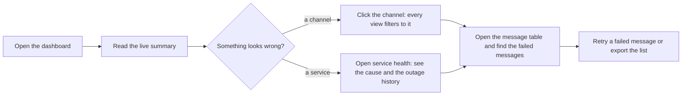

# Monitoring dashboard (planned)

> **Status: planned.** This guide describes what the monitoring dashboard will offer once it is built, phase by phase. Until a phase is
> delivered, the matching section is not available. The requirements and scope are in `docs/tec/en/23-monitoring-dashboard-requirements.md`.

## Where you will find it

In **Iris**, on the home page (the dashboard you already see after logging in) and in a new Monitoring section. What you see today (campaign
totals, delivery rate, failed and pending messages, the state of Mercury and Backbone, and the latest campaigns) stays; the items below are
added to it. You see the data of your own application.

## What it is for

See, as it happens, whether your e-mails, SMS, Telegram, WhatsApp and Push messages and your verification codes are being sent, and know
quickly when a service fails or goes down.

## What you will be able to do

| You want to | You will use | Phase |
|---|---|---|
| Know how many messages went out, failed or are waiting | Summary cards and the success-rate ring | 1 |
| See the trend of the last hour, day, week or month | Time-series charts with a range selector | 1 |
| Find why messages fail and which are stuck | Failures view (top causes, old queued messages) | 1 |
| Follow verification codes | Codes view: generated, sent, confirmed, expired, failed | 1 |
| Find one message | Message table with filters (channel, status, application, template, date) | 1 |
| Know whether SMTP, Kafka, the databases, Backbone or Telegram are up | Service health with history and cause | 2 |
| See it update by itself | Live updates (no need to reload the page) | 2 |
| Use the charts and filters together | Interactive, linked views | 3 |
| Be warned, retry or export | Alerts, retry button, CSV/JSON export | 4 |

## Things to know

- **Linked views:** clicking a channel, a bar or a service filters everything else on the screen. Click it again to clear the filter.
- **Channels without a provider:** SMS, WhatsApp and Push messages are shown as **"queued, no provider"**, not as delivered, because no
  provider is connected yet.
- **Privacy:** recipients appear masked, and message bodies and verification codes are never shown.
- **Stale data:** if the live connection drops the dashboard shows a warning and keeps refreshing by itself.
- **Permissions:** viewing needs a dedicated monitoring permission. An application sees only its own data.
