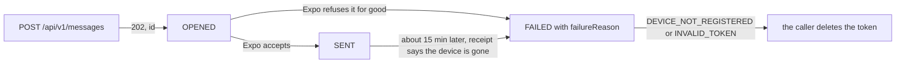

# User guide: push notifications through Expo

Mercury delivers push notifications to phones that run an Expo app (for example CHISPA). A backend service (the caller) asks mercury to send the notification; mercury sends it to
Expo, and tells the caller afterwards if the phone's token stopped being valid, so the caller can delete it. Technical detail: [chapter 28](../../tec/en/28-push-expo-dispatch.md).

> **Status:** tested against a simulated Expo server only. It has not been run against the real Expo service or a physical phone.

## Switch it on

Push delivery is **off** until `PUSH_EXPO_ENABLED=true`. While it is off, push messages are accepted and stay `OPENED`; they are sent when it is switched on. An Expo access
token (`PUSH_EXPO_ACCESS_TOKEN`) is needed only if "enhanced push security" is enabled in the Expo project; keep it in Vault, never in a file.

## Send a push

`POST /api/v1/messages` with `channel: push`, the **Expo push token** of the device as `target` (`ExponentPushToken[...]`), the template by name and language, and optionally:

| Field | Use |
|---|---|
| `template`, `language`, `applicationId` | for CHISPA, `ch_invitation`, `ch_challenge`, `ch_surprise`, `ch_plan`, `ch_date_confirmed`, `ch_memory` or `ch_reward`, in `es` or `en` |
| `sendDate` | do not send before this instant (UTC); mercury waits, e.g. for quiet hours |
| `subject` or `options.title` | the notification title; if neither, the template's subject (`CHISPA`) |
| `options.data` | small JSON object (ids only) delivered to the app, e.g. where to open |
| `options.priority`, `options.badge`, `options.sound` | `default`/`normal`/`high`, badge number, sound (default `default`) |
| `Idempotency-Key` header | makes a retry safe |

## Follow it and react to a dead token

`GET /api/v1/messages/{id}` answers `{id, status, createdAt, updatedAt, failureReason}`. `failureReason` is empty unless `status` is `FAILED`. Check the status again some
minutes after a push shows `SENT`: Expo only reports a dead token in the receipt. When `failureReason` is `DEVICE_NOT_REGISTERED` or `INVALID_TOKEN`, delete that device token and do not send to it again.

| `failureReason` | Meaning |
|---|---|
| `DEVICE_NOT_REGISTERED`, `INVALID_TOKEN` | the token is dead or not an Expo token: delete it |
| `INVALID_MESSAGE` | the message had no text |
| `MESSAGE_TOO_BIG` | `options.data` is too large (4096 bytes in all) |
| `MESSAGE_RATE_EXCEEDED` | too many messages to that device |
| `MISMATCH_SENDER_ID`, `INVALID_CREDENTIALS` | the Expo project credentials need fixing (operator) |
| `PROVIDER_REJECTED`, `PROVIDER_UNAVAILABLE`, `PROVIDER_ERROR` | Expo refused, was unreachable for several attempts, or answered something unknown |

A message that fails for a temporary reason (Expo down, busy) stays `OPENED` and is retried by the next runs (30 s apart, five runs by default) before it is `FAILED`.

## Registering the CHISPA templates

An operator runs `scripts/templates/seed-template-types.sql` (adds the `PUSH_NOTIFICATION` type) and then `scripts/chispa/seed-templates.sql` for the CHISPA application (see the header of
each script for the ids it needs). The 14 `ch_*` files must be in the template storage. The texts are generic on purpose, because a lock screen is public.
