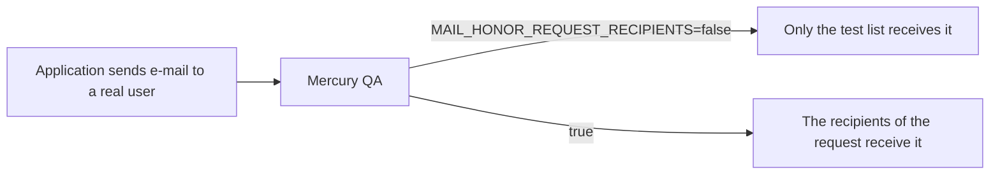

# Sending QA e-mails only to a test list

In QA you can make Mercury deliver every e-mail to a fixed list of addresses, whatever the application asked for.

Set these variables in the environment (Vault / Config Server for QA):

| Variable | Example | Effect |
|---|---|---|
| `MAIL_DEFAULT_RECIPIENTS` | `qa1@example.com,qa2@example.com` | The test list (comma separated). |
| `MAIL_HONOR_REQUEST_RECIPIENTS` | `false` | `false`: ignore the recipients sent by the application and use the test list. `true` (default): use the recipients sent by the application. |

- With `false`, copies (cc) are not sent either.
- With `true` the list is used only when a message names no recipient.
- If you set `false` and leave the list empty, or write an invalid address, Mercury does not start and the log says which setting to fix.
- The override only starts in the `qa` and `dev` profiles (`SPRING_BOOT_PROFILE_ACTIVE`). In `prd`, `prod`, `production` or any other profile Mercury refuses to start with `MAIL_HONOR_REQUEST_RECIPIENTS=false`, so it cannot be turned on in production by mistake. `MAIL_RECIPIENT_OVERRIDE_PROFILES` (default `qa,dev`) changes which non-production profiles may use it; it can never include a production one.
- Leave both unset in production.
- The verification code is still stored for the user the application sent; only the mailbox that receives the message changes, so the person on
  the list reads the code and types it in QA.
