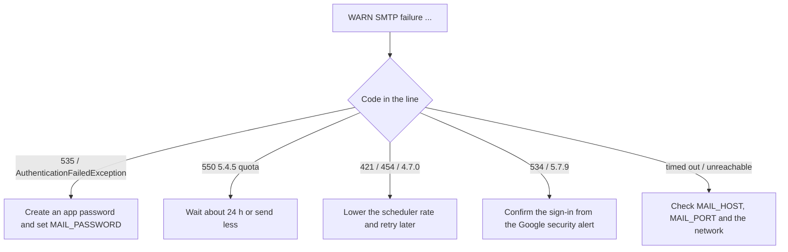

# E-mail refused by Gmail (personal account)

If e-mails stay queued and the log shows `SMTP failure sending message ..., left OPENED to retry:`, the text after it now tells you why.
Find the code in that line and apply the matching fix. None needs a business account.

| Code | What it means | What to do |
|---|---|---|
| `535` | Google refused the login. The normal password does not work over SMTP. | Turn on 2-step verification, create an **app password** (Google Account > Security > App passwords) and use it as `MAIL_PASSWORD`. Create a new one if it stopped working: Google revokes them when the account password changes or on suspicious activity. |
| `550 5.4.5` | Daily limit of the account reached (about 500 recipients per day). | Wait about 24 hours or send fewer messages. Retries also count. |
| `421`, `454`, `4.7.0` | Too many logins or messages too fast. | Raise `PRX_SCHEDULER_SEND_EMAIL_RATE` (default 60000 ms) and retry later. |
| `534`, `5.7.9` | Sign-in blocked as suspicious (new server IP). | Open the security alert of the account and confirm it, or visit https://accounts.google.com/DisplayUnlockCaptcha. |
| timed out | Mercury cannot reach the SMTP server. | Check `MAIL_HOST`, `MAIL_PORT` and the network. |

For a steadier alpha without paying for Google Workspace, a transactional provider with a free plan (Brevo, Resend, Mailgun) works with the same
`MAIL_HOST`, `MAIL_PORT`, `MAIL_USERNAME` and `MAIL_PASSWORD` variables, with no code change.
