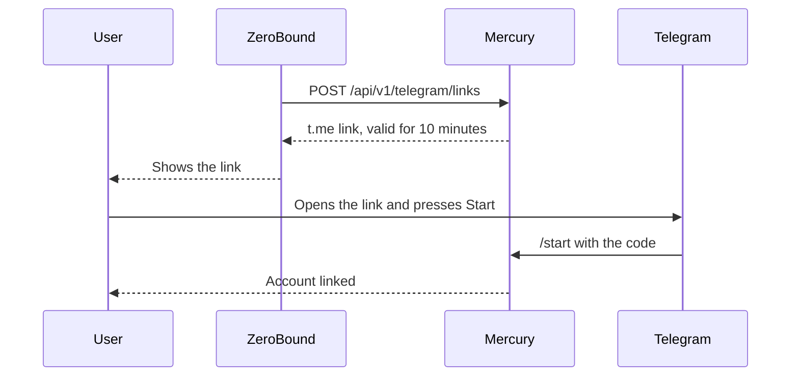

# User guide: Telegram alerts

🌐 [Leer esto en Español](../es/telegram.md)

Mercury delivers ZeroBound alerts by Telegram to users who link their chat. Configuration and deployment are in the [technical guide](../../telegram-channel.md).

> The channel is off by default. It needs `TELEGRAM_ENABLED=true` and the bot token in Vault.

## Link an account



The link works once. If the account is linked to another chat, the previous chat is told and unlinked.

## Bot commands

| Command | What it does |
|---|---|
| `/ayuda`, `/help` | Shows the commands |
| `/estado`, `/status` | Says whether this chat is linked |
| `/desvincular`, `/unlink` | Stops the alerts |

## Send an alert

Authorized services call `POST /api/v1/telegram/messages` with an `Idempotency-Key` header, so a retry does not duplicate the alert.

```json
{ "userId": "00000000-0000-0000-0000-000000000002", "kind": "budget_exceeded", "language": "en", "params": {} }
```

| Response | Meaning |
|---|---|
| `202` | Accepted. Check the state with `GET /api/v1/telegram/messages/{id}`: `QUEUED`, `SENT`, `FAILED` or `BLOCKED` |
| `400` | Unknown template or language |
| `409` | The user is not linked (`TELEGRAM_NOT_LINKED`) or blocked the bot (`TELEGRAM_BLOCKED`) |
| `422` | The `Idempotency-Key` was already used with another request |

If the user blocks the bot, sending stops until they link their account again. Temporary failures are retried up to 6 times, within 48 hours at most.
