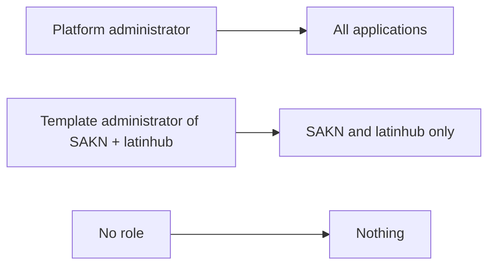

# User guide: who can manage templates

🌐 [Leer esto en Español](../es/administradores-de-plantillas.md)

There are two kinds of people who manage templates:

| Who | How to set it up in Backbone | What they see in Iris |
|---|---|---|
| **Platform administrator** | Give the user a role that holds the feature `PLATFORM_ADMIN` **in the Iris application** | Every application and all its templates |
| **Template administrator** of one or several applications | Give the user a role with `TEMPLATE_MANAGE` and `TEMPLATE_READ` **in each application** they should manage | Only those applications and their templates |

Someone with neither sees no applications, and Mercury answers `403` if they try to reach a template.

Nothing has to be configured in Mercury: the permission names are `PLATFORM_ADMIN`, `TEMPLATE_MANAGE` and `TEMPLATE_READ` by default.
