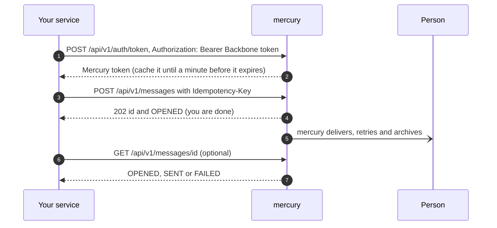

# Send a message through mercury (any channel) — guide for services

Use this when your service must tell a person something (a verification code, a notice, an alert) and you want mercury to deliver it. You do not need Kafka and you do not wait for the delivery.

## 1. What you need
1. A **managed client in Backbone** for your application with the `mercury:message:write` scope (`docs/user-guide/en/m2m-applications.md`). No Mercury password.
2. For e-mail: a **template** registered in mercury for your application (`docs/zerobound-mail-templates.md` shows how). You name it, you do **not** keep its id: send `template` (e.g. `zb_verification`), your `applicationId` and the `language`. Ask `GET /api/v1/messages/templates?applicationId=<uuid>` for what exists and in which languages.

## 2. The flow



## 3. Send
```
POST /api/v1/messages
session-token: <token>
Idempotency-Key: <a key you choose for this event>

{"channel":"email","userId":"<uuid>","target":"ana@example.com","template":"zb_verification","applicationId":"<uuid>",
 "language":"es","from":"no-reply@your.app","subject":"Your code","params":{"vc":"123456"}}
```
* `channel`: ask `GET /api/v1/messages/channels` for the codes available now (e-mail, sms, whatsapp, telegram, push, ...). New channels appear there by themselves; you only change the word you send.
* `target`: where it goes in that channel: an address for e-mail, `+34600112233` (E.164) for sms and whatsapp, a numeric chat id for telegram, a device token for push.
* Use a stable `Idempotency-Key` per event (for example `REGISTER-CODE:<user>:<slot>`): if your call times out you can repeat it and the person gets **one** message.

## 4. Answers
| Status | Meaning | What to do |
|---|---|---|
| `202` | Queued. `Idempotent-Replayed: true` = you already sent this one | Nothing; keep the `id` if you want its state |
| `400` | Unknown or disabled channel, wrong target for the channel, a missing field, an unknown template, or a template with **no version in the language you asked** (mercury never sends in another language; the message lists the available ones) | Fix the request, or register the missing language; the message says which |
| `401` | Not a mercury machine token | Get a new token |
| `422` | That key was used with a different message | Use a new key |
| `5xx` / no answer | mercury is not available | Try again later with the same key |

## 5. Good to know
* mercury never tells you the person **received** it; `SENT` means handed to the provider (SMTP, Telegram...).
* Messages are kept for status for 30 days.
* Do not put secrets or the person's data in `params` beyond what the template prints.
