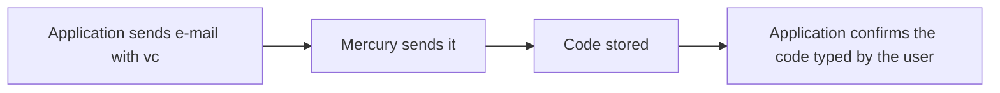

# Verification codes

When an application (for example ZeroBound) asks Mercury to send a verification e-mail, Mercury also remembers the code so the application can
check what the user types.

- The code is available **right after the e-mail is sent** (within about a minute of the request), no longer after several minutes.
- The template of that e-mail must be of the type **VERIFICATION_CODE** (or the one configured in `PRX_VERIFICATION_CODE_TEMPLATE_ID`).
- The message must carry the code in the `vc` parameter and, optionally, `expiresInMinutes` (at most two days).
- A user has 3 attempts per code; asking for a new code cancels the previous one.

To check it worked: after sending, `mercury.verification_codes` has a row for the user, and Mercury's log says
`Verification code stored for user …`. If the row is missing, look in the log for `carries no 'vc' parameter`.

## Where to look

- The sent e-mail waits in MongoDB (`messages`) until Mercury records it; its record is `mercury.message_record` and the code is `mercury.verification_codes`.
- An e-mail whose SMTP send failed is retried every minute; you will see `SMTP failure sending message …, left OPENED to retry` in the log.
