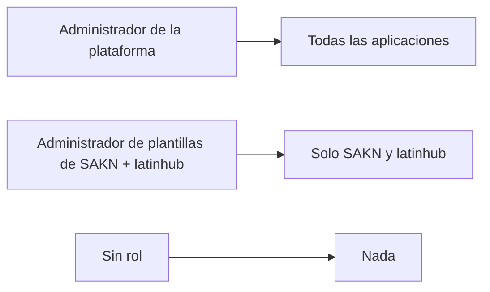

# Guía de usuario: quién puede gestionar plantillas

🌐 [Read this in English](../en/template-administrators.md)

Hay dos tipos de personas que gestionan plantillas:

| Quién | Cómo se define en Backbone | Qué ve en Iris |
|---|---|---|
| **Administrador de la plataforma** | Dale al usuario un rol con la feature `PLATFORM_ADMIN` **en la aplicación Iris** | Todas las aplicaciones y sus plantillas, y los login clients |
| **Administrador de plantillas** de una o varias aplicaciones | Dale al usuario un rol con `TEMPLATE_MANAGE` y `TEMPLATE_READ` **en cada aplicación** que deba gestionar | Solo esas aplicaciones y sus plantillas |

Quien no tenga ninguno no ve aplicaciones, y Mercury responde `403` si intenta llegar a una plantilla.

No hay que configurar nada en Mercury: los nombres de permiso son `PLATFORM_ADMIN`, `TEMPLATE_MANAGE` y `TEMPLATE_READ` por defecto.
