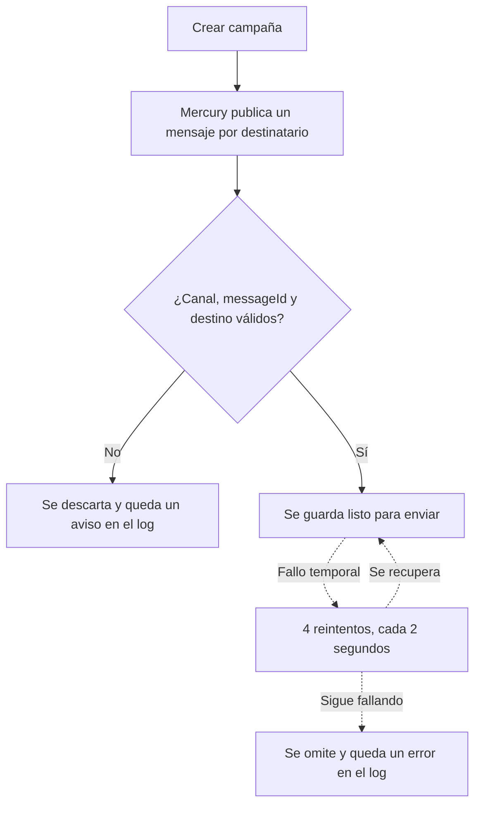

# Guía de usuario: envío por SMS, Telegram, WhatsApp y Push

🌐 [Read this in English](../en/messaging-channels.md)

Esta guía explica cómo pedirle a Mercury que envíe una campaña por SMS, Telegram, WhatsApp o Push, y qué esperar después. El detalle técnico está en la [guía de configuración](../../tec/es/06-configuracion-entornos.md).

> **Estado actual:** Mercury valida y guarda estos mensajes, pero todavía no los entrega. Ningún canal llama aún a un proveedor real (Twilio, Telegram Bot API, WhatsApp Cloud API, FCM/APNs).

## Crear una campaña

La llamada es la misma para todos los canales: `POST /api/v1/campaigns`, con el formato descrito en [create-campaign.md](../../create-campaign.md). Solo cambian `channelTypeCode`, el formato de `identifier` y los valores de `templateParams`.

```json
{
  "name": "Aviso de julio",
  "channelTypeCode": "whatsapp",
  "templateId": "00000000-0000-0000-0000-000000000001",
  "userId": "00000000-0000-0000-0000-000000000002",
  "recipients": [
    { "identifier": "+34600111222", "name": "Ana" }
  ],
  "templateParams": {
    "message": "Tu pedido ya salió",
    "media_url": "https://example.com/pedido.png",
    "media_type": "IMAGE"
  },
  "status": "ACTIVE",
  "applicationId": "00000000-0000-0000-0000-000000000003"
}
```

## Qué poner en `identifier`

| Canal | `channelTypeCode` | Formato de `identifier` | Ejemplo |
|---|---|---|---|
| SMS | `sms` | Teléfono E.164: `+`, código de país y número | `+34600111222` |
| WhatsApp | `whatsapp` | Teléfono E.164 | `+34600111222` |
| Telegram | `telegram` | `chatId` numérico, hasta 18 dígitos; puede ser negativo | `-100123456789` |
| Push | `push` | Token del dispositivo, no vacío | `dA3f...` |

> ⚠️ Crear la campaña no comprueba estos formatos. Un destinatario con formato incorrecto se descarta más tarde: la API responde con éxito, pero ese mensaje no se guarda y las métricas de la campaña no lo reflejan.

## Parámetros de `templateParams`

Todos son opcionales.

| Canal | Parámetro | Uso |
|---|---|---|
| Todos | `message` | Texto del mensaje |
| Todos | `template_name`, `template_language` | Nombre e idioma de la plantilla |
| Todos | `media_url`, `media_type` | Archivo adjunto. `media_type` admite `IMAGE`, `VIDEO` o `NONE` (por defecto) |
| SMS | `senderId` | Remitente que se muestra |
| Telegram | `parseMode` | Formato del texto, por ejemplo `HTML` |
| WhatsApp | `message_type` | Tipo de mensaje; por defecto `text` |
| Push | `platform` | Plataforma; por defecto `web` |
| Push | `title`, `icon`, `click_action`, `sound` | Presentación de la notificación |
| Push | `priority`, `badge` | Prioridad (por defecto `normal`) y número de la insignia |

## Qué pasa con un mensaje



## Preguntas frecuentes

**¿Ha cambiado algo para quien usa la API?**
No. La llamada y la respuesta son las mismas. Internamente, los cuatro canales comparten ahora un único topic de Kafka.

**¿Y el correo electrónico?**
Sigue funcionando como siempre, por su propio topic.

**Mi campaña se creó, pero falta un mensaje. ¿Por qué?**
Revisa el formato de `identifier` en la tabla anterior. El caso más habitual es un teléfono sin `+`. Los descartes se ven en el log de Mercury como `Invalid target identifier`; el log no incluye el destinatario, porque es un dato personal.

**¿Publicas directamente en Kafka?**
Usa el formato de [topic-general-message.md](../../topic-general-message.md). `messageId` es obligatorio y debe ser único por mensaje: dos mensajes con el mismo valor se tratan como el mismo.
