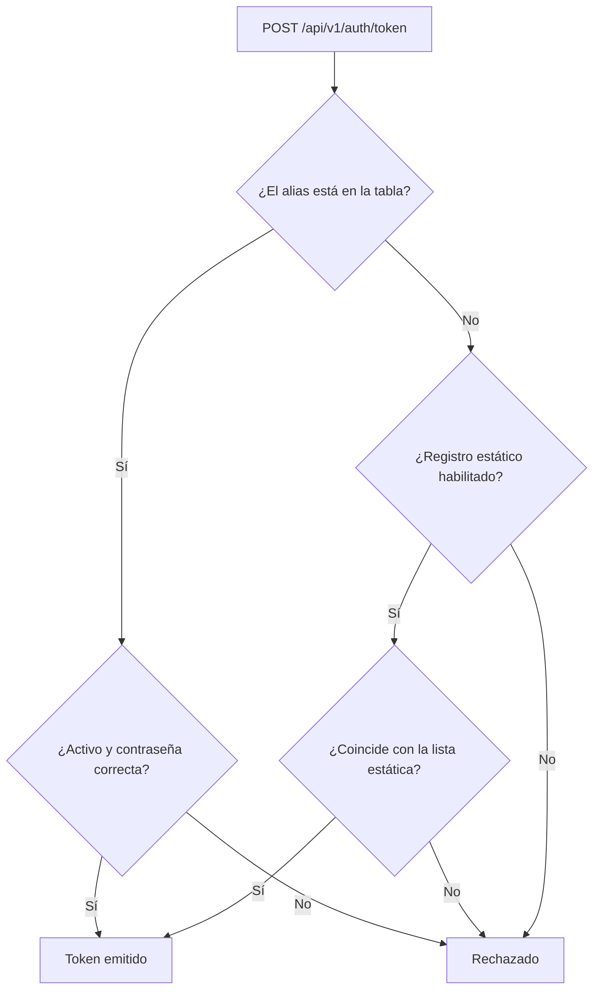

# Guía de usuario: clientes de login

🌐 [Read this in English](../en/login-clients.md)

Un cliente de login es un servicio backend autorizado a pedir un token con `POST /api/v1/auth/token`. Mercury los guarda en la tabla `mercury.login_clients`, con la contraseña cifrada con bcrypt.

Administrarlos exige el permiso `LOGIN_CLIENT_MANAGE` en la aplicación indicada por `LOGIN_CLIENTS_ADMIN_APPLICATION_ID`. Si esa variable está vacía, nadie puede administrarlos.

## Operaciones

| Acción | Llamada |
|---|---|
| Listar | `GET /api/v1/login-clients` |
| Registrar | `POST /api/v1/login-clients` |
| Activar, desactivar o describir | `PUT /api/v1/login-clients/{id}` |
| Rotar la contraseña | `PUT /api/v1/login-clients/{id}/password` |
| Eliminar | `DELETE /api/v1/login-clients/{id}` |

Todas requieren la cabecera `session-token`.

```json
{ "alias": "zerobound-rest", "description": "Backend de ZeroBound" }
```

Si no envías `password`, Mercury genera una y **solo la muestra en esa respuesta**. Si la envías, debe tener entre 12 y 72 caracteres ASCII imprimibles, sin espacios.

## Cómo se valida un login



## Puesta en marcha

1. Aplica `V2031__login_clients.sql`. Mientras la tabla no exista, solo funciona la lista estática.
2. Da de alta cada servicio con la API o con `scripts/login-clients/add-login-client.sh`.
3. Cuando todos estén en la tabla, define `LOGIN_REGISTRY_PROPERTIES_ENABLED=false`.
