# Guía de integración con Mercury

**Para quién:** equipos de las aplicaciones que quieren enviar correos, mensajes de Telegram, códigos de verificación y notificaciones a través de Mercury.
**Qué encontrarás:** qué debe hacer tu aplicación, paso a paso, con las llamadas exactas, los diagramas del flujo, los errores y qué hacer en cada uno.

> Hay una versión interactiva de esta guía (constructor de peticiones, explorador de canales, lista de verificación y simulador de errores). Este documento tiene la misma información en Markdown.

---

## Índice

1. [Mercury en 60 segundos](#1-mercury-en-60-segundos)
2. [Canales disponibles y su estado real](#2-canales-disponibles-y-su-estado-real)
3. [Qué necesitas antes de escribir código](#3-qué-necesitas-antes-de-escribir-código)
4. [Paso 1: identidad y tokens](#4-paso-1-identidad-y-tokens)
5. [Paso 2: plantillas](#5-paso-2-plantillas)
6. [Paso 3: enviar un mensaje](#6-paso-3-enviar-un-mensaje)
7. [Paso 4: saber qué pasó con el mensaje](#7-paso-4-saber-qué-pasó-con-el-mensaje)
8. [Códigos de verificación (registro de usuarios)](#8-códigos-de-verificación-registro-de-usuarios)
9. [Telegram](#9-telegram)
10. [SMS, WhatsApp y Push](#10-sms-whatsapp-y-push)
11. [Campañas (envíos masivos)](#11-campañas-envíos-masivos)
12. [Errores, reintentos e idempotencia](#12-errores-reintentos-e-idempotencia)
13. [Seguridad y privacidad](#13-seguridad-y-privacidad)
14. [Observabilidad](#14-observabilidad)
15. [Lista de verificación para salir a producción](#15-lista-de-verificación-para-salir-a-producción)
16. [Resolución de problemas](#16-resolución-de-problemas)
17. [Referencia rápida de endpoints](#17-referencia-rápida-de-endpoints)
18. [Implementación de referencia: ZeroBound](#18-implementación-de-referencia-zerobound)
19. [Glosario](#19-glosario)

---

## 1. Mercury en 60 segundos

Mercury es la plataforma de mensajería de la organización. Tu aplicación **no** habla con servidores de correo, ni con la API de Telegram, ni guarda plantillas: le pide a Mercury que envíe y Mercury se encarga de la entrega, los reintentos y el registro.

Lo que tu aplicación hace, en orden:

1. **Se identifica** con el token de Backbone de su cliente gestionado y lo cambia por un token de Mercury.
2. **Tiene sus plantillas** registradas en Mercury (una por idioma) y conoce sus ids.
3. **Envía** con `POST /api/v1/messages` y una clave de idempotencia. Recibe `202` y sigue con su trabajo.
4. **Consulta el estado** solo si lo necesita (`OPENED`, `SENT`, `FAILED`).
5. Si el mensaje es un **código de verificación**, lo confirma después con `POST /api/v1/verification-code`.

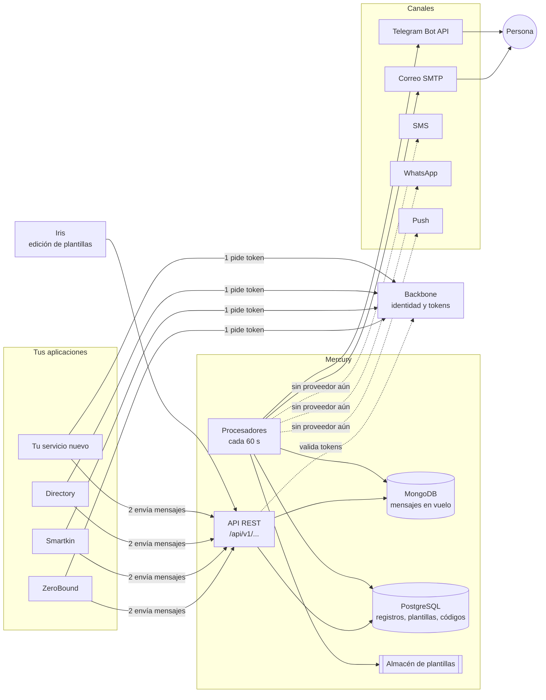

**Reglas que conviene tener claras desde el principio**

| Regla | Qué significa para tu aplicación |
|---|---|
| Una aplicación solo actúa sobre **sí misma** | Tu token solo sirve para tu aplicación. Mandar el `applicationId` de otra devuelve `403`. Si omites `applicationId`, Mercury usa el tuyo. |
| La entrega es **asíncrona** | `202` quiere decir «aceptado», no «entregado». No esperes la entrega en la misma petición. |
| `SENT` no es «lo leyó» | Significa que Mercury entregó el mensaje al proveedor (SMTP, Telegram). Mercury no sabe si la persona lo abrió. |
| Mercury **nunca cambia de idioma** | Si pides una plantilla en `es` y solo existe en `en`, la petición se rechaza con `400`. |
| El asunto del correo es de la **plantilla** | Se edita desde Iris sin tocar tu código. Tu aplicación no lo envía. |

---

## 2. Canales disponibles y su estado real

Consulta siempre `GET /api/v1/messages/channels` para saber qué canales acepta tu Mercury en este momento.

| Canal | `channel` | Destino (`target`) | Estado de la entrega |
|---|---|---|---|
| Correo | `email` | dirección de correo | **Completo.** Se envía por SMTP cada ~60 s. |
| Telegram | `telegram` | id numérico de chat | **Completo.** Para personas vinculadas se usa `POST /api/v1/telegram/messages` (sección 9). |
| SMS | `sms` | teléfono E.164, por ejemplo `+34600112233` | **Solo se acepta y se guarda** como `OPENED`. Todavía no hay proveedor conectado. |
| WhatsApp | `whatsapp` | teléfono E.164 | **Solo se acepta y se guarda** como `OPENED`. Todavía no hay proveedor conectado. |
| Push | `push` | token del dispositivo | **Solo se acepta y se guarda** como `OPENED`. Todavía no hay proveedor conectado. |

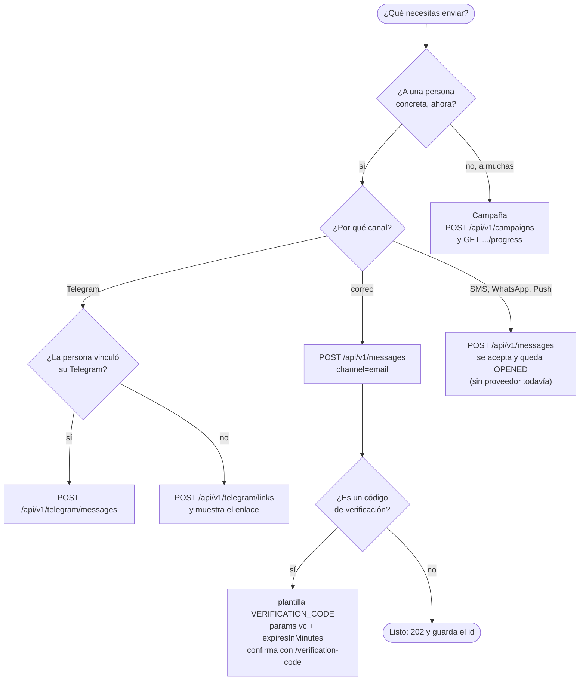

---

## 3. Qué necesitas antes de escribir código

| # | Qué | Quién lo hace | Cómo se comprueba |
|---|---|---|---|
| 1 | Un **cliente gestionado en Backbone** para tu aplicación, con los scopes `mercury:message:write` (cambiar y enviar) y, si solo vas a consultar, `mercury:message:read` | Administración de Backbone | `POST /api/v1/auth/token` devuelve `200` |
| 2 | El cliente debe estar **ligado a una sola aplicación** (tu `applicationId`) | Administración de Backbone | Si no lo está, `/auth/token` devuelve `403` («The client is not tied to an application») |
| 3 | **Plantillas** en Mercury para cada mensaje y cada idioma | Tu equipo, desde Iris o la API | `GET /api/v1/messages/template-definitions?applicationId=…` las lista |
| 4 | Una **dirección remitente** (`from`) permitida por el servidor de correo | Plataforma | El correo de prueba llega |
| 5 | Para Telegram: el bot configurado en Mercury | Plataforma | `Telegram bot @nombre reachable` en el log de Mercury |

Tu aplicación **no** necesita usuario ni contraseña en Mercury: no existen. Si tu servicio todavía envía `{"alias": …, "password": …}` a `/api/v1/auth/token`, recibirá `401`; cámbialo por el flujo de la sección 4.

---

## 4. Paso 1: identidad y tokens

Tu aplicación maneja **dos** tokens:

| Token | Quién lo emite | Para qué sirve | Cómo se envía |
|---|---|---|---|
| Token de Backbone | Backbone (client credentials) | Demostrar quién eres y pedir el de Mercury | `Authorization: Bearer <token>` solo en `/api/v1/auth/token` |
| Token de Mercury | Mercury | Todo lo demás: plantillas, mensajes, códigos | `session-token: <token>` |

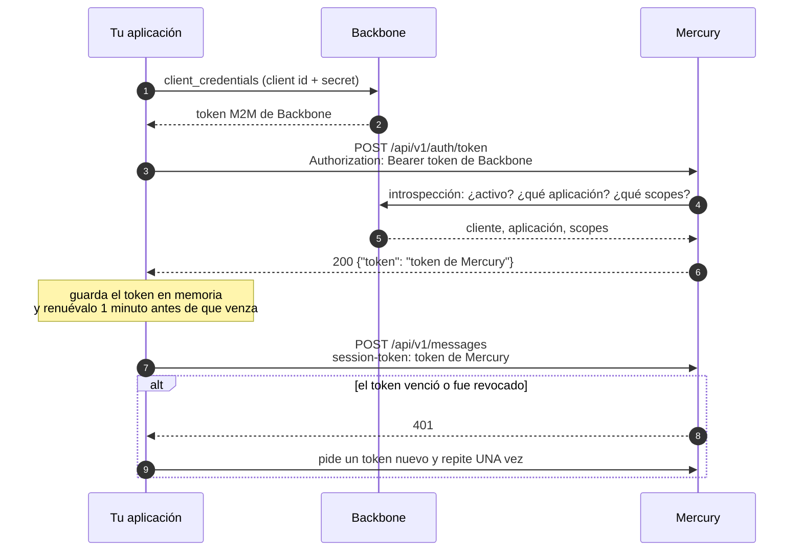

```bash
# 1) token de Mercury a partir del token de Backbone
curl -sS -X POST "$MERCURY/api/v1/auth/token" \
  -H "Authorization: Bearer $BACKBONE_TOKEN"
# => {"token": "eyJ..."}
```

**Qué debe hacer tu código**

- Guardar el token de Mercury **en memoria** y reutilizarlo. Dura 1 hora por defecto (lo configura la plataforma): renuévalo 1 minuto antes de que venza.
- Si una llamada responde `401`, pide un token nuevo y **repite una sola vez**. Si vuelve a dar `401`, es un problema de credenciales, no de caducidad.
- No registrar nunca el token ni el secreto del cliente en los logs.

| Respuesta de `/auth/token` | Causa | Solución |
|---|---|---|
| `401` | El token de Backbone falta, venció o fue revocado | Pide uno nuevo a Backbone |
| `403` | El cliente no tiene ningún scope `mercury:*`, o no está ligado a una aplicación | Pide a Backbone que lo corrija |

---

## 5. Paso 2: plantillas

Una **plantilla** es el archivo con el contenido del mensaje (HTML o FreeMarker `.ftl`) más su metadato: idioma, tipo, severidad y, para correo, el asunto. Cada idioma es una plantilla distinta.

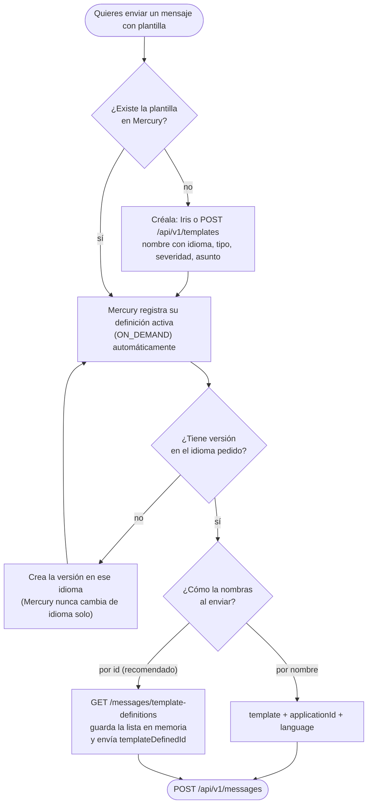

### Crear una plantilla

Desde Iris (pantalla Plantillas) o con la API, usando el token de Mercury:

```bash
curl -sS -X POST "$MERCURY/api/v1/templates" \
  -H "session-token: $MERCURY_TOKEN" -H "Content-Type: application/json" \
  -d '{"location":"welcome_es.ftl","fileFormat":"ftl","templateTypeId":"<uuid>","severityTypeId":"<uuid>",
       "applicationId":"<tu applicationId>","description":"Bienvenida"}'
```

- Nombre del archivo: lleva el idioma como sufijo (`welcome_es.ftl`, `welcome_en.ftl`). El idioma es `es` y el nombre con el que se envía es `welcome`. Una plantilla **sin idioma** se crea pero no se puede enviar por nombre.
- `templateTypeId` y `severityTypeId`: consulta `GET /api/v1/templates/types` y `GET /api/v1/templates/severities`.
- Al crearla, Mercury registra automáticamente su **definición activa**, que es lo que la hace enviable. Al borrarla, la desactiva.
- Contenido: `PUT /api/v1/templates/{id}/content` (con `ETag` / `If-Match`). Vista previa: `POST /api/v1/templates/preview`. Cada guardado crea una versión que se puede restaurar.
- **Asunto (correo):** se define en la plantilla, hasta 500 caracteres, con marcadores `${nombre}` que tu aplicación debe enviar en `params`. Si falta un marcador, el mensaje se rechaza con un error claro.

### Tipo de plantilla para códigos de verificación

Las plantillas de códigos de verificación deben ser del tipo **`VERIFICATION_CODE`**. Solo con ese tipo Mercury guarda el código para poder confirmarlo después (sección 8).

### Descubrir qué hay y cómo nombrarlo

| Llamada | Devuelve | Úsala para |
|---|---|---|
| `GET /api/v1/messages/templates?applicationId=…` | `[{"template":"welcome","languages":["en","es"]}]` | Enviar **por nombre** |
| `GET /api/v1/messages/template-definitions?applicationId=…` | `[{"templateDefinedId":"…","location":"welcome_es.ftl","language":"es"}]` | Enviar **por id** (recomendado) |

`template-definitions` solo responde para **tu propia aplicación** (`403` si pides otra).

### Recomendado: enviar por id, con la lista en memoria

No copies ids de plantillas en tu configuración ni en tu base de datos. Pídele a Mercury la lista y consérvala en memoria:

- Cárgala en el primer uso.
- Refréscala cada pocos minutos (ZeroBound: cada 5 min).
- Refréscala también cuando una plantilla **no aparece** (con un tiempo mínimo entre intentos, ZeroBound: 30 s).
- Si Mercury no responde al refrescar, conserva la última lista buena.

Así, una plantilla nueva, cambiada o desactivada en Mercury se refleja sola. Una plantilla que falte debe hacer que **tu aplicación rechace el envío antes de llamar a Mercury**, con un mensaje claro (`falta la plantilla EMAIL/debt_due/es`).

---

## 6. Paso 3: enviar un mensaje

```
POST /api/v1/messages
session-token: <token de Mercury>
Idempotency-Key: <clave estable por evento>
Content-Type: application/json
```

| Campo | Obligatorio | Descripción |
|---|---|---|
| `channel` | sí | `email`, `sms`, `whatsapp`, `telegram`, `push` (ver `GET /messages/channels`) |
| `userId` | sí | id del usuario destinatario (UUID) |
| `target` | sí | dirección en ese canal (correo, teléfono E.164, id de chat, token de dispositivo) |
| `templateDefinedId` **o** `template` | correo: sí | Una de las dos formas, no ambas. Con `template` hay que enviar también `applicationId` y `language` |
| `applicationId` | con `template` | Debe ser el tuyo |
| `language` | con `template` | `es`, `en`… Sin respaldo a otro idioma |
| `from` | correo: sí | Remitente |
| `subject` | no | Si lo envías, **gana** sobre el de la plantilla. Lo normal es no enviarlo |
| `body` | no | Texto base. La plantilla renderiza el contenido real |
| `params` | no | Datos que usa la plantilla (hasta 50 claves) |
| `options` | no | Opciones del canal (hasta 30 claves) |
| `sendDate` | no | `yyyy-MM-dd HH:mm:ss` en UTC. Vacío = lo antes posible |
| `mediaUrl`, `mediaType` | no | Adjunto (`IMAGE`, `VIDEO`, `NONE`) |

### Ejemplo: correo por id

```bash
curl -sS -X POST "$MERCURY/api/v1/messages" \
  -H "session-token: $MERCURY_TOKEN" \
  -H "Idempotency-Key: DEBT-DUE:$USER_ID:2026-11-15" \
  -H "Content-Type: application/json" \
  -d '{
    "channel": "email",
    "userId": "22222222-2222-4222-8222-222222222222",
    "target": "ana@example.com",
    "templateDefinedId": "33333333-3333-4333-8333-333333333333",
    "language": "es",
    "from": "no-reply@tuapp.com",
    "params": {"nombre": "Ana", "monto": "120.00"}
  }'
# => 202 {"id":"44444444-...","status":"OPENED","message":"Queued"}
```

### Ejemplo: correo por nombre

```json
{
  "channel": "email", "userId": "…", "target": "ana@example.com",
  "template": "welcome", "applicationId": "<tu applicationId>", "language": "es",
  "from": "no-reply@tuapp.com", "params": {"nombre": "Ana"}
}
```

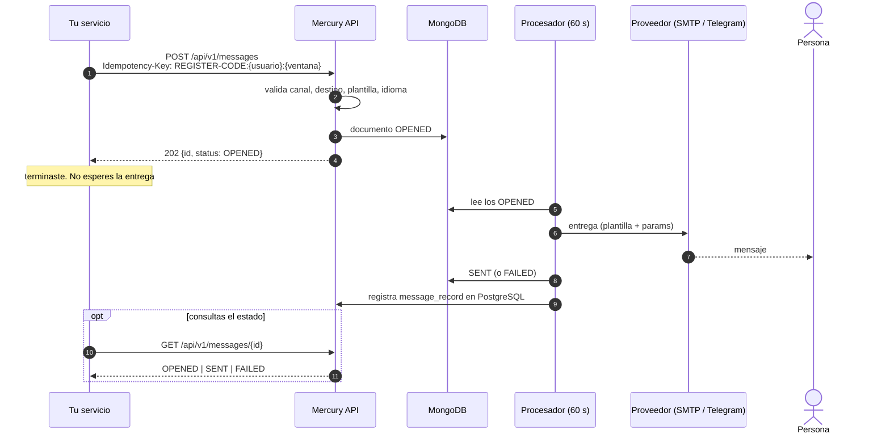

### Idempotencia: una clave por evento

`Idempotency-Key` evita mensajes duplicados cuando reintentas. Mercury guarda la clave junto con el mensaje:

- **Misma clave y mismo mensaje:** `202` con la cabecera `Idempotent-Replayed: true`. No se envía un segundo mensaje.
- **Misma clave y mensaje distinto:** `422`.
- La clave debe describir el **evento**, no el intento: `REGISTER-CODE:<usuario>:<ventana>`, `DEBT-DUE:<usuario>:<fecha>`. Una clave nueva por cada intento anula la protección.
- Para códigos de verificación conviene una clave con una **ventana de tiempo** (por ejemplo, un hueco por cada minuto): pedir «reenviar» varias veces seguidas no manda correos repetidos, pero pasado el tiempo sí envía uno nuevo.

### Respuestas

| Código | Significado | Qué hacer |
|---|---|---|
| `202` | Aceptado (`OPENED`) o repetición de una clave ya usada | Guarda el `id` si quieres consultar el estado |
| `400` | Canal desconocido o desactivado, destino inválido para el canal, falta un campo, plantilla inexistente o **sin versión en ese idioma** | Corrige la petición. El mensaje del error lo explica y lista los idiomas disponibles |
| `401` | `session-token` ausente, vencido o no emitido por Mercury | Token nuevo y repite una vez |
| `403` | Falta el scope `write`, o nombraste la plantilla de otra aplicación | Revisa scopes y `applicationId` |
| `422` | La clave ya se usó con otro mensaje | Usa una clave nueva |
| `5xx` o sin respuesta | Mercury no está disponible | Reintenta con la **misma** clave |

---

## 7. Paso 4: saber qué pasó con el mensaje

```bash
curl -sS "$MERCURY/api/v1/messages/$ID" -H "session-token: $MERCURY_TOKEN"
# => {"id":"…","status":"SENT","createdAt":"…","updatedAt":"…"}
```

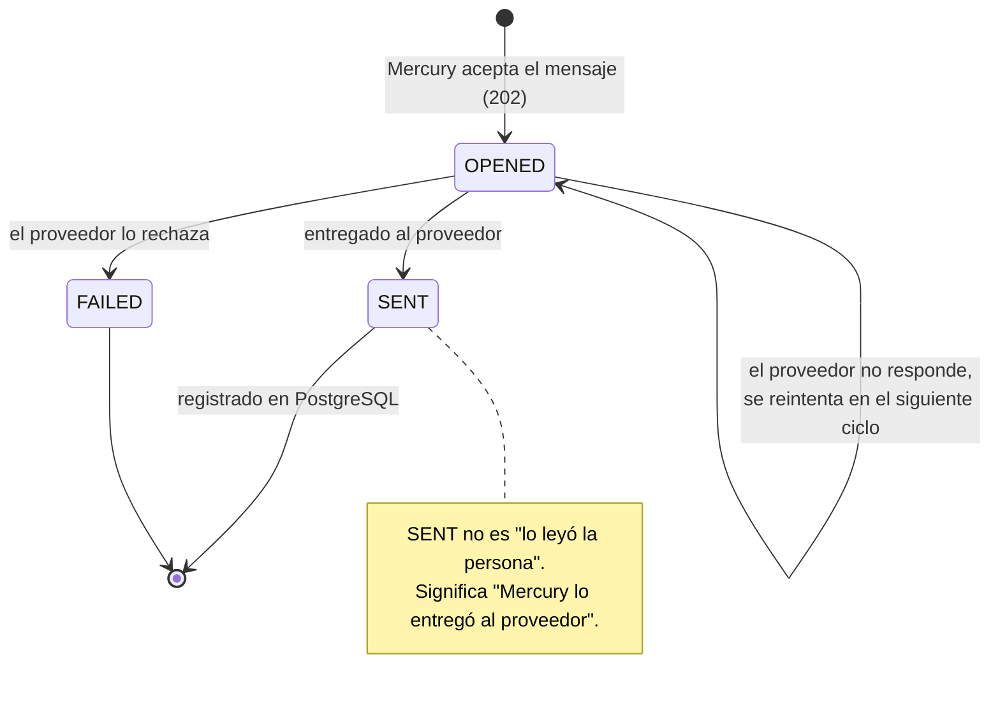

- Solo puedes consultar mensajes **que tu aplicación envió** (`404` si es de otra o si ya pasó la retención de 30 días).
- No hace falta consultar para cada mensaje. Hazlo cuando tu negocio dependa del resultado.
- Si un mensaje queda mucho tiempo en `OPENED`, algo falla en la entrega (por ejemplo, el servidor SMTP). Mercury lo reintenta cada ciclo; avisa a la plataforma.

---

## 8. Códigos de verificación (registro de usuarios)

Este es el flujo que usan ZeroBound, Smartkin y Directory para activar cuentas.

**Quién guarda qué**

- Tu aplicación crea el usuario **inactivo** y genera el código de 6 dígitos. **No lo guarda.**
- Mercury lo envía por correo y **lo recuerda** en su tabla `verification_codes` (usuario, aplicación, código, vencimiento, intentos).
- Cuando la persona escribe el código, tu aplicación le pregunta a Mercury si es el correcto.

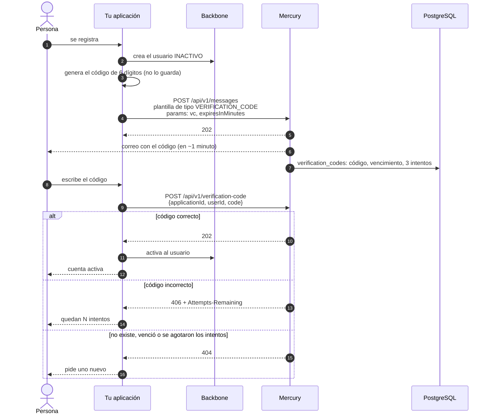

### Qué debe hacer tu aplicación

1. **Generar el código** (6 dígitos, aleatorio seguro) y enviarlo con una plantilla del tipo `VERIFICATION_CODE`:

```json
{
  "channel": "email", "userId": "<id del usuario>", "target": "ana@example.com",
  "templateDefinedId": "<definición de verification-code en el idioma del usuario>",
  "language": "es", "from": "no-reply@tuapp.com",
  "params": {"vc": "482913", "expiresInMinutes": "30"}
}
```

   - `vc` es el código. El nombre es obligatorio: Mercury lo busca con ese nombre.
   - `expiresInMinutes` es lo que la plantilla le dice a la persona y también lo que Mercury aplica (máximo 2 días; sin valor, 2 días).
2. **Confirmar** cuando la persona lo escribe:

```bash
curl -sS -i -X POST "$MERCURY/api/v1/verification-code" \
  -H "session-token: $MERCURY_TOKEN" -H "Content-Type: application/json" \
  -d '{"applicationId":"<tu applicationId>","userId":"<id>","code":"482913"}'
```

| Respuesta | Significado | Tu aplicación |
|---|---|---|
| `202` | Código correcto | Activa al usuario (en Backbone) y deja entrar |
| `406` + `Attempts-Remaining: N` | Incorrecto | Muestra «quedan N intentos». Con `0`, pide un código nuevo |
| `404` | No hay código vigente: no existe, venció o se agotaron los intentos | «Este código ya no sirve. Pide uno nuevo» |

3. **Reenviar:** genera un código nuevo y envíalo otra vez. Al guardarse el nuevo, los pendientes del mismo usuario y aplicación **dejan de valer**.
4. **Recuperación:** `GET /api/v1/verification-code/latest-status?userId=<id>` devuelve `true` o `false` (el último código ya fue verificado o no), `404` si no hay ninguno y `400` si el id no es un UUID. Úsalo si Mercury aceptó el código pero tu activación falló, para reintentar la activación sin pedir otro código.

**Cosas que conviene saber**

- El código se puede confirmar a partir de **~1 minuto** después de la petición (cuando Mercury envía el correo).
- Son **3 intentos** por código.
- Si la tabla `verification_codes` no tiene la fila, `/verification-code` responde siempre `404` y el usuario nunca se activa. Los síntomas y causas están en la sección 16.
- Responde a la persona siempre igual al reenviar, exista o no la cuenta, para no revelar qué usuarios existen.

---

## 9. Telegram

Telegram necesita que la persona **vincule** su chat con el bot antes de recibir mensajes. Mercury es dueño del bot, del `chat_id` y de la entrega; tu aplicación nunca ve el `chat_id`.

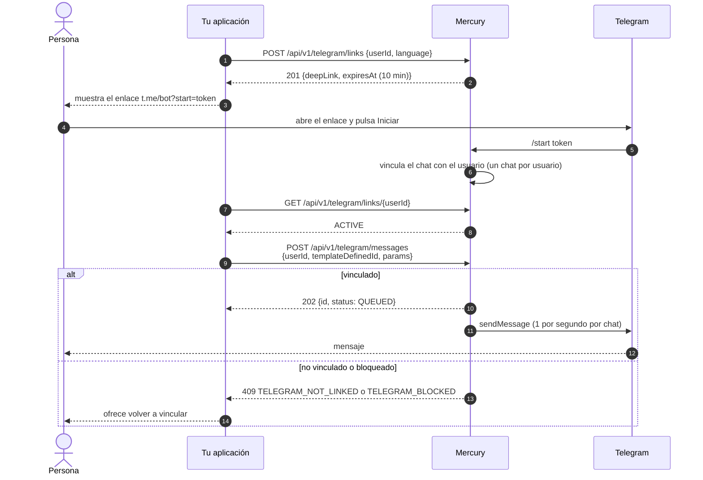

| Qué | Llamada | Respuesta |
|---|---|---|
| Crear enlace de vinculación | `POST /api/v1/telegram/links` `{"userId":"…","language":"es"}` | `201 {"deepLink":"…","expiresAt":"…"}`. El enlace vale 10 minutos y se usa una vez. `400` idioma no soportado, `503` bot apagado |
| Ver el estado | `GET /api/v1/telegram/links/{userId}` | `{"status":"NONE\|PENDING\|ACTIVE\|BLOCKED"}` |
| Desvincular | `DELETE /api/v1/telegram/links/{userId}` | `204` (idempotente) |
| Enviar | `POST /api/v1/telegram/messages` `{"userId","templateDefinedId","params","disableNotification"}` + `Idempotency-Key` | `202 {"id","status":"QUEUED"}` |
| Ver el envío | `GET /api/v1/telegram/messages/{id}` | `QUEUED`, `SENT`, `FAILED` o `BLOCKED` |

- Nombra la plantilla con **exactamente una** de dos formas: `templateDefinedId` (recomendado, lleva su idioma) o `kind`.
- `409` con `code`: `TELEGRAM_NOT_LINKED` (nunca vinculó) o `TELEGRAM_BLOCKED` (bloqueó el bot). Ofrécele volver a vincular.
- `400 Unknown Telegram template or language`: la plantilla no existe, no es de tu aplicación o su archivo no está.
- **Límites:** 1 mensaje por segundo por chat y 30 por segundo por bot. Los textos de más de 4096 caracteres se dividen en líneas. Los errores temporales se reintentan a 1 min, 5 min, 30 min, 2 h y 12 h; el sexto fallo o 48 h es `FAILED`.
- Las plantillas de Telegram de ZeroBound usan el patrón `zb-<tipo>-tg-<idioma>.html`.

---

## 10. SMS, WhatsApp y Push

Hoy Mercury **acepta y guarda** estos mensajes pero no los entrega, porque no hay proveedor conectado (Twilio, WhatsApp Cloud API, FCM/APNs). Puedes integrarte ya con el contrato definitivo: cuando se conecte un proveedor, tu código no cambia.

| Canal | `target` | Validación |
|---|---|---|
| `sms`, `whatsapp` | `+34600112233` | E.164: `+`, país sin cero inicial, hasta 15 dígitos. Si no, `400` |
| `push` | token del dispositivo | texto no vacío |

Mientras no haya proveedor, el estado se queda en `OPENED`. No lo trates como error en tu lógica de negocio.

---

## 11. Campañas (envíos masivos)

Para enviar el mismo mensaje a muchas personas y seguir su progreso:

| Qué | Llamada |
|---|---|
| Crear la campaña | `POST /api/v1/campaigns` con `name`, `channelTypeCode`, `templateId`, `userId`, `recipients` (`identifier`, `name`) y `templateParams` |
| Ver el progreso | `GET /api/v1/campaigns/{id}/progress` |
| Activar o pausar | Ver `docs/toggle-campaign.md` |

El progreso devuelve `totalRecipients`, `totalSent`, `failed`, `pending` (y `delivered`, `opened`, `clicked`, que hoy ningún proceso alimenta). Los correos y los mensajes de Telegram de la campaña avanzan los contadores al enviarse; un destinatario cuyo mensaje no pudo ni publicarse cuenta como `failed`. SMS, WhatsApp y Push se quedan como `pending` hasta que exista proveedor. Los detalles de cada llamada están en `docs/create-campaign.md` y `docs/get-campaign-progress.md`.

---

## 12. Errores, reintentos e idempotencia

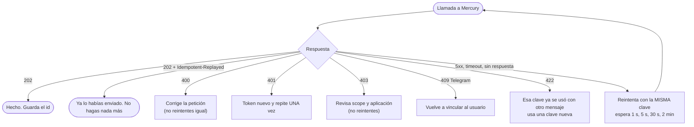

**Política recomendada**

| Situación | Reintentar | Con qué clave |
|---|---|---|
| `5xx`, timeout, sin respuesta | Sí: 1 s, 5 s, 30 s, 2 min, y luego marca el envío como pendiente en tu lado | La **misma** |
| `401` | Una vez, con token nuevo | La misma |
| `400`, `403`, `422`, `409` | No: corrige primero | `422`: una clave nueva |

**Idempotencia, en una frase:** si no sabes si tu llamada llegó, repítela con la misma clave; Mercury no enviará dos mensajes.

**Aislamiento:** el envío de un mensaje nunca debe bloquear ni tumbar la operación de negocio que lo originó. Si Mercury no responde, tu registro de usuario, tu alta o tu alerta siguen; el mensaje queda pendiente y se puede reenviar (ZeroBound devuelve `PENDING_VERIFICATION` y ofrece «reenviar código»).

---

## 13. Seguridad y privacidad

- **Mínimo privilegio:** pide `mercury:message:read` solo si únicamente consultas; `write` para enviar y gestionar plantillas.
- **Una aplicación, un cliente gestionado.** Si un servicio atiende dos aplicaciones, crea un cliente por cada una.
- **Secretos:** el secreto del cliente de Backbone y los tokens viven en tu gestor de secretos (Vault) y en memoria. Nunca en el repositorio, en logs ni en una respuesta.
- **Datos personales:** no pongas en `params` nada que la plantilla no imprima. No registres `target`, `params` ni el código en tus logs; Mercury tampoco los registra.
- **Código de verificación:** de un solo uso, caduca y tiene 3 intentos. Tu aplicación no lo guarda ni lo registra.
- **Alcance:** tu token solo permite actuar sobre tu aplicación (`403` si no).

---

## 14. Observabilidad

Lo que conviene medir en tu aplicación (nombres de ejemplo, los de ZeroBound):

| Métrica o log | Para qué |
|---|---|
| Mensajes entregados a Mercury por resultado (aceptado, repetido, fallido) | Detectar caídas de Mercury |
| Plantillas que faltan (`zerobound_mercury_templates_missing`, `-1` = no se pudo consultar) | Detectar plantillas sin crear o sin idioma |
| Intercambios de token fallidos por paso (Backbone, Mercury) | Distinguir credenciales de caídas |
| `Idempotent-Replayed` recibidos | Entender reintentos |

Mercury deja trazas claras de lo que no puede registrar, por ejemplo `Could not record message <id> (it stays SENT in MongoDB and is retried): …` o `Verification code stored for user …`.

---

## 15. Lista de verificación para salir a producción

**Identidad**
- [ ] Cliente gestionado de Backbone con los scopes mínimos, ligado a **una** aplicación.
- [ ] `/api/v1/auth/token` responde `200` en cada entorno.
- [ ] Token de Mercury en memoria, renovado un minuto antes y un solo reintento ante `401`.

**Plantillas**
- [ ] Una plantilla por mensaje **y por idioma**, con tipo, severidad y asunto (correo).
- [ ] Las de códigos de verificación son del tipo `VERIFICATION_CODE`.
- [ ] Lista de definiciones cargada en memoria y refrescada, sin ids copiados en tu configuración.
- [ ] Tu aplicación rechaza antes de llamar a Mercury cuando falta una plantilla.

**Envío**
- [ ] `Idempotency-Key` estable por evento en cada envío.
- [ ] El fallo de Mercury no rompe la operación de negocio.
- [ ] Política de reintentos aplicada (solo `5xx`, timeout y un `401`).
- [ ] No se registran `target`, `params`, códigos ni tokens.

**Verificación de usuarios**
- [ ] Código aleatorio de 6 dígitos, sin guardarlo en tu lado.
- [ ] `vc` y `expiresInMinutes` en `params`.
- [ ] `202` activa, `406` muestra los intentos que quedan, `404` ofrece reenviar.
- [ ] «Reenviar» usa una clave con ventana de tiempo.

**Telegram (si aplica)**
- [ ] Flujo de vinculación y manejo de `409`.

**Operación**
- [ ] Métricas y alertas de la sección 14.
- [ ] Prueba de extremo a extremo en QA: mensaje recibido, estado `SENT`, y para códigos, usuario activado.

---

## 16. Resolución de problemas

Estos son los problemas reales que ya ocurrieron durante las primeras integraciones.

| Síntoma | Causa probable | Qué hacer |
|---|---|---|
| `400 The template '…' is not registered for this application` | La plantilla no existe, está desactivada, o la nombraste distinto a su archivo | `GET /api/v1/messages/templates?applicationId=…` y usa el nombre exacto (sin idioma). Por id: `template-definitions` |
| `400 … has no 'es' version (available: en)` | Falta la plantilla en ese idioma | Crea la versión en `es`. Mercury no sustituye por otro idioma |
| `400 subject is required for email` | Ni el mensaje ni la plantilla tienen asunto | Rellena el asunto en la plantilla desde Iris |
| `403` en `/auth/token` | El cliente de Backbone no tiene scope `mercury:*` o no está ligado a una aplicación | Pide a Backbone que lo corrija |
| `403` en otras llamadas | Falta el scope `write`, o el `applicationId` no es el tuyo | Revisa scopes y que no envías el `applicationId` de otra aplicación |
| `401` tras tener token | El token venció | Pide uno nuevo y repite una vez |
| `422` | Reusaste una `Idempotency-Key` con otro mensaje | Una clave por evento, nueva para un mensaje distinto |
| Recibo `202` pero el correo no llega | El mensaje sigue `OPENED` (SMTP caído o lento) | `GET /messages/{id}`. Si sigue `OPENED`, avisa a la plataforma: Mercury lo reintenta cada minuto |
| El correo llega pero el código siempre da `404` | No hay fila en `verification_codes`: el tipo de plantilla no es `VERIFICATION_CODE`, falta `vc` en `params`, o Mercury no pudo guardarla | Revisa el tipo de la plantilla y `params.vc`. Revisa en el log de Mercury `Verification code stored` o `Could not record message` |
| `404` con un código recién enviado | Todavía no pasó el minuto del envío, o ya venció (`expiresInMinutes`) o se agotaron los 3 intentos | Espera un minuto o pide un código nuevo |
| `409 TELEGRAM_NOT_LINKED` | La persona nunca vinculó su Telegram | Crea un enlace con `POST /telegram/links` |
| `409 TELEGRAM_BLOCKED` | La persona bloqueó el bot | Pídele que lo desbloquee y vuelva a vincular |
| `503` en `/telegram/links` | El bot está apagado o no responde | Avisa a la plataforma |
| `5xx` o timeout | Mercury no disponible | Reintenta con la misma `Idempotency-Key` |

---

## 17. Referencia rápida de endpoints

Todas las llamadas llevan `session-token: <token de Mercury>`, salvo `/auth/token`, que lleva `Authorization: Bearer <token de Backbone>`.

| Área | Método y ruta | Scope | Notas |
|---|---|---|---|
| Token | `POST /api/v1/auth/token` | read o write | Sin cuerpo. Responde `{"token":"…"}` |
| Mensajes | `POST /api/v1/messages` | write | `Idempotency-Key`. `202` |
| Mensajes | `GET /api/v1/messages/{id}` | read o write | `OPENED`/`SENT`/`FAILED` |
| Mensajes | `GET /api/v1/messages/channels` | read o write | Canales disponibles |
| Mensajes | `GET /api/v1/messages/templates?applicationId=` | read o write | Nombres e idiomas |
| Mensajes | `GET /api/v1/messages/template-definitions?applicationId=` | read o write | Ids, archivo e idioma. Solo tu aplicación |
| Códigos | `POST /api/v1/verification-code` | write | `202` / `406` / `404` |
| Códigos | `GET /api/v1/verification-code/latest-status?userId=` | read | `true`/`false`/`404`/`400` |
| Telegram | `POST /api/v1/telegram/links` | write | `201 {deepLink, expiresAt}` |
| Telegram | `GET`/`DELETE /api/v1/telegram/links/{userId}` | read / write | Estado / desvincular |
| Telegram | `POST /api/v1/telegram/messages` | write | `Idempotency-Key`. `202` |
| Telegram | `GET /api/v1/telegram/messages/{id}` | read | `QUEUED`/`SENT`/`FAILED`/`BLOCKED` |
| Plantillas | `POST`/`PUT`/`DELETE`/`GET /api/v1/templates…` | write / read | Contenido, vista previa y versiones |
| Plantillas | `GET /api/v1/templates/types`, `/severities` | read | Tipos y severidades |
| Campañas | `POST /api/v1/campaigns`, `GET /api/v1/campaigns/{id}/progress` | write / read | Envíos masivos |

La referencia completa y siempre actual es el OpenAPI de Mercury (`src/main/resources/api/openapi.yaml`).

---

## 18. Implementación de referencia: ZeroBound

ZeroBound ya está integrado. Su código es el mejor ejemplo de las prácticas de esta guía.

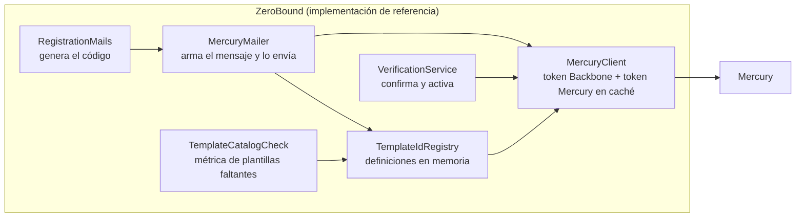

| Pieza | Qué hace | Lección |
|---|---|---|
| `MercuryClient` | Pide el token de Backbone y lo cambia por el de Mercury. Guarda ambos en memoria y reintenta una vez ante `401` | Un solo lugar para los tokens |
| `TemplateIdRegistry` | Pide `template-definitions`, guarda las plantillas en memoria, las refresca cada 5 min y ante una que falta (mínimo 30 s entre intentos) | Sin ids copiados |
| `MercuryMailer` | Arma el mensaje (`channel`, `templateDefinedId`, `from`, `params`), usa `Idempotency-Key` y rechaza **antes** de reclamar si falta la plantilla | Falla temprano y claro |
| `RegistrationMails` | Genera el código y lo envía con una clave que tiene ventana de tiempo | Reenviar no duplica |
| `VerificationService` | Confirma con Mercury y, si es `202`, activa en Backbone. Recupera con `latest-status` | Tolera fallos a medias |
| `TemplateCatalogCheck` | Publica cuántas plantillas faltan | Alerta antes de que un usuario lo note |

Convención de nombres de ZeroBound: `zb-<tipo>-<idioma>.html` para correo y `zb-<tipo>-tg-<idioma>.html` para Telegram (por ejemplo `zb-debt-due-es.html`, `zb-debt-due-tg-es.html`, `zb-verification-code-es.html`).

Fases típicas de una integración nueva (los días son una referencia de tamaño, no un compromiso):

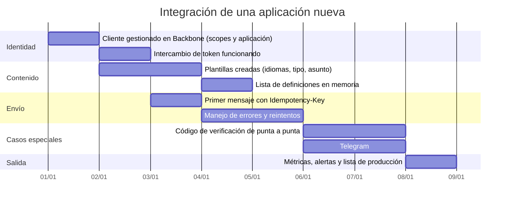

---

## 19. Glosario

| Término | Significado |
|---|---|
| **Aplicación** | Un sistema cliente de Mercury (ZeroBound, Smartkin…). Se identifica con su `applicationId` |
| **Cliente gestionado** | Credenciales de máquina que Backbone entrega a una aplicación |
| **Token de Backbone** | Prueba tu identidad ante Mercury. Solo se usa en `/auth/token` |
| **Token de Mercury** | El que se envía en `session-token` en las demás llamadas. Vale para tu aplicación |
| **Plantilla** | Archivo con el contenido del mensaje y su metadato (idioma, tipo, asunto) |
| **Definición de plantilla** (`templateDefinedId`) | Registro activo que hace enviable a una plantilla. Es el id con el que se envía por id |
| **`OPENED` / `SENT` / `FAILED`** | Estados de un mensaje: aceptado, entregado al proveedor, fallido |
| **Idempotencia** | Repetir una petición con la misma clave no produce un segundo mensaje |
| **`VERIFICATION_CODE`** | Tipo de plantilla cuyo código Mercury guarda para confirmarlo |
| **Vinculación (Telegram)** | Asociar el chat de una persona con su usuario mediante un enlace de un solo uso |
| **Iris** | La interfaz donde se administran las plantillas |
