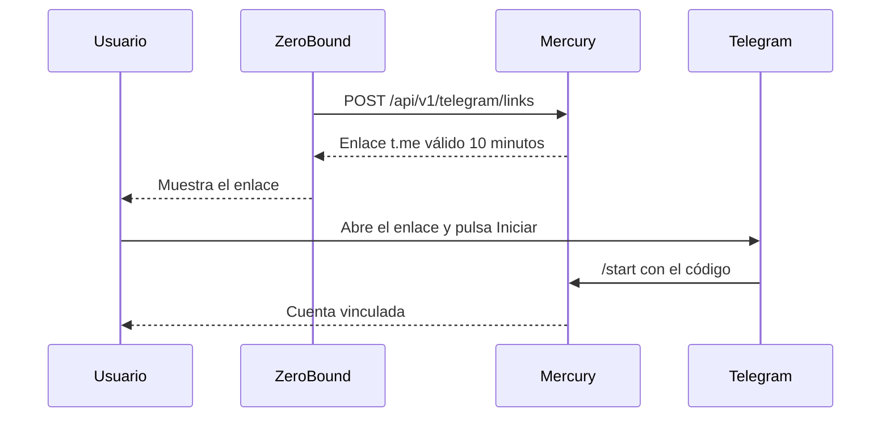

# Guía de usuario: avisos por Telegram

🌐 [Read this in English](../en/telegram.md)

Mercury entrega avisos de ZeroBound por Telegram a los usuarios que vinculan su chat. La configuración y el despliegue están en la [guía técnica](../../telegram-channel.md).

> El canal viene apagado. Necesita `TELEGRAM_ENABLED=true` y el token del bot en Vault.

## Vincular una cuenta



El enlace es de un solo uso. Si la cuenta se vincula a otro chat, el anterior recibe un aviso y queda desvinculado.

## Comandos del bot

| Comando | Qué hace |
|---|---|
| `/ayuda`, `/help` | Muestra los comandos |
| `/estado`, `/status` | Indica si este chat está vinculado |
| `/desvincular`, `/unlink` | Deja de recibir avisos |

## Enviar un aviso

Los servicios autorizados llaman a `POST /api/v1/telegram/messages` con una cabecera `Idempotency-Key`, así un reintento no duplica el aviso.

```json
{ "userId": "00000000-0000-0000-0000-000000000002", "kind": "budget_exceeded", "language": "es", "params": {} }
```

| Respuesta | Significado |
|---|---|
| `202` | Aceptado. Consulta el estado con `GET /api/v1/telegram/messages/{id}`: `QUEUED`, `SENT`, `FAILED` o `BLOCKED` |
| `400` | Plantilla o idioma desconocidos |
| `409` | El usuario no está vinculado (`TELEGRAM_NOT_LINKED`) o bloqueó el bot (`TELEGRAM_BLOCKED`) |
| `422` | La `Idempotency-Key` ya se usó con otra petición |

Si el usuario bloquea el bot, los envíos se detienen hasta que vuelva a vincular su cuenta. Los fallos temporales se reintentan hasta 6 veces en un máximo de 48 horas.
