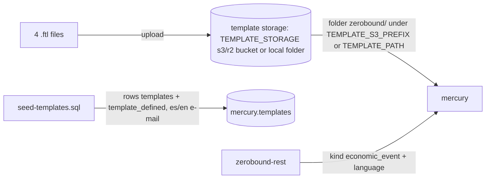

# ZeroBound in Mercury: login client, mail API and templates (T-71)

Mercury is the only place that talks to SMTP. zerobound-rest queues notifications in its own outbox and calls
`POST /api/v1/mail` (decision D-8, `zerobound-rest/docs/decisions/D-8-delivery-to-mercury.md`).

## 1. Who may call `/mail` and `/verification-code`
Only a **backend token Mercury minted itself** (`POST /api/v1/auth/token {alias, password}`): `iss`/`aud` are
Mercury's own (`umdc.security.jwt.issuer`/`audience`), there is no `uid`, and the subject is the login-client alias.
A backbone-rest user session (trusted by the generic session gate because of `trusted-issuers`) is answered `401` there.
`MachineTokenInterceptor` enforces it; the caller alias is available to controllers as the `mercury.caller` request attribute.

### Login client of zerobound
`application.yml` → `umdc.mercury.login-clients` has two ZeroBound entries, fed from Vault by the environment:

| Variable | Use |
|---|---|
| `ZEROBOUND_LOGIN_ALIAS` / `ZEROBOUND_LOGIN_PASSWORD` | the client zerobound-rest uses (its Vault keys `MERCURY_CLIENT_ALIAS` / `MERCURY_CLIENT_PASSWORD` hold the same pair) |
| `ZEROBOUND_NEXT_LOGIN_ALIAS` / `ZEROBOUND_NEXT_LOGIN_PASSWORD` | second slot for **rotation without downtime**: set the next pair here, switch zerobound-rest to it, then move it to the first slot and clear this one |

A client with an empty alias or password never matches. Tokens already minted live out their short expiry.

## 2. `POST /api/v1/mail`
Same body as before (`SendEmailRequest`), now implemented (it used to answer 501):

* checks that `templateDefinedId` exists (unknown → `400`), queues the message as `OPENED`; `SendEmailScheduler` renders the
  FreeMarker template and sends it, as for the other flows.
* `Idempotency-Key` (optional, scoped to the caller): the same key **and** the same request is accepted once, a repeat answers
  the first message with `Idempotent-Replayed: true`; the same key with a different request → `422`. Key and request are
  compared with a SHA-256 of every field, maps in key order.
* Answer: `{id, status: "OPENED", message}`; `id` is what the status call takes.

`GET /api/v1/mail/{id}` → `{id, status, createdAt, updatedAt}` with `OPENED`, `SENT` or `FAILED`; `404` for an unknown id, an id of
another caller or one past retention. The delivery log is the Mongo collection `mail_tracking` (no recipient, subject or
parameter; TTL `umdc.mail.tracking-retention`, default `30d`). `DELIVERED` is not reported: SMTP gives no receipt.

**Logging:** `SendEmailRequest.toString()` and `EmailMessageDocument.toString()` print ids, counts and dates only, never recipients,
subject, body or params, because the processor and the framework log them.

## 3. Templates (`zb_<kind>_<es|en>.ftl`, in the template storage)

> Mercury ships no templates: they live in the storage set by `TEMPLATE_STORAGE` (bucket or `TEMPLATE_PATH` folder); upload the files there. Reference copies used by the tests: `src/test/resources/templates/`.
The language is part of the file name, so zerobound picks the `templateDefinedId` of the user's language. Values are HTML-escaped
(`?html`); amounts arrive **already masked/formatted by zerobound** (`"≈ 300"` by default) and are printed as received. A missing
parameter makes the render fail instead of sending a half-empty mail. No uid, account number or free text of a transaction travels.

| kind | params |
|---|---|
| `debt_due` | `debtName`, `dueDate`, `amount` |
| `budget_exceeded` | `categoryName`, `period`, `spent`, `limit`, `percent` |
| `goal_reached` | `goalName`, `target` |
| `critical_insight` | `title`, `summary` |
| `price_alert` | `symbol`, `direction`, `threshold`, `price` |
| `weekly_summary` | `periodStart`, `periodEnd`, `income`, `spending`, `net` |
| `verification` | `vc`, `expiresInMinutes` |
| `economic_event` | `phase` (`upcoming` = high-impact event starting within the hour, `released` = the figure is out), `title`, `country`, `scheduledAt` (UTC ISO), `previous`, `forecast`, `actual` (`-` when unknown). Public macro data: no personal amounts; the text says it is informational, not financial advice |

`ZeroboundTemplatesTest` renders all 16 with exactly these params (`economic_event` in both phases).

### The verification code (T-96, decision D-10 of zerobound-rest)
`verification` is the one template that makes mercury **keep a code**. zerobound-rest generates the six digits and sends them as `vc`;
when `SendEmailScheduler` has sent the message, `MessageProcessor` stores the code for the template's user and application when the template
is of the type configured as `PRX_VERIFICATION_CODE_TEMPLATE_ID`; `POST /api/v1/verification-code {applicationId, userId, code}` then checks it.

* **Template type.** Only `zb_verification_{es,en}` must be of that type; the seed gives it `verification_type_id` and every other `zb_*` template the ordinary
  `type_id` (they have no `vc`, so the wrong type would make them fail). The two ids must differ.
* **Expiry.** The code lives `expiresInMinutes` (what the e-mail tells the user), never more than 2 days; absent, zero, negative or not a number means 2 days.
* **Attempts.** 3 per code. A wrong code answers `406` with the header `Attempts-Remaining` (`0` = exhausted: ask for a new code); `404` = no code that can still be confirmed (expired, none, or already verified).
* **Resend.** Issuing a code for the same user and application **expires the pending ones**, so only the newest can be confirmed and a wrong guess counts against it alone. (This applies to every application, not only ZeroBound.)
* The e-mail is transactional: its footer does not mention notification preferences, which a visitor does not have yet.

### Registering them in an environment
Templates are files (in the storage set by `TEMPLATE_STORAGE`; not baked into the images) **plus** rows in
`mercury.templates` / `mercury.template_defined`. `scripts/zerobound/seed-templates.sql` creates the rows (idempotent) and prints
the `template_defined` ids zerobound-rest needs. The schema is managed outside the application, so it was **not run** here: review it
against the target database first. The `application` row of ZeroBound in `general.application` must already exist.

**Subjects.** Since migration `V2036` the subject of each e-mail is a column of the template, edited from Iris (see
`docs/template-management-api.md#-e-mail-subject`); zerobound-rest no longer sends one. The seed script fills the subject of the 16
`zb_*` templates **only where it is still empty**, with the lines zerobound used before, so an edited subject is never overwritten.
Run it (or fill the subjects from Iris) **before** deploying a zerobound-rest that stops sending the subject, or those messages are
refused with `subject is required for email`.

## Telegram (T-116)

The same kinds (all but `verification`, so 7 kinds including `economic_event`) exist for Telegram as `zb_<kind>_tg_<es|en>.ftl`, with the same parameters (amounts arrive already
masked). Telegram's HTML subset only (`<b>`, `<i>`, `<code>`, links): every value is escaped with `?html` (a raw `<` makes Telegram reject the
message) and each message fits the 4096-character limit. No id is registered: `POST /api/v1/telegram/messages` names the `kind` and mercury picks
the file by language. `ZeroboundTelegramTemplatesTest` renders all 14 with the documented parameters.

## economic_event: uploading and registering (zerobound-rest economic calendar)

zerobound-rest sends `economic_event` (high-impact calendar events) with the parameters in the table of section 3. The four files are
`zb_economic_event_es.ftl`, `zb_economic_event_en.ftl`, `zb_economic_event_tg_es.ftl` and `zb_economic_event_tg_en.ftl`
(reference copies in `src/test/resources/templates/`).

1. **Upload the files** to the storage: with `TEMPLATE_STORAGE=s3` (Cloudflare R2 variables `CLOUDFLARE_R2_*`, see `application.yml`), under
   `<TEMPLATE_S3_PREFIX><folder of ZeroBound>/` (the e-mail files; the folder is the one in `mercury.application_template_folders`) and the
   Telegram files under `TEMPLATE_TELEGRAM_FOLDER` (default `zerobound`); with `local`, the same layout under `TEMPLATE_PATH`. Mercury picks them up within about 5 seconds.
2. **Register the e-mail rows** by running `scripts/zerobound/seed-templates.sql` again (idempotent: the 14 existing locations are skipped, the two new
   `zb_economic_event_{es,en}.ftl` get their `templates` and `template_defined` rows and their subject). Telegram needs no rows.
3. `TemplateCatalogCheck` in zerobound-rest reports the missing ones (`zerobound_mercury_templates_missing`).

Not verified: the real upload to the bucket and a run of the seed against a real database (neither is available here); the tests only render the reference files.
